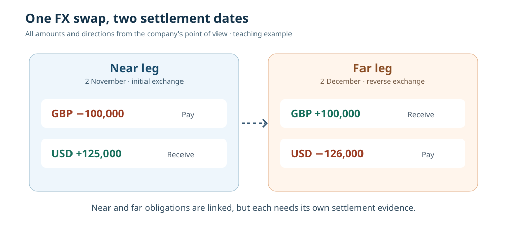

# 16. Two currencies, two dates: understand an FX swap

*Treasury Management, TMS and Calypso — From Zero · Practical foundations*

In Chapter 8, we met a simple **foreign-exchange (FX) forward**: an agreement made today to exchange two currencies on a future date. It had two contractual currency movements, but they took place on the **same** future value date.

Now imagine a treasury team that **needs dollars for a short period**, but expects to return to pounds afterwards. Rather than making two unrelated decisions, the team may use an **FX swap**. It is commonly constructed from two linked currency exchanges: one on a near date and one on a far date.

You do not need to know derivatives mathematics to follow the example. You only need to keep four facts clear: **which currency**, **which direction**, **how much** and **on which date**.

## Begin with a practical funding need

A fictional British company holds pounds but needs dollars for a payment on the near date. It expects to receive dollars later and wants to exchange back into pounds on a future date.

For teaching purposes, suppose the company agrees the following two exchanges with a bank:

- **Near leg (2 November):** pay GBP 100,000 and receive USD 125,000.
- **Far leg (2 December):** pay USD 126,000 and receive GBP 100,000.

These are **invented contractual amounts**. They imply near and far rates of 1.25 and 1.26 USD per GBP respectively. Do not treat them as current market prices or as a correct valuation formula; actual swap pricing reflects market conditions and conventions.

Let's put the cash movements in a table from the company's point of view:

| Date | GBP movement | USD movement | Meaning |
|---|---:|---:|---|
| 2 November | **−100,000** | **+125,000** | Exchange pounds for dollars |
| 2 December | **+100,000** | **−126,000** | Exchange dollars back for pounds |

The bank sees the opposite flows. Whenever you read a trade ticket, establish **whose point of view** its buy/sell labels describe. “Buy USD” without a party and date can be dangerously ambiguous.

## Why is this called a swap?

The two exchanges are **linked parts of one FX swap arrangement**. The near exchange provides dollars for an interim period; the far exchange reverses the currency direction on the later date. You may hear people describe this as *swapping one currency for another and then swapping back*.

The difference between USD 125,000 received near and USD 126,000 paid far is **USD 1,000** in this fictional deal. It is tempting to call that a simple fee, but doing so would be misleading. The near and far rates express the contract's pricing and interest-rate relationship. The financing economics cannot be understood by subtracting the two USD legs without considering dates, currencies and discounting. For now, recognise the flows rather than deriving a market price.

An FX swap is not the same as an interest-rate swap. Both use the word *swap*, but they exchange different contractual things. An interest-rate swap typically exchanges calculated interest cashflows under specified terms; an FX swap involves currency principal exchanges on near and far dates.

## Four objects a system must keep separate

This example is an excellent way to understand why a Treasury Management System needs more than a “balance” field.

**1. The financial agreement.** The FX swap has a trade identifier, counterparties, currencies, rates, value dates, status and an owning trading book. The agreed economic terms should not be silently edited when a payment fails.

**2. Expected cashflows.** The system can derive four signed amounts: GBP out and USD in on the near date; USD out and GBP in on the far date. These are expectations from the contract.

**3. Settlement instructions.** Each currency movement needs the correct accounts, receiving bank/agent details and cut-off times. Instructions can differ between currencies and dates.

**4. Actual settlement evidence.** A payment message being generated is not the same as money arriving. Settlement acknowledgements and reconciled bank records establish whether the obligations were completed.

A developer who stores only “FX swap complete: yes/no” would lose useful information about which leg succeeded, which message failed and where the investigation should start.

## What if one currency arrives and the other does not?

Suppose the company pays GBP 100,000 on the near date, but USD 125,000 has not appeared in the intended account. The economics of the FX swap remain agreed; the problem is in its **operational settlement state**.

Before taking any action, operations should establish whether the USD payment is delayed, rejected, routed to the wrong account, or simply not yet visible in the bank statement. Sending a duplicate instruction without checking the original message and settlement references could make the problem worse.

A treasury team will also update its short-term cash forecast. It cannot treat the expected USD as settled cash until the available evidence supports that state. The team might need to escalate to the settlement and liquidity owners because a missing currency leg can affect other payments.

## A first look at Calypso processing

In a Calypso-style environment, the FX swap is captured against a **book** and **counterparty**, passed through configured workflow controls, and processed into relevant settlement obligations. Transfer and messaging functions may create operational records for each payment. Exact object types, actions and engine configurations depend on the installed release and client setup.

The important lesson is one of **authority**: do not make an operational problem disappear by altering the financial agreement or writing directly to a database. Use authorised workflow and repair procedures, preserving an audit trail and the original business identifiers.

## Try it yourself

**Exercise A.** A company receives **EUR 80,000** and pays **GBP 70,000** on a near date. On a far date, it pays **EUR 81,000** and receives **GBP 70,000**. Write the four signed cash movements and identify the dates.

**Exercise B.** Why would a single net amount in GBP be insufficient to describe that FX swap?

**Exercise C.** The near EUR receipt is missing, but the GBP payment has settled. Name three records you would review before considering a payment repair.

### Check your answers

**A:** Near: EUR +80,000, GBP −70,000. Far: EUR −81,000, GBP +70,000. Keep the specific contractual value dates with each.  
**B:** The currencies, payment dates and directions are essential. A net GBP figure would conceal the EUR obligation and the fact that there are two separate settlement dates.  
**C:** The original EUR transfer, its settlement instructions, the generated payment message and acknowledgement, plus bank-account reconciliation where available. Check the trade version and business date as context.

**Next:** FX swaps can help a treasury team obtain currency liquidity. Another source of short-term funding uses securities. We will investigate a *repurchase agreement*, usually called a **repo**, and explain how collateral changes the risk.
