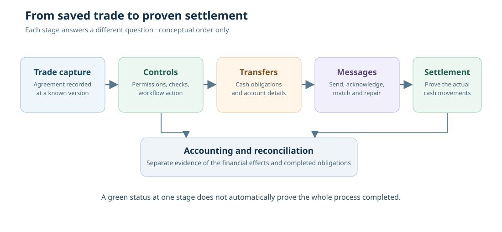

# 18. Follow one trade from booking to settlement

*Treasury Management, TMS and Calypso — From Zero · Practical foundations*

A financial trade is not finished when a trader clicks **Save**. That action may record a contract, but other people and systems still need to verify its terms, prepare settlement instructions, exchange messages, move money and record accounting effects.

We have already met a forward transaction: a company agreed to **buy USD 125,000 and sell GBP 100,000** on a future date. In this chapter, we follow that same fictional trade through the processing chain. The goal is not to memorise product-specific Calypso screens. It is to understand **who is responsible**, **what each stage means**, and **what evidence proves the next stage is safe**.

## The difference between a product and a trade

Before the deal can be saved, the system needs a way to describe the kind of financial contract being used. That is the **product**. An FX forward product defines a type of agreement with currencies, amounts, rates and dates.

A **trade** is one particular agreement between two parties. It has its own identifier, terms, version, status and organisational owner. Many trades can use the same product family, just as many customer orders can use the same product catalogue without being the same order.

A trade is normally associated with a **book**, which groups activity for an organisational purpose, and a **counterparty**, the other party to the deal. A **legal entity** represents a party recognised in the platform's organisation and reference data; a bank's internal processing organisation is not necessarily the same entity as its external counterparty.

For this example, imagine:

| Field | Fictional value | Why it matters |
|---|---|---|
| Trade reference | FX-TRAINING-2041 | Helps trace one agreement |
| Product | FX forward | Defines its economic structure |
| Book | LONDON_FX | Identifies the owning business portfolio |
| Counterparty | Riverside Bank | Identifies the other party |
| Buy currency | USD | The company expects to receive dollars |
| Buy amount | 125,000 | Exact contractual amount in USD |
| Sell currency | GBP | The company expects to pay pounds |
| Sell amount | 100,000 | Exact contractual amount in GBP |
| Value date | Agreed future date | Determines when obligations are due |

The reference is an invented teaching identifier, not a Calypso trade ID.

## A chain of responsibilities

**1 — Front office: capture the agreement.** An authorised trader or interface records the contract terms. The system checks that required information exists. A successful save proves that a version of the trade was recorded; it does not prove later settlement.

**2 — Middle-office or configured control: verify the trade.** Independent checks may examine counterparty limits, product eligibility, rates, dates and permissions. An action such as **Verify** or **Authorise** is meaningful only under the workflow configured for that organisation and product.

**3 — Back-office processing: derive obligations.** For our deliverable FX forward, the system expects a GBP payment and a USD receipt on the relevant value date. The processing service needs valid settlement instructions, which may identify accounts and correspondent banks. Missing reference data can stop or delay this stage.

**4 — Messaging: communicate the obligations.** A confirmation or payment instruction may be created and transmitted. The system should keep track of the message's identity and status. **Generated** is not the same as **sent**; **sent** is not the same as **acknowledged**; and acknowledgement is not necessarily the same as final settlement.

**5 — Settlement and reconciliation: prove the movements.** Operations needs appropriate evidence that the cash actually moved to and from the intended accounts. Depending on the product and settlement arrangement, the proof may involve bank statements, network messages, settlement-system acknowledgements and account reconciliation.

**6 — Accounting: record the financial effects.** Accounting rules produce entries according to the institution's configuration, accounting policy and the trade's lifecycle. The relevant postings must balance and reconcile with the appropriate ledger. Accounting can begin or change before final settlement; the stages are not always one straight line.

## Why Calypso uses data services and events

In classic Calypso architectures, a **Data Server** provides authorised access to business objects through supported services. It is not good practice for custom applications to edit the core database directly: doing so could bypass validation, audit, workflow and event processing.

The **Event Server** distributes notifications that help downstream components discover relevant business changes. An **Engine Server** can host processing engines that act on those notifications or other configured work. Transfer, messaging and accounting responsibilities are logically different, even when an installation groups some components together.

For example, an approved trade action may make the trade available for transfer processing. A transfer-related event may then be consumed by a messaging function. Exact event classes, engine names, filters and deployment arrangements differ across Calypso releases and client configurations. At this stage, understand the **roles** before attempting vendor-specific implementation.

## Work through a settlement exception

It is settlement morning. Operations finds the following fictional records:

| Evidence | Observed result |
|---|---|
| Trade status | Confirmed |
| GBP transfer | Settled |
| USD transfer | Pending |
| USD message | Generated; no final receipt acknowledgement |
| Treasury cash forecast | USD 125,000 shown as expected, not settled |

A colleague says, “The trade is confirmed and the GBP has gone. Mark it all settled so the dashboard goes green.” That would turn an unknown or incomplete business outcome into a false statement.

A better investigation starts with the **USD transfer identifier**, the **settlement instruction**, the **message and acknowledgement history**, the relevant value date and the receiving account's reconciled information. Was the message sent? Was it rejected? Was it accepted but delayed? Was a payment received but not yet matched? The next action depends on the answer.

Only an authorised repair process should resend, amend or reconcile instructions. Without duplicate controls, simply pressing **Send** again might create a second payment. Similarly, a restart may clear an error display without proving that the underlying obligation completed.

This is why system administrators, treasury users and software engineers need a **shared vocabulary**. A server process can be running while a transfer is pending; a trade can be economically valid but operationally incomplete.

## Put the whole journey together

Copy the following table into your notebook and fill the third column before checking the answer:

| Claim | Is it enough to close the trade? | What other evidence is needed? |
|---|---|---|
| “The trade was saved” | No | Authorised workflow and downstream status |
| “The confirmation was generated” | No | Delivery or matching result where required |
| “The GBP payment settled” | No | The USD receipt and complete settlement evidence |
| “Both cash legs are settled” | Not necessarily | Accounting, reconciliation and any remaining lifecycle obligations |

The final answer is **not always one universal status**. Different organisations close different operational tasks at different times. The essential requirement is that every status claim should identify **what it proves** and **what it does not prove**.

## Try it yourself

**Exercise A — explain a term.** Describe the difference between a product, trade, book, counterparty and transfer in one plain sentence each.

**Exercise B — diagnose the gap.** Suppose the trade is confirmed, the transfer exists, but the payment message was rejected for an invalid receiving account. Which team or function would normally investigate the settlement instruction? Why is changing the trade's FX rate not a solution?

**Exercise C — connect to the cash ladder.** In Harbour Supplies' cash forecast, should USD 125,000 appear as settled cash if the trade's USD receipt is still pending? What should the record say instead?

### Check your answers

**A:** A *product* describes the contract type; a *trade* is a particular agreement; a *book* groups/owns trades for a business portfolio; a *counterparty* is the other contractual party; a *transfer* represents a cash or securities movement to be processed.  
**B:** Back-office settlement/reference-data owners would examine the standing settlement instruction and approved repair route. The FX rate belongs to the economic contract; an account-routing error is a different problem.  
**C:** No. It may remain in a forecast or expected-cashflow view with a **pending** or **unconfirmed receipt** status, depending on the system's terminology.

## What you can now explain

You can make a dated cash ladder, calculate simple interest under a stated day-count convention, recognise a funding gap, describe both legs of an FX swap, understand repo cash and collateral, and follow a trade towards settlement. Those are meaningful foundations for learning the Calypso object model and the software that manages it.

In the next stage, we will examine reference data, trade workflows and how to read a real financial requirement before attempting any programming. **You do not need access to a licensed Calypso environment to complete these foundation lessons.**
