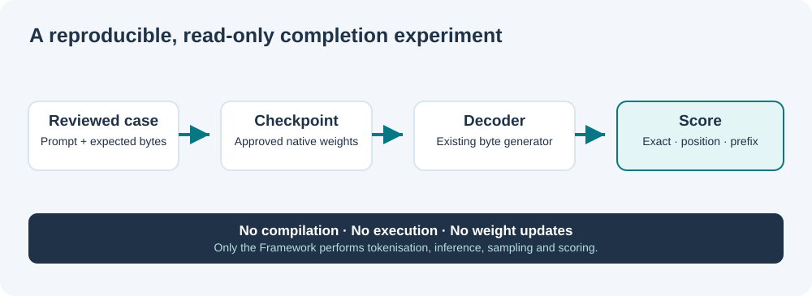

# Lesson 26 — Build a Native C23 Completion Benchmark

**Level:** developing | **Time:** 25 minutes | **Prerequisites:** Lessons 17, 18 and 25

## Our goal: ask a question that the model can actually answer

We are building a native Umicom language model. It is tempting to ask whether it can now write an entire banking application. Our first decoder is far too small and has been trained on a deliberately limited source corpus. A useful experiment begins with a smaller question: **given a starting fragment, which bytes does the decoder produce, and do they match a known reference completion?**

Suppose the prompt is part of a fictional account type:

```c
/* Prompt supplied to the decoder */
typedef struct Account {
```

We might prepare the following reference completion:

```c
    int64_t balanceMinor;
```

The learner must understand that the reference is *not* a financial specification or a compile test. We will compare **bytes**, not run the generated code, and never accept the result as trustworthy source automatically.



## Inspect the real Framework API

Open `framework/include/umicom/ai/training/benchmark.h`. The two central concepts are a **case** (the prompt and expected bytes) and a **result** (what agreed).

```c
static const uint8_t prompt[] = "typedef struct Account {\n";
static const uint8_t expected[] = "    int64_t balanceMinor;\n";
UmiAiTrainingBenchmarkCase cases[] = {
    {"Fictional account member",
     prompt, sizeof(prompt) - 1U,
     expected, sizeof(expected) - 1U}
};
```

This example shows the fields, but do not hand-count string lengths in working code. Use arrays and `sizeof(array) - 1U` to exclude the trailing C-string terminator, as the Umicom LLM console does. The benchmark works on explicit byte counts; a NUL byte inside a prompt is legal.

The Framework exposes `UmiAiTrainingBenchmarkRun`. It uses the **existing** `UmiAiTrainingDecoderGenerateBytes` function. We have not built a competing tokeniser, sampling engine or decoder inside Umicom LLM.

## Trace one benchmark case

1. Review the case text and confirm that the reference solution is not copied into the training corpus.
2. Load a previously approved decoder checkpoint. The checkpoint is model *data*, not an executable program.
3. Choose sampling options. `topK = 1` makes generation greedy and deterministic.
4. Generate exactly as many bytes as the expected completion contains.
5. Compare the generated bytes with the reference.
6. Record the score and the model's completed training steps.

The runner validates all cases before starting generation and stages its scores in memory. If a later operation fails, the caller's result arrays remain unchanged.

## Use a reviewed benchmark suite instead of hard-coded examples

The Framework can also load a small, plain-text suite. This lets us compare the same model with different **reviewed inputs** without rebuilding the application. The file is data, not a C program or script.

```text
UMICOM-AI-BENCHMARK-1
# The example bytes A, B and C are encoded in hexadecimal.
case example 4142 43
```

Here `41` is the byte for `A`, `42` for `B`, and `43` for `C`. Every two hex digits identify one byte. A dash (`-`) represents an **empty prompt**, but the expected completion must not be empty. The suite parser accepts at most 64 cases; a prompt is at most 4,096 bytes and a reference completion at most 256 bytes. Case identifiers must be unique.

Find the reviewed example at `framework/learning/native-llm/fixtures/benchmark-reviewed.txt`. Its fictional C23 fragments are visible to you before the model runs. `UmiAiTrainingBenchmarkSuiteLoadFile()` parses that file into a Framework-owned snapshot. Your LLM application borrows each case and returns the suite to the Framework when finished.

**Security boundary:** the parser rejects malformed hex and oversized files, but it does not prove licence rights, that prompts were held out of training, or that a symlink points to a safe location. A person must review these conditions before approving a comparison.

## Compile and test the Framework laboratory

From the Umicom Applications root, in PowerShell:

```powershell
Set-Location "C:\umicom\Umicom-Applications"
$env:Path = "C:\msys64\ucrt64\bin;$env:Path"

cmake -S ".\framework\learning\native-llm" `
  -B ".\build\windows-ucrt64-native-llm-debug" -G Ninja `
  -DCMAKE_BUILD_TYPE=Debug -DBUILD_TESTING=ON

cmake --build ".\build\windows-ucrt64-native-llm-debug" --parallel 2

ctest --test-dir ".\build\windows-ucrt64-native-llm-debug" `
  -R "benchmark_(score|runner|rejections|reporting)" `
  --output-on-failure
```

The names describe test *contracts*: scoring, trained-model delegation, invalid-input rejection and honest reporting. An `OK` result means those implementations worked in the tested environment. It does **not** mean the model writes correct C23.

## Worked exercise: what should match?

**Reference bytes:** `int64_t amountMinor;`  
**Generated bytes:** `int64_t amountMajor;`

They share a prefix, but differ in `Minor` versus `Major`. Even when most positions match, an exact match is **false**. In financial software that difference could be a serious semantic error.

## Check your understanding

<details><summary>Why not compile every generated completion in the benchmark runner?</summary>

We first require an isolated, reviewable byte-completion baseline. Compiling or executing model-generated code could have effects outside the test process; it belongs to a separate, explicitly sandboxed and authorised evaluation stage. This API neither compiles nor executes generated text.

</details>

<details><summary>Can a byte-exact result prove that a C23 function is safe?</summary>

No. It only proves agreement with one reviewed byte sequence. Correct compilation, tested behaviour, memory ownership and security need separate evidence.

</details>

## What comes next

Lesson 27 explains how to interpret the exact-match, positional and prefix scores without inflating them into claims of programming ability.
