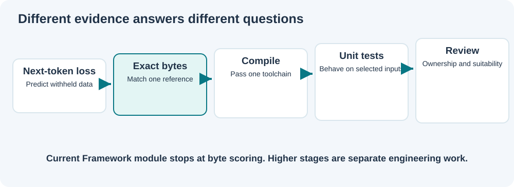

# Lesson 27 — Interpret Model Completion Metrics

**Level:** developing | **Time:** 25 minutes | **Prerequisites:** Lessons 18, 25 and 26

## One model result, three different numbers

Imagine a model is completing a field in a fictional payment record. Its reference completion is:

```c
    int64_t amountMinor;
```

The model returns:

```c
    int64_t amountMajor;
```

Both strings resemble C23, but they name different fields. A banking developer must not call them equivalent. **Byte metrics help us describe the observed difference; they cannot decide whether the code is correct.**



## Three scoring measures

**Exact match:** True only when *every byte and the full length* agree with the reference. Even one changed character makes the result false.

**Matching positions:** Count the byte positions where the expected and generated values agree. This can be high despite a serious error in one identifier or operator.

**Matching prefix:** Count consecutive agreeing bytes, starting from the beginning and stopping at the first difference. This is useful for investigating where a completion first diverged.

The Framework function `UmiAiTrainingBenchmarkScoreBytes()` calculates all three from explicit input lengths. It handles embedded NUL bytes safely and accepts empty inputs for this low-level scoring operation.

### Calculate the scores by hand

Consider a smaller artificial example:

| Position | 1 | 2 | 3 | 4 |
|---|---|---|---|---|
| Reference | `A` | `B` | `C` | `D` |
| Generated | `A` | `B` | `X` | `D` |

The exact match is **false**. Three of four positions agree. The matching prefix is **two** bytes: it stops before `X`.

Try a second result, `AB`, against the reference `ABCD`. The first two positions match, but the lengths differ, so the result is not exact.

## What we must not claim

A model could copy a boilerplate snippet perfectly but implement a flawed transfer or accounting algorithm. To assess a specialised C23 expert, add independent evidence as the project matures.

| Evidence | What it measures | What it does not establish |
|---|---|---|
| Held-out cross-entropy | Likelihood of withheld next-token targets | Useful completed software |
| Byte completion exact match | Exact agreement with one reference | Safety, compilation or intent |
| Compiler diagnostics | Whether a specified candidate compiles | Correct business logic |
| Unit tests | Whether selected cases behave as required | Correctness on all inputs |
| Address/UB sanitiser tests | Certain observed memory and undefined-behaviour defects | Absence of all defects |
| Code review | Ownership, invariants and suitability | Mathematical proof of correctness |

The native benchmark in this update implements **only the second row**. It does not call a compiler or any external command.

## Avoid training/evaluation leakage

If a prompt and reference completion were present in training data, a successful completion might measure memorisation rather than generalisation. For a trustworthy comparison, reviewers should:

1. Use source files and prompts they have permission to process.
2. Keep the benchmark's complete solutions outside training partitions.
3. Record exact model checkpoint identity, course code revision and evaluation inputs.
4. Reuse the same reviewed cases and sampling settings when comparing checkpoints.
5. Report failed examples alongside successes instead of selecting only good outputs.

A deterministic seed makes the computation repeatable but does not establish data provenance by itself.

## A practical banking exercise

Write three *fictional* requirements and a test plan **without executing generated code**: reject a zero-amount transfer, reject an amount greater than available minor units, and preserve all inputs when validation fails. Identify which criteria can be checked by text agreement and which require behavioural tests.

<details><summary>Suggested answer</summary>

Byte-completion agreement can confirm a literal reference spelling. It cannot prove any of the three behavioural rules. Those require an independently reviewed implementation and targeted tests with checked integer arithmetic and explicit ownership.

</details>

## What comes next

Lesson 28 connects the Framework benchmark contract to the actual Umicom LLM application, demonstrating thin product composition and reproducible checkpoint evaluation.
