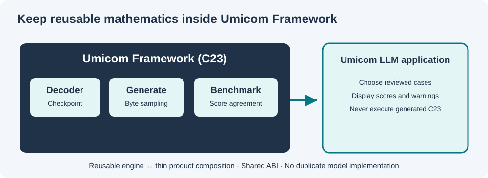

# Lesson 28 — Connect the Framework Benchmark to Umicom LLM

**Level:** intermediate | **Time:** 30 minutes | **Prerequisites:** Lessons 23–27, basic C23 and CMake

## Two repositories, one authoritative implementation

Our source tree separates reusable libraries from applications. The reusable benchmark is in **Umicom Framework**; the Umicom LLM module is a **thin consumer** that loads a reviewed checkpoint, submits reviewed cases and displays Framework results.



```text
C:\umicom\Umicom-Applications\
  framework\
    include\umicom\ai\training\benchmark.h
    src\ai\training\benchmark.c
  applications\llm\
    src\console\benchmark_main.c
```

The LLM module is a Git submodule. Commit its new console to that module's repository, not just to the parent `Umicom-Applications` repository.

## The native C23 application remains small

The essential application operation is an ordinary Framework call:

```c
UmiAiTrainingBenchmarkReport report;
UmiAiTrainingBenchmarkCaseResult rows[3];
UmiAiTrainingSamplingOptions sampling = {1.0F, 1U};

UmiStatus status = UmiAiTrainingBenchmarkRun(
    decoder, cases, 3U, &sampling, UINT64_C(20261022),
    rows, 3U, &report);
```

The application does not contain a new tensor operator, softmax, tokenizer, SGD or AdamW implementation. It does not execute, compile, save or trust the generated completions.

The sample cases live in `applications/llm/src/console/benchmark_main.c`. They demonstrate a source-completion *interface*; they are **not** an independent hidden competency benchmark and should not be used to advertise C23 expertise.

## Why the console is opt-in

The LLM application already has other functionality. The new CMake option defaults to **OFF**, preserving normal builds:

```text
UMICOM_LLM_BUILD_NATIVE_BENCHMARK=OFF
```

When enabled in a parent Umicom Applications build, it composes the already existing Framework native training module and builds `umicom-llm-benchmark`. The standard `umicom-llm-console` remains unchanged.

### Build and run on Windows

First build the focused Framework library and tests, as in Lesson 26. A complete Umicom Applications build requires the Framework's existing CMake presets and a working MSYS2 UCRT64 environment.

```powershell
Set-Location "C:\umicom\Umicom-Applications"
$env:Path = "C:\msys64\ucrt64\bin;$env:Path"

cmake --preset windows-ucrt64-all-debug `
  -DBUILD_TESTING=ON `
  -DUMICOM_LLM_BUILD_NATIVE_BENCHMARK=ON

cmake --build --preset windows-ucrt64-all-debug `
  --target umicom-llm-benchmark --parallel 2
```

Use a trained, **approved native byte-decoder checkpoint** created by the Framework experiment programme. Replace `<path-to-approved-checkpoint>` below with an actual locally reviewed path:

```powershell
& ".\build\windows-ucrt64-all-debug\bin\umicom-llm-benchmark.exe" `
  "<path-to-approved-checkpoint>"
```

*Build layout note:* the executable directory is determined by the active CMake runtime-output settings. Inspect the build output if your preset places it elsewhere. Never disable Windows security to make a test pass.

## Run an approved benchmark suite

To compare a saved decoder with the supplied teaching suite, pass a **second argument** to the opt-in console:

```powershell
& ".\build\windows-ucrt64-all-debug\bin\umicom-llm-benchmark.exe" `
  "<path-to-approved-checkpoint>" `
  ".\framework\learning\native-llm\fixtures\benchmark-reviewed.txt"
```

The console delegates suite parsing to `UmiAiTrainingBenchmarkSuiteLoadFile()` and scoring to `UmiAiTrainingBenchmarkRun()`. It prints the result for every named case, including failures. The programme does not execute, compile or publish generated code.

The suite format is intentionally straightforward: one approved identifier plus hex-encoded prompt and expected completion per line. This avoids ambiguous C-string escaping while preserving arbitrary bytes. Review every reference before treating the run as independent evaluation evidence.

## Read results responsibly

The console prints the number of completed training steps, each case's exact/positional/prefix agreement, and totals. If the elementary decoder matches none of the snippets, that is a valid observed outcome. It shows a weak baseline, not a broken benchmark.

The runner holds its score data locally until every case succeeds. Invalid options, unsupported vocabulary or insufficient result capacity return a status without publishing partial results.

## Your design review exercise

A proposed change adds a second `Softmax()` implementation inside `applications/llm/src/console/`. Should it be approved?

<details><summary>Recommended review finding</summary>

No. The canonical C23 native generation and sampling functionality already belongs to Umicom Framework. Extend or test the Framework service instead; applications should use its public ABI and provide only the necessary presentation, input selection and user consent handling.

</details>

## Next engineering milestone

Develop a reviewed external benchmark-manifest format and an **isolated, explicitly authorised** compiler-and-unit-test assessment service. It must record toolchain versions, prevent training-data leakage and never execute generated source within the normal application process.
