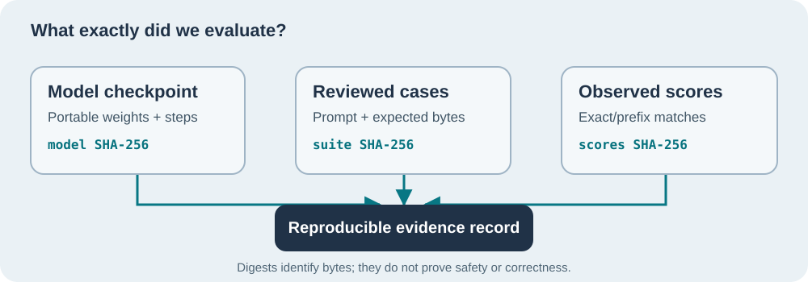

# Lesson 29 — Identify a Trained Model and Reviewed Benchmark with SHA-256

**Author:** Sammy Hegab · **Organisation:** Umicom Foundation · **Licence:** MIT  
**Level:** Beginner to intermediate · **Reading:** 25–35 minutes  
**Prerequisites:** [Lesson 24 — Checkpoint Recovery](24-checkpoint-recovery-and-evidence.md), [Lesson 26 — Native Completion Benchmark](26-build-a-native-completion-benchmark.md)

## What you will learn

A benchmark result is useful only if we can identify what was measured. A score such as **0 of 3 exact completions** is incomplete evidence without the model, reviewed prompts, expected completions, sampling settings and optimiser-step number. In this lesson we extend our actual Umicom Framework training code to identify these inputs with SHA-256 digests. We do not write a second hash implementation or model.



## Start with a concrete Umicom example

A contributor trains our elementary byte-level decoder on fictitious account and payment source code. The contributor loads one portable `.umi` checkpoint and asks the model to continue a `typedef struct` declaration. The result is compared with a reviewed expected continuation. A different checkpoint, even with the same model dimensions, might produce a different completion. A different expected continuation changes the scoring task. Both differences must be obvious in the evidence.

A SHA-256 hash maps an arbitrary sequence of bytes to 32 digest bytes (usually written as 64 hexadecimal characters). In our application it identifies **content**, not intent, ownership or mathematical correctness. Two matching digests give strong evidence that the same byte content was measured; they do **not** tell us whether that content was authorised, safe or independently reviewed.

### Why not simply hash a filename?

A filename is not unique to its contents. `decoder.umi` could be overwritten with a different checkpoint tomorrow. Our new Framework service obtains the model's **canonical portable checkpoint bytes** through the existing checkpoint encoder and hashes those bytes using the established `umicom/base/sha256.h` implementation. We do not hash in-memory pointers, padding or compiler-specific struct layouts.

For a reviewed completion suite, the service hashes each case in a fixed order: case title, raw prompt bytes and raw expected-completion bytes, with explicit lengths. This is independent of whitespace or comment formatting in the input manifest. The same parsed suite produces the same digest even if its outer text file is formatted differently.

## Read the real Framework API

The new public header is `framework/include/umicom/ai/training/benchmark_evidence.h`:

```c
UmiAiTrainingBenchmarkEvidence evidence;
UmiStatus status = UmiAiTrainingBenchmarkEvidenceInspect(
    decoder, cases, scores, caseCount, &report,
    &sampling, UINT64_C(20261022), &evidence);
```

The model and case buffers remain owned by their existing Framework services. `EvidenceInspect` copies only hash strings, the chosen sampling seed, top-K and exact float32 temperature bits. It does not load a new model, retrain it, compile generated code or write an output file. The caller must first obtain real scores through `UmiAiTrainingBenchmarkRun` and retain the same cases when creating evidence.

### Why three hashes instead of one?

1. **Model checkpoint digest:** exactly which trained parameters and step count the decoder currently holds.
2. **Reviewed cases digest:** which ordered prompts and expected bytes were submitted for review.
3. **Reported scores digest:** which per-case result counters, sampler settings and step count were recorded.

This separation is useful during diagnosis. If the model digest differs but the case digest matches, we changed the trained model. If the case digest changes but the model digest matches, we changed the exercise. If only reported scores differ, we should investigate reproducibility, execution provenance and scoring inputs.

## Try it in PowerShell

After merging and building the native Framework laboratory, inspect a **previously reviewed** local checkpoint without running the quarantined historical test executable:

```powershell
Set-Location "C:\umicom\Umicom-Applications"
$checkpoint = "C:\umicom\trusted-models\reviewed-decoder.umi"
if (Test-Path -LiteralPath $checkpoint -PathType Leaf) {
    Get-FileHash -LiteralPath $checkpoint -Algorithm SHA256
}
```

The Windows command hashes the bytes **already on disk**. It cannot decide whether the file is a valid Umicom decoder. Conversely, the new C23 evidence API hashes **canonical encoded model bytes** after the decoder has been loaded. Those SHA-256 values agree when the file is the same canonical checkpoint. Do not load an untrusted checkpoint merely to check its hash.

## Verify the failure contract

When an invalid title, inconsistent counters or an incompatible checkpoint is supplied, the Framework rejects the request and leaves the caller's evidence structure unchanged. This is important in larger applications: a failed inspection must not leave half-updated identity strings beside an old report.

For our small source training laboratory, numerical computations and generation remain handled by the already established decoder and sampler. The evidence service is a reusable **read-only** consumer.

## Practice with an Umicom banking module

Imagine three reviewed cases: completing an account record, naming an integer minor-unit balance and returning an account-validation status. Record the model's SHA-256 and the reviewed-suite SHA-256. Change only one expected character in the third case. Which digest should remain constant? Which should change? Restore the expected bytes, train the decoder for one additional optimiser step and compare again.

<details><summary>Suggested answer</summary>
Changing a case should change the reviewed-suite digest while leaving the model digest unchanged. Training the model should change the canonical checkpoint digest and completed-step count, while the restored case suite retains its original identity. A new score digest may also change; it is not an independently verified claim of accuracy.
</details>

## Keep the evidence boundary visible

Our byte-level benchmark does not compile or execute the model's generated source. It cannot establish whether a proposed account calculation is correct. In later lessons we will add an auditable JSON export and discuss how to review training provenance and Windows release signatures. **SHA-256 is not an Authenticode code-signing certificate.**

**Next:** [Lesson 30 — Export and Compare Native Benchmark Evidence](30-export-and-review-benchmark-evidence.md).
