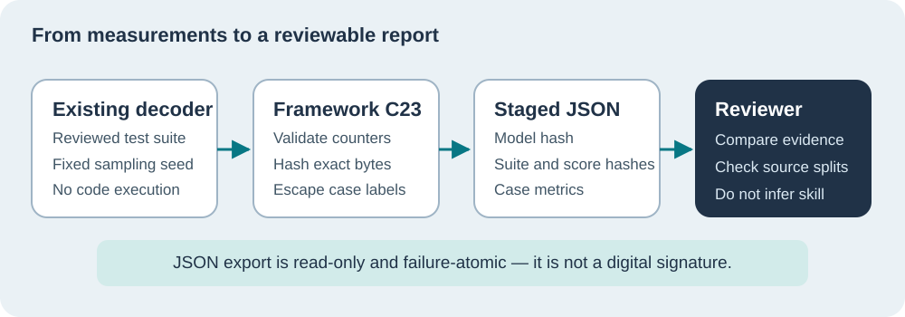

# Lesson 30 — Export and Review Reproducible Native Benchmark Evidence

**Author:** Sammy Hegab · **Organisation:** Umicom Foundation · **Licence:** MIT  
**Level:** Intermediate · **Reading:** 30–40 minutes  
**Prerequisites:** [Lesson 27 — Interpret Completion Metrics](27-interpret-model-completion-metrics.md), [Lesson 29 — SHA-256 Identities](29-identify-model-and-benchmark-with-sha256.md)

## Why do we need a machine-readable report?

When an LLM changes, we must be able to compare its behaviour without guessing from a screenshot of a terminal. A structured report can be reviewed, versioned, checked for accidental changes and compared against a previous run. It should say **which model**, **which cases**, **which sampling settings** and **which scores** were involved.



## A small Umicom source-code experiment

Our native benchmark tests a decoder with a prompt such as `typedef struct Account {` and a reviewed continuation declaring `balanceMinor` as an exact integer amount. For each case, the Framework already counts:

- Expected and generated byte lengths.
- Byte positions that agree with the reviewed reference.
- Matching bytes from the beginning of the completion.
- Whether every expected byte matched in a complete exact result.

These measures are deliberately narrow. If an answer differs in whitespace but still compiles, exact match will fail. If it matches perfectly but contains flawed financial logic in the reference itself, exact match may pass. Neither outcome alone establishes C23 or treasury-system competence.

## Our new C23 export contract

`UmiAiTrainingBenchmarkEvidenceJson` turns the benchmark report into bounded, deterministic JSON. Its output has three domain-separated SHA-256 identities and per-case counters. It includes the optimiser-step count and top-K sampling information. The integer seed and completed steps are formatted as strings to avoid rounding by JavaScript's 53-bit integer limit.

```c
char json[UMI_AI_BENCHMARK_EVIDENCE_MAX_JSON_BYTES];
size_t bytesWritten = 0U;

UmiStatus status = UmiAiTrainingBenchmarkEvidenceJson(
    cases, scores, caseCount, &report, &evidence,
    json, sizeof(json), &bytesWritten);
```

The Framework builds the whole report in private bounded storage. It copies bytes to `json` **only after** every value and capacity check succeeds. If the output buffer is too small, neither the buffer nor `bytesWritten` changes. Case names are escaped so a literal quote cannot break JSON syntax. No network service, database, Python runtime or new file format parser is introduced into Umicom applications.

## How to run the thin Umicom LLM console

The application keeps its original display behaviour when launched without an extra flag. The optional `--evidence-json` mode writes only valid JSON to stdout. The following is an example for an **approved** checkpoint after local antivirus triage, not for a quarantined executable:

```powershell
Set-Location "C:\umicom\Umicom-Applications"
$exe = ".\build\windows-ucrt64-all-debug\bin\umicom-llm-benchmark.exe"
$checkpoint = "C:\umicom\trusted-models\reviewed-decoder.umi"
$suite = ".\framework\learning\native-llm\fixtures\benchmark-reviewed.txt"

& $exe $checkpoint $suite --evidence-json |
    Set-Content -LiteralPath ".\reviewed-benchmark-evidence.json" -Encoding utf8
```

This explicitly redirects the output to a caller-selected file; the Framework evidence service itself does **not** choose or open a destination. Review the JSON and approve the checkpoint and source files before comparing model quality. The combined evidence file should not be interpreted as an anti-malware scan or a signed provenance attestation.

## Read a report as a reviewer

A representative report has the following shape; the hashes below are illustrative placeholders, **not calculated evidence**:

```json
{
  "format": "umicom-ai-reviewed-benchmark",
  "model_checkpoint_sha256": "<64-lowercase-hex-characters>",
  "reviewed_cases_sha256": "<64-lowercase-hex-characters>",
  "reported_scores_sha256": "<64-lowercase-hex-characters>",
  "sampler": {"seed": "20261022", "temperature_float32_bits": "3f800000", "top_k": 1},
  "metrics": {"completed_steps": "32", "case_count": 3, "exact_cases": 0}
}
```

The actual export includes complete score counters, per-case details and warnings about interpretation. It does **not** include generated source bytes, so it cannot leak the model's full output through this reporting channel. All numeric benchmark counters are checked against the case summaries before export. A malicious caller could still forge internally consistent scores: to establish trusted execution, we would need signed build provenance, an approved independent runner and additional verification.

## Review for accidental changes

Suppose two trainees both claim to have evaluated checkpoint `model.umi`. First compare the model digests. If they differ, stop—the same filename does not imply the same trained model. Next compare the reviewed-case digests. If they differ, the tests themselves changed. Then compare the sampling seed, top-K and temperature bits. Only when those identities and the execution environment agree is it meaningful to compare the reported score counters.

Different platforms, compiler settings or math libraries can affect floating-point outputs, especially near sampling ties. A digest records bytes and configuration; it does not guarantee numerical equivalence across all systems.

### Practical review questions

1. Can a machine-readable report prove that the expected C23 code is financially correct?
2. Why does a report include a separate `reviewed_cases_sha256`?
3. Why should the completed step count be copied from the decoder rather than typed manually?

<details><summary>Suggested answers</summary>
1. No. Exact completion is only byte agreement, not compilation or financial correctness. 2. It identifies the evaluation questions separately from the model so a changed benchmark is detectable. 3. It helps bind the reported result to the decoder state instead of a potentially incorrect label.
</details>

**Next:** [Lesson 31 — Sign Windows Releases Without Bypassing Security](31-sign-windows-releases-and-protect-trust.md).
