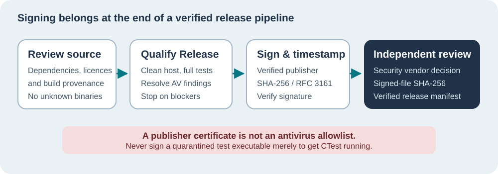

# Lesson 31 — Sign Windows Releases Without Bypassing Security

**Author:** Sammy Hegab · **Organisation:** Umicom Foundation · **Licence:** MIT  
**Level:** Beginner to intermediate · **Reading:** 35–45 minutes  
**Prerequisites:** [Lesson 29 — SHA-256 Identities](29-identify-model-and-benchmark-with-sha256.md), [Lesson 30 — Review Evidence](30-export-and-review-benchmark-evidence.md)

## The practical problem

A Windows antivirus product can block a newly compiled Umicom test executable before CTest can launch it. In October 2026, McAfee quarantined builds of `umicom-native-llm-experiment.exe` and an Umicom Studio composition-lifecycle test. Because the process did not start, the test report used `BAD_COMMAND` and `Not Run`. Those are **not** successful test results and do not prove the application contains malware either. A separate security review is required.



## Three different questions

A reliable release answers three questions independently:

1. **Integrity:** Are the bytes we have now identical to the file whose SHA-256 we recorded?
2. **Publisher:** Was the executable signed using a certificate belonging to a verified publisher, and is its signature valid under Windows trust policy?
3. **Safety and suitability:** Has the application been reviewed, tested, and cleared by relevant security protections? Does it behave as users expect?

A content hash helps with the first question. Windows Authenticode helps with the second. Neither automatically answers the third. A signed executable can still be harmful, and McAfee may still detect a signed file. Signing is not an antivirus exclusion.

## Where code signing belongs in Umicom

Source remains in Umicom Framework and the Umicom LLM application. The release pipeline compiles approved native C23 into Win32 executables and required DLLs. **Only after** source review, trusted clean builds, complete test qualification and disposition of existing antivirus findings should the publisher sign the approved release binaries. Do not sign quarantined test programs as a way of making them run.

Our new opt-in CMake helper is:

`framework/cmake/UmicomWindowsReleaseSigning.cmake`

The helper supports **single-configuration Release builds only**, requires explicit human approval and a chosen certificate thumbprint, and rejects non-Windows hosts or missing metadata. It is not connected to the default build and does not contain a private key. The helper invokes the Windows SDK SignTool when the product owner deliberately attaches it to a release executable target.

## Choosing a publisher identity

For public distribution, use a publicly trusted organisational code-signing certificate or a suitable managed signing service such as Microsoft's Artifact Signing, subject to the organisation's eligibility and identity verification. A self-signed certificate may help test signing mechanics but is not a publicly trusted publisher identity. Microsoft states that Extended Validation (EV) no longer grants automatic positive SmartScreen reputation. New signed applications may still attract warnings while their reputation develops.

Never commit signing certificates with private keys, token PINs, Azure secrets or service credentials to GitHub. In the Umicom architecture, credentials belong outside `/framework`, `/applications`, educational ZIPs and build logs.

## Inspect an approved binary before signing

Open PowerShell and inspect, **without executing**, a previously approved candidate release:

```powershell
$exe = "C:\umicom\Umicom-Applications\build\windows-ucrt64-all-release\bin\umicom-llm-console.exe"
if (Test-Path -LiteralPath $exe -PathType Leaf) {
    Get-FileHash -LiteralPath $exe -Algorithm SHA256
    Get-AuthenticodeSignature -LiteralPath $exe |
        Format-List Status,StatusMessage,SignerCertificate
}
```

If the file is missing because it is quarantined, stop. Do not restore it solely to make the command succeed. Collect its security-product detection ID and supporting build provenance for the vendor review.

## Sign and verify only after approval

Windows SDK `signtool.exe` signs Portable Executable files. Microsoft recommends `/fd SHA256` for the code digest and `/tr <URL> /td SHA256` for an RFC 3161 timestamp. Use a timestamp URL supplied by your actual certificate authority or signing provider, not a guessed address. The following is a **review template**, not a runnable command until the owner has approved a certificate and clean release:

```powershell
$signTool = (Get-Command signtool.exe -ErrorAction Stop).Source
$certThumbprint = "<verified-certificate-thumbprint>"
$timestampUrl = "<approved-https-rfc3161-timestamp-url>"
$releaseExe = "C:\umicom\Umicom-Applications\build\windows-ucrt64-all-release\bin\umicom-llm-console.exe"

& $signTool sign /fd SHA256 /sha1 $certThumbprint /tr $timestampUrl /td SHA256 $releaseExe
if ($LASTEXITCODE -ne 0) { throw "Signing failed" }
& $signTool verify /pa /v $releaseExe
if ($LASTEXITCODE -ne 0) { throw "Signature verification failed" }
Get-FileHash -LiteralPath $releaseExe -Algorithm SHA256
```

Signing changes the PE file's bytes. Therefore, record the **final signed-file hash** after signing. Replacing or patching a signed executable afterwards may invalidate the signature. Signed release packages and installers must be reviewed separately from debug CTest targets.

## The McAfee decision remains independent

McAfee supports submissions from developers who believe a safe file was detected incorrectly. Submit the actual detection identifiers, hashes, approved source and build provenance to the vendor. Do not disable McAfee globally or exclude the entire `C:\umicom` directory. Run a complete Windows test suite only after the security incident has been resolved, and record failures honestly until then.

## A useful Umicom example

The benchmark JSON from Lesson 30 may identify a model checkpoint with SHA-256. The release executable may be signed using Authenticode. This gives **two different trust boundaries**: the checkpoint identity and the executable publisher. The release still needs an independently reviewed benchmark, tested dependencies and AV clearance. None of these establishes correct banking logic without further application-level tests.

<details><summary>Check your understanding</summary>
**Question:** Does signing the previously blocked `umicom-native-llm-experiment.exe` prove it is safe? **Answer:** No. A certificate verifies publisher and integrity; it is not a substitute for malware investigation. **Question:** When do we calculate the hash we publish with a release? **Answer:** After the final signing step, because signing changes the binary bytes.
</details>

## Further reading

- Microsoft SignTool: https://learn.microsoft.com/en-us/windows/win32/seccrypto/signtool
- Microsoft SmartScreen reputation: https://learn.microsoft.com/en-us/windows/apps/package-and-deploy/smartscreen-reputation
- Microsoft Authenticode timestamping: https://learn.microsoft.com/en-us/windows/win32/seccrypto/time-stamping-authenticode-signatures
- McAfee file-dispute review: https://www.mcafee.com/support/s/article/000001921?id=35533&language=en_US

**Next:** Return to the [course map](../../courses/llm-from-scratch/course-map.html) or review the earlier [training evidence lesson](30-export-and-review-benchmark-evidence.md).
