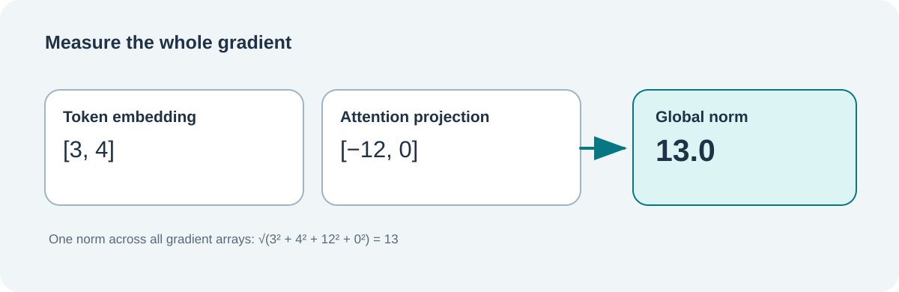

# Lesson 32 — Gradient Norms: Measuring the Size of a Learning Update

**Course:** Build an LLM from Scratch · **Level:** Developing · **Focus:** C23, numerical stability and optimisation

## What will we learn?

By the end of this lesson, we can explain why a gradient has a *size*, calculate its global Euclidean norm, and identify a numerical mistake that would make large gradients impossible to measure reliably.

A small model learns by adjusting its parameters. During backpropagation, the training tape calculates a gradient for each trainable parameter. A gradient says how a tiny change to that parameter would affect the loss. Parameters are updated by an optimiser such as SGD or AdamW.

A banking application offers a useful analogy. Imagine several independent entries in a fictional ledger. Examining one entry tells us about one change; examining all entries together tells us about the scale of a whole adjustment. The analogy stops there: gradients are not transactions or monetary balances. Their size is a property of the model's mathematics.



## From several gradients to one norm

Suppose backpropagation produced two arrays:

```text
Account-related parameter gradients:   [3.0, 4.0]
Payment-related parameter gradients:   [-12.0, 0.0]
```

The **global L2 norm** is the square root of the sum of every squared entry:

```text
norm = sqrt(3² + 4² + (-12)² + 0²)
     = sqrt(9 + 16 + 144)
     = sqrt(169)
     = 13
```

The norm is non-negative. It considers *all* gradient entries across *all* trainable parameter tensors; the model does not choose the largest parameter array and ignore the others.

### Why use a global norm?

If we have separate gradient arrays for token embeddings, attention projections and feed-forward weights, a single global norm gives one magnitude for the whole proposed update. This can support consistent gradient clipping. It does **not** prove that the model is learning a useful skill, that the learning rate is suitable, or that the result is safe.

## The overflow problem

A computer stores many neural-network gradients as 32-bit floating-point numbers. A naive norm implementation might calculate `gradient * gradient` in `float`. Large finite values can overflow during squaring, even when their original values were valid.

For example, two components near `FLT_MAX` have a finite mathematical norm that is larger than the largest representable `float`. Such a norm can be represented as a `double` on ordinary IEEE-754 platforms, but **not** as a `float`.

The native Framework implementation uses **scaled sum of squares**: it tracks the largest absolute value, then accumulates the squares of ratios to that value. This avoids squaring enormous floating-point values directly.

The key idea is:

```text
scale = largest |gradient|
norm = scale × sqrt(sum((gradient / scale)²))
```

In a real implementation, the scale and sum are updated incrementally without needing to keep another copy of the gradients.

## Inspect the C23 contract

The new Framework header is `include/umicom/ai/training/gradient_clipping.h`. Its principal API accepts borrowed gradient arrays and explicit element counts:

```c
UmiAiTrainingGradientClipReport report = {0};
const float tokenGradients[] = {3.0F, 4.0F};
const float paymentGradients[] = {-12.0F, 0.0F};
const float *gradients[] = {tokenGradients, paymentGradients};
const size_t lengths[] = {2U, 2U};

UmiStatus status = UmiAiTrainingGradientGlobalNorm(
    gradients, lengths, 2U, 6.5F, &report);
```

A successful call reports `globalNorm = 13`, `appliedScale = 0.5` and `wasClipped = 1`. The function only *measures and plans*. It does not change any gradient array or model parameter.

A rejected call leaves `report` unchanged. Null arrays, invalid dimensions, non-finite gradient values and non-positive limits are rejected before publishing a result.

## Practice

Calculate the norm of `[6, 8]`. Then calculate the norm of `[6, 8, 0, 0]`. Why does adding zeros not change the answer?

<details><summary>Worked answer</summary>

Both norms are `sqrt(36 + 64) = 10`. Zero entries contribute nothing to the sum of squares. They still occupy parameter positions, so the number of elements is different even though the norm is not.

</details>

## Key distinctions

A **gradient norm** measures the magnitude of a proposed optimisation direction. **Training loss** measures how poorly the model predicts its training examples. **Held-out evaluation** measures behaviour on separately selected examples. They answer different questions and should be recorded separately.
