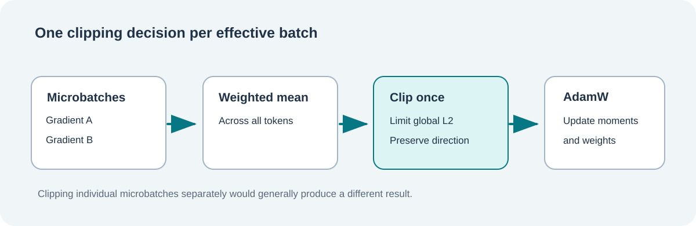

# Lesson 33 — Clip Global Gradients Before an AdamW Update

**Course:** Build an LLM from Scratch · **Level:** Developing · **Focus:** AdamW, microbatches and atomic updates

## Why clipping exists

Training a language model means updating many parameter arrays. Occasionally the global gradient norm can become much larger than expected. A gradient-clipping policy limits its magnitude while preserving its direction.

Gradient clipping is a **control on the proposed update**, not a way to make an incorrect answer correct. It can help with numerical stability, but it does not guarantee faster learning, lower evaluation loss or a safer model.



## Calculate the clipping factor

Let `g` represent the concatenated gradient arrays and let `M` be the approved maximum norm:

```text
scale = min(1, M / ||g||₂)     when ||g||₂ > 0
scale = 1                      when ||g||₂ = 0
clipped gradient = scale × original gradient
```

A vector `[3, 4]` has norm `5`. If the maximum is `2.5`, the factor is `0.5`, so the clipped vector becomes `[1.5, 2]`, with norm `2.5`.

A vector with norm `1.5` and limit `2.5` is unchanged. Clipping must **never enlarge** smaller gradients.

## Where clipping belongs in microbatch training

Our native decoder can split one effective batch into smaller microbatches. Each microbatch calculates gradients; the Framework combines them using the number of token positions processed.

The order is important:

```text
Source-code examples
        ↓
Microbatch A → mean gradient A ─┐
                                ├→ weighted mean of all gradients
Microbatch B → mean gradient B ─┘
                                       ↓
                                calculate global L2 norm
                                       ↓
                                   clip once
                                       ↓
                            one atomic AdamW update
```

If we clip microbatch A and microbatch B *separately* before averaging, we generally get a different final gradient. That alters the optimisation path and breaks equivalence with a direct full-batch calculation.

## One transaction for weights and moments

AdamW maintains a first moment and a second moment for each model parameter. The optimiser must update both moments and weights together after the candidate update passes validation.

The Framework exposes a failure-atomic native C23 overload:

```c
UmiAiTrainingGradientClipReport report = {0};
float trainingLoss = 0.0F;

UmiStatus status = UmiAiTrainingDecoderTrainAdamWAccumulatedClipped(
    decoder,
    optimizer,
    inputTokenIds,
    targetTokenIds,
    totalTokenCount,
    microbatchSequences,
    learningRate,
    2.5F,
    &trainingLoss,
    &report);
```

This function uses the existing decoder's forward pass, backpropagation and gradient reducer. It clips the combined gradients once, before calling the existing AdamW update. The original AdamW training APIs continue to work unchanged.

If validation or updating fails, model weights, optimiser moments, optimiser-step count and the caller's output values are preserved. Temporary graphs are rewound after their gradients are collected.

## What changes in an AdamW checkpoint?

Clipping changes the gradients **before** they enter AdamW's moment calculations. AdamW checkpoints retain the resulting model parameters, moments and completed optimiser steps.

The *clipping threshold itself* is not embedded in the current combined checkpoint format. Therefore, reproducible continuation also requires preserving the approved training policy externally alongside the source manifest and learning-rate schedule. Restarting with another threshold may lead to a different trained model, even if the checkpoint loads correctly.

## Try the native demonstration

From the Umicom Applications repository after building the isolated learning laboratory:

```powershell
& ".\build\windows-ucrt64-native-llm-debug\umicom-native-llm-gradient-clipping.exe"
```

The demonstration prints the global norm, the applied factor, the number of gradient entries and the resulting parameter values. It does not train on customer information or execute model-generated source code.

## Practice

Two equal-sized microbatches produce gradients `[6, 0]` and `[0, 2]` for the same two parameters. Calculate the averaged gradient and determine whether a global clipping limit of `2` changes it.

<details><summary>Worked answer</summary>

The mean is `[(6 + 0)/2, (0 + 2)/2] = [3, 1]`. Its norm is `sqrt(10) ≈ 3.1623`. The factor is `2/sqrt(10) ≈ 0.63246`. The clipped gradient is approximately `[1.8974, 0.6325]`.

</details>
