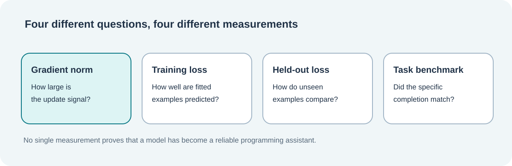

# Lesson 34 — Test Gradient Clipping and Interpret Training Stability

**Course:** Build an LLM from Scratch · **Level:** Developing · **Focus:** reproducibility, evidence and testing

## Why a passing program is not enough

A gradient-clipping implementation can compile successfully and still be wrong. It might clip each tensor separately, mutate the caller's gradient array, update AdamW moments before discovering an invalid input, or silently overflow while calculating the norm.

We test mathematical results, ownership rules and training behaviour independently. Each test has a specific, verifiable claim.



## Four useful types of test

**Mathematics:** A gradient vector `[3, 4]` must have norm `5`. With a limit of `2.5`, its scale is `0.5`. A zero-gradient vector must be left unchanged. These assertions catch errors in the norm formula.

**Numerical boundaries:** A pair of gradients near `FLT_MAX` is still a legal vector of finite FP32 values. The norm routine must not overflow in FP32 while squaring them. A report can use a double-precision norm.

**Failure atomicity:** A `NAN` gradient or a zero clipping limit must be rejected. The optimiser-step count, model weights and output report must not change when the call fails.

**Model-level parity:** A clipping limit far greater than the global norm means *no clipping*. Training with that limit should produce the same decoder checkpoint as the established unclipped AdamW path when all other inputs and step ordering are equal.

## The distinction between stability and progress

Consider these simplified observations from an imaginary educational model:

| Checkpoint | Training loss | Held-out loss | Global gradient norm |
|---|---:|---:|---:|
| A | 5.20 | 5.35 | 4.2 |
| B | 4.80 | 5.11 | 7.8 |
| C | 4.35 | 5.24 | 18.0 |

Training loss falls at every checkpoint. Held-out loss improves from A to B, then worsens at C. The gradient norm also grows. These facts raise useful questions about generalisation and learning-rate policy, but **they do not prove** that clipping will improve checkpoint C.

A controlled comparison would hold the training corpus, evaluation split, random seeds, model configuration, learning-rate schedule and effective-batch policy constant, then change only the clipping threshold.

## Comparing experiments fairly

When analysing two runs, record the following evidence:

| Evidence | What it tells us |
|---|---|
| Checkpoint identifier | Which saved weights and optimiser state were measured |
| Training-plan identity | Which steps, schedule and accumulation policy were used |
| Clipping threshold | What maximum global norm was requested |
| Gradient norm and factor | Whether clipping was actually applied |
| Training cross-entropy | How well the model fits selected training examples |
| Held-out cross-entropy | How it performs on separately selected examples |
| Exact completion benchmark | How many reviewed byte completions matched their references |

Remember that a byte-exact benchmark is not a C23 compiler, a functional test or proof of coding expertise. A production-oriented evaluation programme would need independent compilation, testing and safety checks in a properly isolated environment.

## Verify the native tests

The Framework laboratory registers focused CTests for mathematical measurement, rejection handling, AdamW parity and decoder-wide accumulated gradient clipping. After a successful build, they can be selected by name:

```powershell
ctest --test-dir ".\build\windows-ucrt64-native-llm-debug" `
    --output-on-failure `
    -R "gradient_norm|gradient_clipping|adamw_clipping|decoder_clipping"
```

An antivirus-blocked process is **not** a passing or failing mathematical test; it is a process-launch problem that must be investigated separately. Disabling protection is not a substitute for verification.

## Practice

A run has lower training loss but higher held-out loss than another run. Is it enough to declare the first model better?

<details><summary>Worked answer</summary>

No. Lower training loss only demonstrates a better fit to that particular training sample. Higher held-out loss can indicate weaker generalisation. Compare both runs on the same approved evaluation data and review task-level evidence before drawing a conclusion.

</details>

## What comes next?

Gradient clipping is a small, necessary piece of scalable training infrastructure. Future work can connect a persisted clipping policy to entire reproducible experiments and add richer training diagnostics. Model capability still depends on architecture, suitable data, evaluation discipline and enough compute for meaningful learning.
