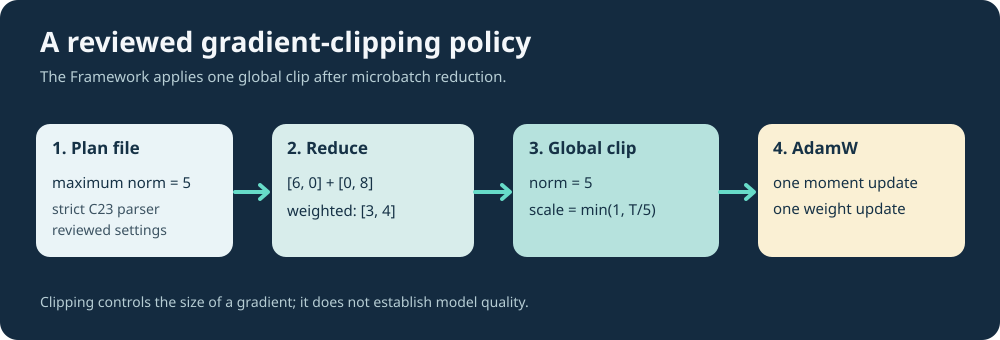

# Lesson 35 — Configure Gradient Clipping in a Reproducible Training Plan

**Course:** Build an LLM from Scratch  
**Level:** Developing  
**Focus:** reviewed configuration, global gradient clipping, AdamW and effective-batch semantics

## From an API argument to a reviewed experiment

Lesson 33 introduced global gradient clipping. That API receives a threshold directly as a C23 `float`. For repeated scientific experiments, we need something more reliable than remembering a value typed on a command line: an explicit, reviewed plan that travels with the experiment.

The next step in Umicom Framework adds an **opt-in** key to AdamW training plans:

```ini
UMICOM-AI-EXPERIMENT-1
manifest=manifest.txt
steps=4
eval_interval=2
batch_sequences=2
effective_sequences=2
microbatch_sequences=1
learning_rate=0.025
maximum_gradient_norm=1.0
```

The model's context, channels and seeds may be provided as in earlier lessons or inherit published defaults. The sample values are small so a student can inspect individual optimiser steps. They are not universal tuning recommendations.

### What does the threshold mean?

Let the complete accumulated gradient be the vector `g = [6, 8]`. Its Euclidean norm is:

`||g||₂ = sqrt(6² + 8²) = 10`.

For `maximum_gradient_norm=5.0`, the Framework calculates:

`scale = min(1, 5 / 10) = 0.5`.

The optimiser receives `[3, 4]`, not `[6, 8]`. **AdamW then performs its usual moment and weight updates.** Clipping the gradient is not the same operation as clipping the model's weights or limiting the learning rate.



## Why clipping happens after accumulation

Suppose two equally weighted microbatches contribute gradients `[6, 0]` and `[0, 8]`.

1. Aggregate the microbatch gradients using the established token-weighted reducer: `[3, 4]`.
2. Calculate the **global** norm: `5`.
3. At threshold `4`, apply scale `4/5 = 0.8` to the combined gradient.
4. Perform exactly one AdamW update using `[2.4, 3.2]`.

If each microbatch had been clipped separately, the aggregate would generally be different. The same threshold therefore has a different meaning if applied in a different position. The approved policy places clipping **after** reduction and **before** the optimiser step.

## Strict C23 plan parsing

A second, explicit parser (`UmiAiTrainingExperimentPlanLoadAdamW`) recognises `maximum_gradient_norm`. The older parser rejects it rather than ignoring a setting that it does not implement. The new parser rejects duplicate keys, negative and zero thresholds, `nan`, `inf`, exponent syntax and unbounded decimal input. It leaves the caller's output buffers unchanged if the plan is rejected.

The threshold is optional in the parser and defaults to **clipping disabled**. The separate `umicom-native-llm-adamw-clipped-experiment` learning command requires an explicit positive threshold; the original experiment command remains available with its previous behaviour.

This teaching command uses the bounded AdamW experiment sampler. If `effective_sequences` is present, it must currently equal `batch_sequences`. `microbatch_sequences` may be smaller, so that the Framework accumulates gradients across multiple graphs. Future work can lift that CLI restriction while retaining deterministic source sampling.

## C23 application interface

```c
UmiAiTrainingExperimentConfig config;
UmiAiTrainingExperimentAccumulation batches;
float maximumGradientNorm = 0.0F;
char manifestPath[1024];

UmiStatus status = UmiAiTrainingExperimentPlanLoadAdamW(
    "approved/experiment.conf", &config, &batches,
    &maximumGradientNorm, manifestPath, sizeof(manifestPath));

if (status != UMI_STATUS_OK) {
    /* Do not train from a rejected or partially parsed plan. */
    return 1;
}
```

The actual training remains inside Umicom Framework, so a native CLI, Umicom LLM and Umicom Studio IDE can share the same policy and results without separate implementations.

## Practical exercise

Create two reviewed plan files that differ only in `maximum_gradient_norm` (for example `1.0` and `0.5`). Predict the difference in clipping frequency using hypothetical gradient norms `0.4`, `0.8` and `2.0`. Then explain why a change in the *reported training loss* does not by itself prove better generalisation.

**Remember:** a clipping threshold is an optimisation policy, not a measure of model accuracy. Held-out evaluation and repeatable comparisons are still required.
