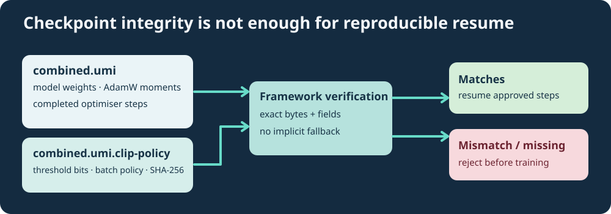

# Lesson 36 — Bind a Clipping Policy to a Checkpoint and Resume Safely

**Course:** Build an LLM from Scratch  
**Level:** Developing  
**Focus:** checkpoint identity, configuration continuity, SHA-256 and reproducible resume

## Why an optimiser checkpoint is not an entire experiment

The combined Umicom AdamW checkpoint stores model weights, first and second moments and completed optimisation steps. It does not store every external decision: the source dataset, sampling seeds, learning-rate schedule or chosen clipping threshold. Changing the threshold while resuming can lead to a different training trajectory even when the model loads correctly.

A new, **separate companion record** therefore binds the clipping policy to the exact combined checkpoint bytes. The established binary checkpoint format remains unchanged.



## What the record contains

The Framework emits a short, canonical ASCII record resembling:

```text
UMICOM-AI-ADAMW-CLIP-POLICY-1
maximum_gradient_norm_bits=3f800000
batch_sequences=2
microbatch_sequences=1
checkpoint_sha256=<64 lowercase hexadecimal characters>
```

`3f800000` is the IEEE-754 binary32 representation of `1.0`. Storing the exact bits avoids ambiguity caused by different decimal spellings or locale settings. The 64-character SHA-256 digest identifies the bytes of the corresponding checkpoint. The batch fields preserve **where the optimiser step's gradient was accumulated**.

This is a consistency check, **not a digital signature**. A person who can replace both files could forge a matching pair. For security-sensitive use, approve the source, hash externally, verify the release signature and retain an independent record of the review.

## A safe resume sequence

1. Review the experiment plan and source manifest; confirm that the dataset contents and sampling seeds are still approved.
2. Load the combined checkpoint using the Framework's bounded decoder-and-AdamW codec.
3. Re-encode it into the canonical in-memory format and compute its SHA-256 digest.
4. Read the companion `.clip-policy` file and compare **all** fields with the currently approved gradient policy.
5. Reject the resume when the record is missing, truncated, altered or mismatched.
6. Only then clone the checkpoint state, sample the next source windows and perform clipped AdamW steps.

The new educational command requires a matching record for **every clipped resume**. The older native AdamW experiment remains separate, so historical un-clipped plans and checkpoints are not silently reinterpreted.

## Running the native demonstration

In a reviewed local Windows checkout with the native laboratory built, the two supplied small plans use the same approved dataset, seeds, optimiser settings, clipping policy and absolute learning-rate schedule. The first plan ends at optimiser step four; the continuation plan ends at step eight. Both run against the same *eight-step schedule* from the beginning.

```powershell
Set-Location 'C:\umicom\Umicom-Applications'
$exe = '.\build\windows-ucrt64-native-llm-debug\umicom-native-llm-adamw-clipped-experiment.exe'
$firstPlan = '.\framework\learning\native-llm\fixtures\clipped-adamw-experiment.conf'
$continuedPlan = '.\framework\learning\native-llm\fixtures\clipped-adamw-continuation.conf'
& $exe $firstPlan 8 'C:\umicom\_local\models\first.umi'
```

That successful command publishes two new files: `first.umi` and `first.umi.clip-policy`. The later run uses a fresh output path and the reviewed checkpoint pair:

```powershell
& $exe $continuedPlan 8 'C:\umicom\_local\models\continued.umi' 'C:\umicom\_local\models\first.umi'
```

The continuation performs steps five through eight. Its source plan differs from the initial plan only in `steps`; the absolute schedule argument remains `8`. **Changing the schedule total after a checkpoint would change intermediate learning rates and invalidate an exact comparison**, even when the clipping threshold matched. Do not reuse existing output paths; use only locally reviewed data and executables cleared for use by your security controls.

## Why two files are not one atomic transaction

A filesystem cannot generally guarantee an atomic rename of *two independent paths*. A crash between writing the checkpoint and its policy can leave an incomplete pair. The safe behaviour is to **refuse to resume** that checkpoint until a reviewer resolves the incomplete publication. Never silently overwrite another experiment's evidence.

In memory, the training operations remain transactional: a failed AdamW step must not change the optimiser moments or published model output. The companion file solves a *different* problem: preserving the approved clipping decision during subsequent experiments.

## Worked exercise

You are given checkpoint `A.umi` and a matching record containing threshold bits `3f800000`, `batch_sequences=2` and `microbatch_sequences=1`.

Explain whether each proposed resume is acceptable:

- The plan retains threshold `1.0`, batch size `2` and microbatch size `1`, and the checkpoint digest matches.
- The plan changes only the threshold to `0.5`.
- The plan keeps threshold `1.0` but changes microbatch size to `2`.
- The plan matches the policy, but the checkpoint bytes differ.

Only the first case matches the recorded clipping policy and checkpoint identity. **Even that case requires an independent dataset and provenance review.**
