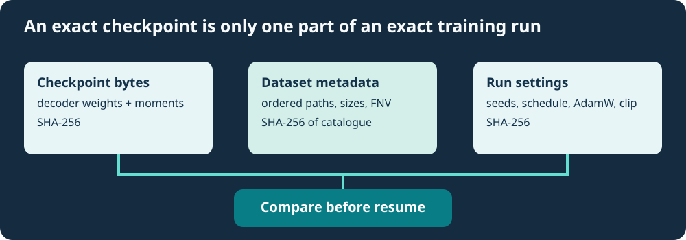

# Lesson 37 — Bind Your Dataset and Training Schedule to an AdamW Checkpoint

**Course:** Build an LLM from Scratch  
**Level:** Developing  
**Focus:** reproducible training, ordered datasets, schedules, numerical configuration and run-lock records

## Why a valid checkpoint is not enough

In Lesson 36, a `.clip-policy` record tied the gradient-clipping threshold and microbatch size to a combined AdamW checkpoint. But two researchers can load the **same** checkpoint and produce different next updates if they choose different training files, source-file ordering, seeds, learning-rate schedules or optimiser options.

For example, suppose a model has completed step four of an eight-step cosine schedule. The next update must calculate the rate for absolute step **five of eight**. If the experiment is restarted with a new six-step schedule, the model still loads correctly but the next optimiser update can differ. This would be a new experiment, not an exact continuation.



## Three identities, rather than one

The next Umicom Framework component records a short, canonical C23 run-lock companion:

```text
UMICOM-AI-ADAMW-RUN-LOCK-1
checkpoint_sha256=<64 hexadecimal characters>
dataset_snapshot_sha256=<64 hexadecimal characters>
run_settings_sha256=<64 hexadecimal characters>
```

The **checkpoint digest** identifies the combined model and AdamW moment bytes supplied for inspection. The **dataset-snapshot digest** covers the ordered source-document catalogue, including each file's training/evaluation partition, relative path, byte length and pre-existing FNV-1a64 content fingerprint. The **settings digest** covers the model dimensions, training and evaluation seeds, AdamW hyperparameters, entire learning-rate schedule, clipping threshold and microbatch configuration.

The record is an *integrity consistency check*, not proof that a person or organisation approved the source. In particular, hashing FNV-1a64 source fingerprints with SHA-256 does **not** make the original source fingerprint collision-resistant. A signed independent manifest or direct SHA-256 hashes of approved source files are stronger evidence of origin and should be retained separately.

## What does “the same schedule” mean?

Let the learning-rate schedule be defined by:

- a kind (constant, linear or cosine);
- the starting peak and minimum learning rates;
- the number of warm-up steps;
- the **total** number of intended optimiser steps.

All four choices must remain unchanged across a genuine continuation. A four-step intermediate checkpoint may later become an eight-step final checkpoint **only if the schedule was eight steps from the outset**.

The plan's `steps` field is deliberately excluded from the settings identity because it describes a stopping point, not a different underlying optimiser policy. The **schedule horizon is included**. Therefore:

```text
Initial run:        steps=4, schedule-total-steps=8
Continued run:      steps=8, schedule-total-steps=8   MATCH
Wrong continuation: steps=8, schedule-total-steps=10  REJECT
```

## A C23 view of the API

The Framework exposes a borrowed-input structure that makes the required references explicit:

```c
UmiAiTrainingRunLockInputs reviewed = {
    dataset,        /* previously loaded, immutable source snapshot */
    &experiment,    /* decoder dimensions, seeds, batch/evaluation policy */
    &adamw,         /* beta1, beta2, epsilon, weight decay */
    &schedule,      /* complete original absolute-step schedule */
    &clipping       /* maximum norm and microbatch count */
};
```

A C23 caller supplies these values to `UmiAiTrainingRunLockVerify` together with the checkpoint bytes and saved record. The function verifies the exact expected record without executing files or running a training step. Invalid inputs do not partially update caller-owned output buffers.

## Exercise: identify the changed run

A training run saved its checkpoint at step four with `train_seed=4477`, clipping threshold `1.0`, a microbatch of one sequence and an eight-step cosine horizon. Decide whether these changes are compatible with the saved run lock:

1. Increase only the requested stopping point to step eight.
2. Change the training seed to `4478`.
3. Keep the seed but reverse the order of two source documents.
4. Change the cosine horizon from eight steps to ten.
5. Use exactly the same approved source snapshot and training policy.

**Check your answer:** cases 1 and 5 preserve the recorded run identity. Cases 2–4 should be rejected. Real-world approval additionally requires independent checking of the authorised source, toolchain and execution environment.

**Next:** Lesson 38 tests disk checkpoint reloads and verifies that failed continuation does not silently modify the model or the original evidence.
