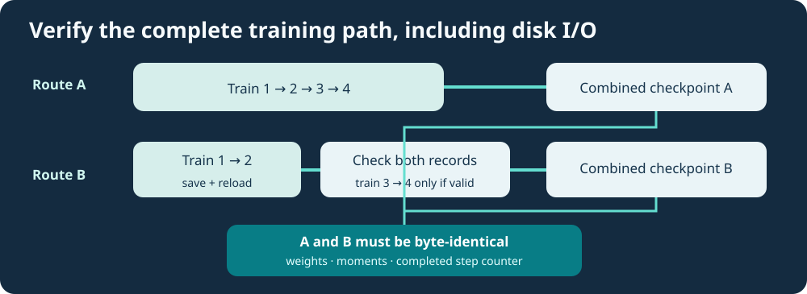

# Lesson 38 — Test On-Disk AdamW Continuation and Detect Invalid Resumes

**Course:** Build an LLM from Scratch  
**Level:** Developing  
**Focus:** C23 regression testing, on-disk checkpoints, no-clobber evidence, byte identity and failure-atomic training

## The difference between an in-memory test and a restart test

An in-memory training regression can compare a complete run with a partial run followed by a resumed run. That is useful, but it does not test the operation a real user performs between sessions: writing a checkpoint to disk and loading it in a fresh process.

A stronger experiment exercises **both** the persistence codec and the training algorithm. The test runs the same small, reviewed source dataset along two routes and compares their final combined decoder-and-AdamW bytes.



## Design the experiment

Use a four-step cosine schedule that was defined as four steps before either run starts:

```text
Route A: train steps 1, 2, 3, 4 → final combined checkpoint A
Route B: train steps 1, 2 → save to disk → reload →
         verify clip policy and run lock → train steps 3, 4 →
         final combined checkpoint B
```

For identical reviewed inputs and deterministic native operations, checkpoints A and B should be byte-for-byte equal, including **both AdamW moment arrays** and the completed optimiser-step counter. Comparing only the final loss is not enough: distinct optimiser states could produce a similar loss but diverge later.

## What to check before step three

Before Route B resumes, verify the original `.clip-policy` and the additional `.training-lock` record against the checkpoint returned by the canonical loader. The run-lock inputs must use the same ordered dataset snapshot, original schedule horizon, AdamW hyperparameters and clipping configuration. A changed `steps` stop point is permitted; an altered **schedule horizon** is not.

Failure tests should include:

- a missing companion file;
- a changed learning-rate horizon;
- a reordered source-document list;
- an altered combined checkpoint byte;
- an already occupied output path.

These are different failures, and each must be reported without silently replacing an existing checkpoint or publication record.

## Write regression assertions in C23

Here is an abbreviated pattern. The actual Framework regression also exercises file creation, loaded handles, detailed statuses and cleanup:

```c
/* After both training routes succeed and checkpoints are encoded: */
if (completeSize != continuedSize ||
    memcmp(completeBytes, continuedBytes, completeSize) != 0) {
    fputs("AdamW disk continuation differs from the full run\n", stderr);
    return 1;
}

/* A changed reviewed schedule must be refused BEFORE resumed training: */
if (UmiAiTrainingRunLockVerifyFile(
        lockPath, loadedBytes, loadedSize, &reviewed) != UMI_STATUS_OK) {
    fputs("run-lock identity mismatch: refusing resume\n", stderr);
    return 1;
}
```

`memcmp` checks *identity*, not whether the language model has learned to write correct C23. Source-code competence still requires separate held-out functional tests and human evaluation.

## Failure atomicity and lifetime

A decoder checkpoint is a **borrowed input** to the Framework resume operation. The implementation clones the model and AdamW moment state before changing any weights. If validation or training fails, the caller must not receive a partially trained model. An observer cancellation must also leave previous published checkpoints unchanged. The optimiser handle must be destroyed before its associated decoder handle.

There is a separate filesystem limitation: the checkpoint, `.clip-policy` and `.training-lock` are **three different paths**. A power failure can occur between writes; ordinary filesystems do not make all three publications one atomic transaction. The safe behaviour is to refuse a strict resume when any required record is missing and let a reviewer resolve incomplete evidence.

## Practical investigation

Build the official Framework CTest targets for run-lock identity, run-lock file handling and disk resume. For a real training run, use the reviewed native executable with the trailing `--strict-run-lock` option. Do not bypass operating-system security warnings or launch previously quarantined binaries merely to complete an exercise.

After tests pass, explain in your own words why (a) a matching SHA-256 of checkpoint bytes, (b) an unchanged optimisation schedule, (c) independent source approval and (d) a clean security review are **four distinct checks**. None automatically substitutes for another.

**Further study:** Expand the dataset service to expose a cryptographic digest of the immutable raw source snapshot rather than relying only on its existing FNV-1a64 catalogue fingerprints. A future signed experiment receipt would then establish a stronger provenance chain without putting signing credentials inside the source tree.
