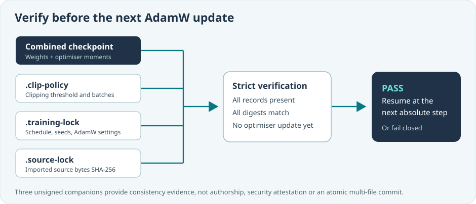

# Lesson 40 — Verify Source-Locked AdamW Checkpoint Continuation

**Course:** Build an LLM from Scratch  
**Level:** Developing  
**Focus:** Three complementary checkpoint records, strict resume and failure-atomic verification

## Different facts require different checks

Suppose a native language model has trained for two optimisation steps and has been saved to disk. You want to continue training through step four. Before using the checkpoint, you must know not only that its bytes are intact, but also that you are using the correct optimiser settings, learning-rate schedule, gradient-clipping configuration and training source corpus.

Umicom Framework now offers three **optional, separately verified** companion records alongside the combined decoder-and-AdamW checkpoint:

| Companion | What it binds to the checkpoint | Why it matters |
|---|---|---|
| `.clip-policy` | Gradient clipping threshold and batch settings | Prevents accidentally changing how unusually large gradients are scaled |
| `.training-lock` | AdamW parameters, learning-rate schedule, seeds, model shape, evaluation settings and the earlier dataset catalogue | Rejects inconsistent training plans |
| `.source-lock` | SHA-256 of the exact immutable imported source bytes, including ordered names and partitions | Strengthens source identity beyond the earlier FNV fingerprints |



<!-- The illustration is owned by the canonical illustrated course. The former ../../assets/diagrams/source-locked-adamw-resume.svg route is retained here as path history; sharing the existing asset keeps both lesson presentations aligned. -->

These files support one another. The source lock does not replace the training lock: a run could retain the exact dataset while silently changing its learning-rate horizon. Likewise, a training lock alone does not cryptographically establish the original source contents.

## Understand the source-lock format

A source-lock record is deliberately small and human-readable:

```text
UMICOM-AI-SOURCE-LOCK-1
checkpoint_sha256=<64 lowercase hexadecimal characters>
dataset_source_sha256=<64 lowercase hexadecimal characters>
```

The checkpoint identity uses SHA-256 over the supplied **canonical combined-checkpoint bytes**. The dataset identity comes from the immutable Framework snapshot described in Lesson 39. The parser expects an exact format: extra characters, reordered lines or incomplete values are not silently accepted.

**Important:** The record is not a digital signature. Anyone with permission to replace all of the files could replace the checkpoint and its unsigned records together. For stronger provenance, a separately trusted release or experiment signer would be required.

## Verify before the next optimiser update

The correct order matters:

1. Load a checkpoint through the Framework's validated combined-checkpoint codec.
2. Import and review the intended dataset once, creating the immutable snapshot.
3. Check the `.clip-policy` and `.training-lock` against the checkpoint and approved settings.
4. Check `.source-lock` against the same checkpoint and the exact imported source bytes.
5. Resume training only after every required verification succeeds.

In a C23 application the new source-lock check looks like this:

```c
UmiStatus status = UmiAiTrainingSourceLockVerifyFile(
    sourceLockPath,
    canonicalCheckpointBytes,
    canonicalCheckpointByteCount,
    approvedDataset);

if (status != UMI_STATUS_OK) {
    fputs("Source-locked resume rejected\n", stderr);
    /* Do not call the optimiser or modify the borrowed checkpoint. */
    return 1;
}
```

The canonical checkpoint bytes and approved dataset are borrowed for this synchronous call. Neither is modified. This check does not execute training.

## Run the educational example

On a reviewed build machine, the native example accepts a final `--strict-source-lock` option. It enables the earlier strict run lock as well; the ordinary historical command syntax remains available for compatibility.

The following is **PowerShell for interactively running a compiled C23 executable**, not an implementation of training functionality:

```powershell
Set-Location 'C:\umicom\Umicom-Applications'
$exe = '.\build\windows-ucrt64-native-llm-debug\umicom-native-llm-adamw-clipped-experiment.exe'
$firstPlan = '.\framework\learning\native-llm\fixtures\clipped-adamw-experiment.conf'
$nextPlan = '.\framework\learning\native-llm\fixtures\clipped-adamw-continuation.conf'

& $exe $firstPlan 8 'C:\umicom\_local\models\reviewed-first.umi' --strict-source-lock
& $exe $nextPlan 8 'C:\umicom\_local\models\reviewed-continued.umi' `
    'C:\umicom\_local\models\reviewed-first.umi' --strict-source-lock
```

Choose *fresh* output file names. The checkpoint and all companion services refuse existing destinations. Never restore or bypass previously quarantined executables simply to perform a lesson. A clean build and any necessary vendor security review must come first.

## Test the rejection cases

A useful regression suite deliberately checks both success and failure. With the same approved source and training policy, a checkpoint saved at step two should resume to step four and produce a byte-identical combined checkpoint to an uninterrupted four-step run. **Comparing a single loss value is insufficient**, because the AdamW moment history may differ.

A proper negative test changes one factor at a time: alter a checkpoint byte, change the clipping threshold, change the schedule horizon, reorder the source manifest, modify a source byte in a separately loaded dataset or remove the `.source-lock`. Each strict resume must refuse the mismatch before an optimiser update.

A final operational limitation remains: ordinary file publication does not make the checkpoint plus three companion files one atomic transaction. If a crash leaves an incomplete set, do not reconstruct a missing record as though it had been published during the original run. Treat the set as incomplete evidence.

## Exercises

1. Explain which companion rejects a changed learning-rate horizon and which rejects a changed source byte.
2. Use CTest to verify the `corpus_source_sha256`, `dataset_source_sha256`, `source_lock` and `run_lock_disk_resume` cases.
3. In a disposable copy of a learning dataset, reorder its training-file list. Reload it and verify that the source-lock check fails.
4. Describe what a future **signed experiment receipt** would add to the three unsigned companion records.

## Check your understanding

**Question:** Can the source lock replace the combined AdamW checkpoint?  
**Answer:** No. It contains only identity digests, not model parameters or optimiser moments.

**Question:** If all three companions verify, has the model been proved safe or correct?  
**Answer:** No. The checks establish consistency of supplied inputs. Source approval, host security, and independent held-out evaluations remain necessary.

**Next:** Extend the training evidence to independent, signed provenance once the native security and reproducibility tests are consistently passing.
