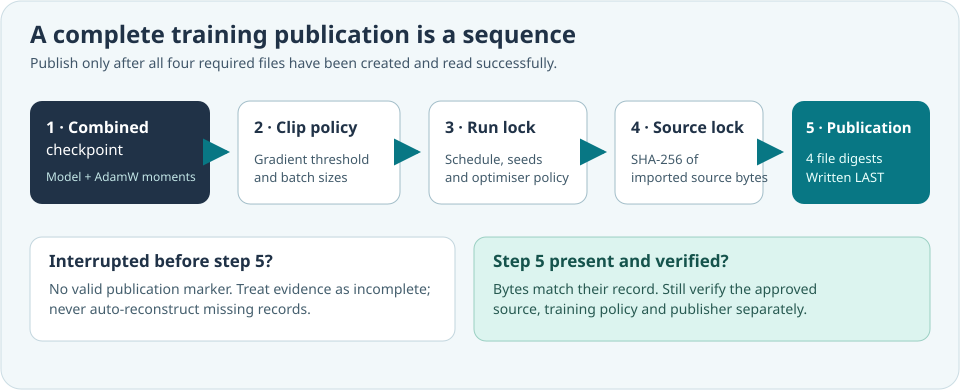

# Lesson 41 — Publish a Complete Native Training Bundle

**Course:** Build an LLM from Scratch  
**Level:** Developing  
**Focus:** Five-file checkpoint publication, SHA-256 integrity and incomplete-run recovery

## Why a valid model checkpoint is not the whole experiment

Imagine that an AdamW experiment writes `model.umi` successfully and then the
computer loses power before it can finish writing the experiment's policy
records. The checkpoint contains decoder weights and optimiser moments, but
you no longer have the complete evidence required to establish how the model
was trained. A *completion marker* makes the distinction visible.

The Framework already has four independently managed files: the combined
checkpoint, `.clip-policy`, `.training-lock` and `.source-lock`. Each has its
own format and purpose. The new, optional `.publication` file adds a final
**byte-integrity record**, written only after the other four files have been
successfully created and inspected.



## What the marker actually records

For each of the four files, the Framework records its byte length and SHA-256
hash. An extract from the human-readable format looks like this:

```text
UMICOM-AI-TRAINING-PUBLICATION-1
checkpoint_bytes=384000
checkpoint_sha256=<64 hexadecimal characters>
clip_policy_bytes=197
clip_policy_sha256=<64 hexadecimal characters>
training_lock_bytes=452
training_lock_sha256=<64 hexadecimal characters>
source_lock_bytes=193
source_lock_sha256=<64 hexadecimal characters>
```

The lengths above are **illustrative**, not measurements from a published
Umicom checkpoint. The real service computes them from actual files. The
names of the four inputs are derived from the checkpoint path; users cannot
substitute unrelated sidecar paths into the record-building operation.

The Framework hashes the files in fixed-size memory buffers rather than
loading an entire checkpoint into application-owned memory. A checksum is
not enough on its own: by also recording lengths, we can reject many obvious
truncation and wrong-file problems with clear evidence.

## Publish last and refuse to overwrite

The native C23 call is deliberately short because the Framework owns the
reading, SHA-256 hashing, record formatting and exclusive publication:

```c
#include "umicom/ai/training/training_publication.h"

UmiStatus status = UmiAiTrainingPublicationSaveNewFile(
    reviewedCheckpointPath);
if (status != UMI_STATUS_OK) {
    /* Preserve existing files for investigation; do not fabricate evidence. */
    return 1;
}
```

This call expects the four files to **already exist**. The function first
computes their identities, creates a same-directory `.publication.partial`
staging file with exclusive creation, writes and synchronises it, and publishes
the completed file under `.publication` without replacing a pre-existing
marker.

A crash may still leave an incomplete **set of files**, or a leftover staging
file. There is no magic multi-file filesystem transaction. The marker is a
practical *completion indicator*, not a guarantee that every file was written
atomically together or that power loss cannot interrupt storage operations.

## Detect a partial training result

Consider two examples:

| Files present | Can we treat the bundle as newly published? |
|---|---|
| Combined checkpoint and all three companions, but no `.publication` | **No**, not in the new publication mode; completion has not been recorded. |
| All four files plus a verified `.publication` | **Yes, as a complete byte-matched bundle**; semantic settings and source authorisation still need separate checks. |

An interrupted `.publication.partial` is **not** a valid marker. Do not simply
rename it into place. Review the four files and the build environment before
choosing a new, distinct publication path.

## Exercises

1. Explain why the publication record must be created *after* the source lock.
2. Explain why a 64-character SHA-256 digest cannot substitute for AdamW
   optimiser moments.
3. In a disposable test folder, change one byte of `.clip-policy` and explain
   how a read-only digest verifier should respond.
4. Review the C23 API contract for failure-atomic inspection. Which data
   remains untouched when a companion is absent?

## Check your understanding

**Question:** Does a completed `.publication` marker prove who trained the
model?  
**Answer:** No. All five files are unsigned and can be replaced by a party
who controls the directory.

**Question:** Does the marker make the original checkpoint format obsolete?  
**Answer:** No. It identifies those exact bytes without changing their format.
