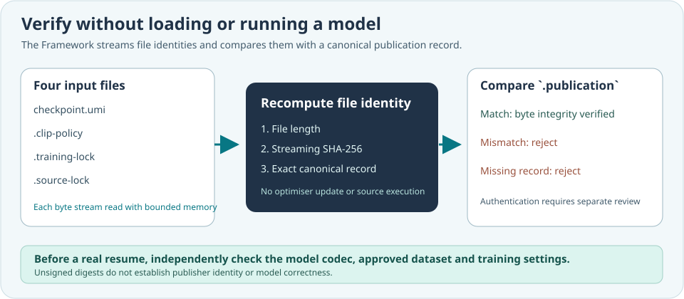

# Lesson 42 — Verify a Published AdamW Run Before Resume

**Course:** Build an LLM from Scratch  
**Level:** Developing  
**Focus:** Independent read-only verification, fail-closed resume and evidence limits

## Separate integrity verification from model training

A model should not need to execute merely to verify whether its saved files
have changed. Umicom Framework now exposes a **read-only native C23 verifier**
for the four-file checkpoint bundle introduced in Lesson 41. It checks that
all four files match the completion record; it does not create a decoder or
run any optimiser updates.



## Use the independent verifier

After your build and security review, run the compiled executable in
PowerShell with an explicitly approved **existing** checkpoint path:

```powershell
Set-Location 'C:\umicom\Umicom-Applications'
$verifier = '.\build\windows-ucrt64-native-llm-debug\umicom-native-llm-publication-verify.exe'
& $verifier 'C:\umicom\_local\models\reviewed-first.umi'
```

The command reads these exact paths:

```text
reviewed-first.umi
reviewed-first.umi.clip-policy
reviewed-first.umi.training-lock
reviewed-first.umi.source-lock
reviewed-first.umi.publication
```

It prints the computed byte lengths and SHA-256 digests on success, and
returns a nonzero exit status when the marker is absent or mismatched. The
verifier itself neither publishes files nor starts training.

The equivalent C23 check in a native application is:

```c
#include "umicom/ai/training/training_publication.h"

UmiStatus status = UmiAiTrainingPublicationVerifyFile(
    approvedCheckpointPath);
if (status != UMI_STATUS_OK) {
    /* An incomplete or modified bundle must not continue training. */
    return 1;
}
```

## Publish from an explicitly reviewed experiment

The clipped AdamW educational executable accepts one new **opt-in** trailing
option, `--publish-evidence`. It enables the existing strict source lock and
strict training-run lock, and creates the `.publication` marker last:

```powershell
Set-Location 'C:\umicom\Umicom-Applications'
$trainer = '.\build\windows-ucrt64-native-llm-debug\umicom-native-llm-adamw-clipped-experiment.exe'
$firstPlan = '.\framework\learning\native-llm\fixtures\clipped-adamw-experiment.conf'
$nextPlan = '.\framework\learning\native-llm\fixtures\clipped-adamw-continuation.conf'

& $trainer $firstPlan 8 'C:\umicom\_local\models\publication-first.umi' --publish-evidence
& $trainer $nextPlan 8 'C:\umicom\_local\models\publication-final.umi' `
    'C:\umicom\_local\models\publication-first.umi' --publish-evidence
```

Use **new checkpoint filenames** and only explicitly approved local training
data. Do not repeat these sample paths if they already contain evidence. The
existing `--strict-source-lock` and `--strict-run-lock` options remain supported.
The new flag is not enabled automatically in existing plans.

The second invocation first checks the previous `.publication`, then reads the
combined checkpoint, and still independently verifies clipping, training and
source-lock semantics using the approved plan and dataset. **A matching
publication digest cannot replace those semantic checks.**

## What a negative test proves

The `framework.ai.training.publication_file` regression changes one file at a
time and verifies that an unchanged marker detects the difference. The
`framework.ai.training.publication_rejections` test checks missing files,
occupied stage paths, oversized companions, malformed records and preserved
outputs on failure.

A changed file should cause the verifier to fail. However, if an attacker
replaces **all five files** and calculates new checksums, the set may still
pass a simple integrity check. A trustworthy publisher identity requires a
separate digital-signature and key-trust procedure. Likewise, even a signed
model is not automatically correct, safe or capable of generating valid C23.

**Security note:** A previously quarantined executable should not be
restored or allowed to run merely to complete an experiment. Build on a
reviewed host and resolve the antivirus finding through the vendor.

## Exercises

1. Verify a disposable published checkpoint, then alter one byte of its
   `.training-lock`. What should the verifier report?
2. Delete only the `.publication` file in a disposable test fixture. Why must
   a strict published resume fail even when the other four files are present?
3. Explain which check compares *raw file bytes* and which checks the
   *meaning* of the reviewed training schedule.
4. Describe what an independently signed, timestamped evidence statement
   would add to this process.

## Check your understanding

**Question:** Can this offline verifier tell whether a changed dataset is
still authorised for training?  
**Answer:** No. It does not import or compare the current dataset. The existing
source-lock verifier must compare an approved immutable snapshot separately.

**Question:** Can the verifier turn unsigned hashes into proof of authorship?  
**Answer:** No. Signatures, publisher identity, trusted keys and host reviews
remain independent tasks.
