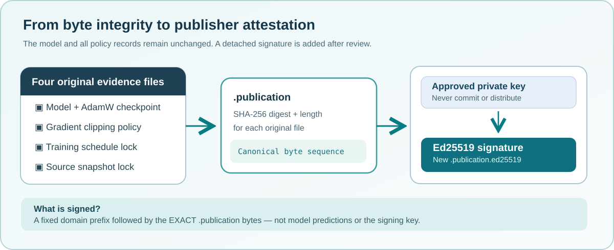

# Lesson 43 — Sign a Native Training Publication with Ed25519

A SHA-256 checksum answers **whether bytes match** an expected digest. It does
not tell us who published that digest. In this lesson we strengthen our native
Umicom training evidence with a digital signature tied to an independently
reviewed public key.



## Learning objectives

By the end of this lesson you should be able to distinguish a checksum from a
digital signature, identify the six files of an attested training publication,
explain why the **private key must not be committed**, and enable an optional
C23 signing service without changing the existing LLM trainer.

## From five files to six

Lessons 41 and 42 introduced four related training files and their final
`.publication` integrity record. The four files contain a combined model/AdamW
checkpoint and the associated clipping, training-plan and source-data locks.
The publication marker records their SHA-256 identities.

The new sixth file is:

```text
reviewed-model.umi
reviewed-model.umi.clip-policy
reviewed-model.umi.training-lock
reviewed-model.umi.source-lock
reviewed-model.umi.publication
reviewed-model.umi.publication.ed25519
```

The `.publication.ed25519` file contains an Ed25519 signature over the original
publication record. It does **not** contain the private key, a copy of the
model weights, or an instruction to run training.

## What changes when we add a signature?

Imagine that a saved publication marker contains a digest of the source-lock
file. An accidental change in that file is detectable because its bytes no
longer match the digest. But an attacker who replaces *all* the files can
calculate fresh unsigned digests.

With Ed25519, the publisher signs the **exact publication record bytes** with a
private signing key. The recipient checks the signature using the corresponding
public key, obtained from an independently trusted source. Producing a matching
signature without the private key should be computationally infeasible when
the algorithm and key management are sound.

A signature is not proof that an LLM generated correct code, that training
used authorised source data, or that the publisher's computer was secure.
Those questions require independent evidence.

## A small native C23 interface

Umicom Framework owns the implementation. An application requests signing by
calling its public function:

```c
#include "umicom/ai/training/training_attestation.h"

UmiStatus result = UmiAiTrainingAttestationSignNewFile(
    reviewedCheckpointPath,
    reviewedPrivateKeyPemPath);

if (result != UMI_STATUS_OK) {
    /* Signing is refused if evidence is invalid or the output exists. */
    return 1;
}
```

The Framework first verifies the existing `.publication` marker and all four
files it identifies. It then signs the domain-separated publication bytes
using OpenSSL's Ed25519 primitive and writes a new signature file using an
exclusive staging-and-publication sequence. Existing records are not
replaced; callers choose a new publication when necessary.

No independent cryptographic mathematics is implemented in the lesson or in
the Umicom LLM application.

## Opt-in build

The ordinary C23 training build has no new OpenSSL dependency. To build the
optional signing tool, enable the following CMake option **only in a reviewed
development environment that provides OpenSSL 3**:

```powershell
Set-Location 'C:\umicom\Umicom-Applications'
$env:Path = 'C:\msys64\ucrt64\bin;' + $env:Path
cmake -S .\framework\learning\native-llm `
  -B .\build\windows-ucrt64-native-llm-debug -G Ninja `
  -DCMAKE_BUILD_TYPE=Debug -DBUILD_TESTING=ON `
  -DUMICOM_AI_TRAINING_ENABLE_SIGNATURES=ON
cmake --build .\build\windows-ucrt64-native-llm-debug `
  --target umicom-native-llm-publication-attest --parallel 2
```

The *native* executable accepts `sign` and `verify` actions. Provision a
properly protected signing key outside the repository, then explicitly sign a
reviewed and already published checkpoint:

```powershell
$tool = '.\build\windows-ucrt64-native-llm-debug\umicom-native-llm-publication-attest.exe'
& $tool sign 'C:\umicom\_local\models\reviewed-model.umi' `
  'C:\umicom\_private\signing\publisher-ed25519.pem'
```

The example key path is illustrative. Never publish the actual private key or
run an unreviewed signing executable. A previously quarantined program must
be investigated rather than simply signed to suppress a warning.

## Why sign the publication record rather than each file separately?

The existing `.publication` file already binds the checkpoint and the three
policy companions through a canonical ordered set of hashes and byte counts.
Signing those **exact record bytes** lets a verifier check one signature and
then reuse the existing Framework integrity checks for the four files.

A fixed protocol prefix is added to the signed message to distinguish this
purpose from other possible Ed25519 signing workflows. This is called
*domain separation*. A raw signature has 64 bytes and is represented as 128
lowercase hexadecimal characters in the educational detached record.

## Exercises

1. Explain which file changes if you edit a training plan after checkpoint
   publication. Which earlier integrity checks should then fail?
2. Sketch a diagram showing the difference between private-key signing and
   public-key verification. Which key may be shared with contributors?
3. Why should the signing service refuse to overwrite a file called
   `reviewed-model.umi.publication.ed25519`?
4. Describe one way an attacker could defeat a signature system **without**
   breaking Ed25519 itself.

## Check your understanding

**Question:** If a file's SHA-256 digest matches, does that identify the
person who published it?  
**Answer:** No. A checksum establishes byte consistency. Publisher identity
requires an authenticated key-management process and a valid signature.

**Question:** Does a successful signature prove that the model has learnt to
write correct C23?  
**Answer:** No. It binds an approved signing key to published file identities;
model quality and test results must be assessed separately.
