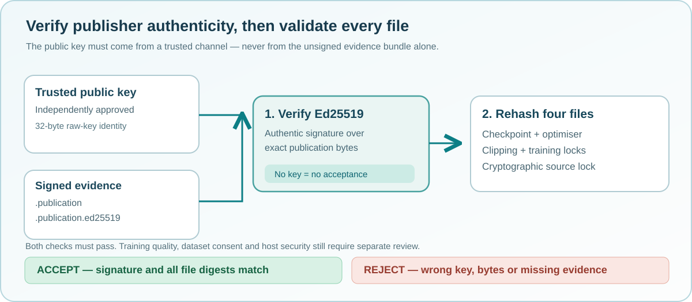

# Lesson 44 — Verify an Ed25519 Publisher Signature and Reject Tampering

Signing is useful only when recipients verify the signature **against a public
key they trust for an independent reason**. In this lesson we build the
verification procedure around the existing native checkpoint integrity checks,
and distinguish cryptographic verification from authorisation.



## Learning objectives

You will learn how to select a trusted public key, verify an Ed25519 signature,
interpret the key fingerprint and reject tampered evidence without loading or
running the model.

## Three separate checks

A reliable verifier must answer three different questions:

| Question | Check | What a passing result establishes |
| --- | --- | --- |
| Is this the publisher key we intended to trust? | Independently approved public-key file | We are using the selected trust anchor, not one supplied by an attacker |
| Did that key sign the publication record? | Ed25519 signature verification | The exact `.publication` bytes match a signature for the selected public key |
| Do the published checkpoint and policy files still match the record? | SHA-256 publication verification | The four underlying files match the signed record's byte identities |

The signature file also includes the SHA-256 fingerprint of the raw 32-byte
Ed25519 public key. This is useful for recognising a key, but it is **not**
authoritative by itself: anyone can write their preferred fingerprint in a
text file. The verifier must receive its trusted public key from a separate,
authenticated channel.

## Verify with the native executable

After obtaining and approving the public key, use:

```powershell
Set-Location 'C:\umicom\Umicom-Applications'
$tool = '.\build\windows-ucrt64-native-llm-debug\umicom-native-llm-publication-attest.exe'
$checkpoint = 'C:\umicom\_local\models\reviewed-model.umi'
$trustedKey = 'C:\umicom\_local\trusted-publishers\publisher-ed25519.pub.pem'
& $tool verify $checkpoint $trustedKey
```

The command checks all six published files. It does not create a training
process, decode the model or open a network connection. A non-zero exit code
means the published evidence was not successfully verified. The program
reports a status code but does not reveal source content or private keys.

The same operation is available to Framework applications through C23:

```c
#include "umicom/ai/training/training_attestation.h"

UmiStatus status = UmiAiTrainingAttestationVerifyFile(
    reviewedCheckpointPath,
    independentlyApprovedPublicKeyPemPath);
if (status != UMI_STATUS_OK) {
    /* Do not accept a changed or untrusted publication. */
    return 1;
}
```

Applications may call the `VerifyAndInspectFile` variant to receive copied
checkpoint/policy hashes and byte lengths **only when verification succeeds**.
Failure leaves the caller's output unchanged.

## What happens when something is altered?

A good verification test changes one element of a disposable evidence bundle
at a time:

- Change one hexadecimal digit in the signature. The Ed25519 check fails.
- Substitute a different public key. The trusted-key fingerprint and/or
  signature verification fails.
- Change one byte of the `.publication` marker. It is no longer the exact
  message that was signed.
- Change one byte of the `.source-lock`. The original signature may still
  match its publication marker, but the Framework's file-integrity check
  must reject the changed companion.
- Remove the public key or signature file. Verification fails rather than
  silently using an unsigned fallback.

The canonical signature record uses lowercase hexadecimal characters and
exactly 254 ASCII bytes. Extra lines, CRLF line endings, truncated signatures
and unexpected algorithm names are rejected, rather than interpreted loosely.

## Why do we need both signature and source verification?

A correctly signed publication can still describe a model trained on data
that the publisher had no right to use. The cryptographic signature cannot
establish consent or licensing. The source-lock records a dataset identity;
reviewers must separately decide which dataset and training policy are
approved. Likewise, Ed25519 does not measure whether generated source code
compiles, passes tests or avoids vulnerabilities.

A signature also says nothing about *when* the training run occurred unless
an independent trusted timestamp is provided. Signing-key revocation, secure
hardware-backed key storage and public transparency logs are sensible later
improvements, but they are not implemented by this optional teaching service.

## Run the regression checks

The optional service includes two C23 tests. They generate disposable Ed25519
keys in the test process and create local sample publication files, rather
than signing a real LLM checkpoint:

```powershell
ctest --test-dir .\build\windows-ucrt64-native-llm-debug `
  -R '^framework\.ai\.training\.attestation_' `
  --output-on-failure --no-tests=error
```

One test proves that sign→verify succeeds with the intended public key and
refuses to replace an existing signature. The other tests missing evidence,
incorrect keys, changed signatures and changed published files. These focused
tests complement, but do not replace, the complete Framework and Windows
integration suites.

## Exercises

1. Suppose two identical published bundles live under different folders.
   Why should their byte-based signature verification succeed in both places?
2. If a signature validates but a `.training-lock` file has changed, should
   the verifier accept the bundle? Explain which check rejects it.
3. Describe how a training lab can distribute its approved public key to new
   contributors **without relying on the signature file itself**.
4. Identify two additional controls required before using a signed model in
   a financial or safety-sensitive application.

## Check your understanding

**Question:** Can a person replace the entire publication bundle and include
their own public key to make it trustworthy?  
**Answer:** No. The verifier requires a public key that the recipient has
approved independently. A new self-declared key provides no authentication.

**Question:** Does the new verifier bypass an earlier antivirus quarantine?  
**Answer:** No. Signature verification and endpoint security are different
controls. An alert requires independent investigation before a binary is
trusted or executed.
