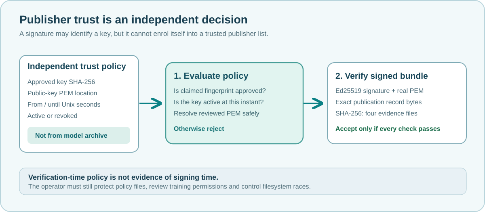

# Lesson 45 — Build an Offline Publisher Trust Policy

An Ed25519 signature proves that a particular private key signed a message.
It does **not** establish whether the signer is authorised to publish an LLM
checkpoint. In this lesson, we make that second decision explicit and
independent of the signed files.



## Learning objectives

By the end, you should be able to explain the difference between a signature
and a trust decision, prepare the structure of an offline publisher policy,
interpret its validity interval and understand why a policy cannot safely be
obtained from the model it is meant to verify.

## The signed checkpoint is not the authority

Consider a training publication containing:

```text
reviewed-model.umi
reviewed-model.umi.clip-policy
reviewed-model.umi.training-lock
reviewed-model.umi.source-lock
reviewed-model.umi.publication
reviewed-model.umi.publication.ed25519
```

The final `.ed25519` record identifies the public key and carries a signature.
If a recipient accepts the key merely because the signature record mentions
it, anyone could produce a different key pair, sign replacement files and
claim that the new key is trustworthy. The verifier therefore requires a
**separately approved policy** that lists which public keys are allowed.

## Express the policy in a small, reviewable format

The Framework's optional native C23 parser recognises this structure:

```text
UMICOM-AI-TRUST-1
# A deliberately nonworking placeholder; replace it after independently checking a real public key.
key=0000000000000000000000000000000000000000000000000000000000000000,keys/publisher.pem,0,4102444800,active
```

The five comma-separated fields have distinct meanings:

| Field | Meaning |
| --- | --- |
| 64-character fingerprint | SHA-256 of the **raw 32-byte Ed25519 public key**, rather than the PEM file text |
| Public-key path | A PEM file relative to the reviewed policy's directory |
| `from` | The first accepted UTC Unix second |
| `until` | The first **rejected** UTC Unix second |
| State | `active` or `revoked` |

The long string of zeros in this teaching example is not a real signing
identity. A real fingerprint must be obtained from a trusted key-distribution
process and checked by the operator. Never copy a fingerprint from an
untrusted model bundle to declare that key trusted.

When the optional native verifier is built, it can derive the **raw Ed25519
public-key fingerprint** from a separately reviewed PEM file:

```powershell
$tool = '.\build\windows-ucrt64-native-llm-debug\umicom-native-llm-publication-trust.exe'
& $tool --fingerprint 'C:\umicom\approved-keys\keys\author.pem'
```

This prints an identifier for review; it does **not** automatically make the
key trusted. Hashing the textual PEM file with `Get-FileHash` is not
interchangeable with hashing the 32 raw key bytes.

### Work through a time interval

Suppose an approved key has:

```text
from  = 1760000000
until = 1890000000
state = active
```

The policy authorises verification at second `1760000000` and every later
second strictly less than `1890000000`. It rejects verification at exactly
`1890000000`. A revoked key fails at every instant, including instants
that were previously inside its validity window.

**Important:** this is *verification-time* policy. It does not mean that the
signature was made during the interval. Establishing a trustworthy signing
time requires a separate, independently verifiable timestamp mechanism.

## Use the native Framework service

A consumer can verify a checkpoint with a policy selected by the operator:

```c
#include "umicom/ai/training/training_trust_policy.h"

/* Both paths are chosen by the trusted caller, independently of the model. */
UmiAiTrainingTrustDecision decision;
UmiStatus status = UmiAiTrainingAttestationVerifyWithTrustPolicy(
    reviewedCheckpointPath,
    approvedPublisherPolicyPath,
    verificationUnixSeconds,
    &decision);

if (status != UMI_STATUS_OK) {
    /* A missing key, expired interval, revoked key or invalid signature
     * must never be treated as a successful verification. */
    return 1;
}
```

The Framework reads only a bounded policy file and signature record. It
selects a candidate from its reviewed keys, checks its current policy state
and then calls the **existing** Ed25519 signature and SHA-256 publication
verifiers. The result includes the verified key fingerprint and the four
checkpoint-file identities. On failure, the result is not modified.

## Understand the path boundary

Relative public-key names such as `keys/publisher.pem` are resolved relative
to the policy file, not the terminal's current folder. The parser rejects
absolute paths, `..` traversal, empty path components and nonportable
characters. These lexical checks are **not** a filesystem sandbox: an
attacker who can change symlinks or key files could still undermine an
unprotected trust directory.

The operator must protect the policy and public keys, independently review
updates and ensure that the selected path is not controlled by the checkpoint
publisher.

## Test the policy independently

After opting into OpenSSL-backed signature support, run the dedicated
regressions:

```powershell
ctest --test-dir .\build\windows-ucrt64-native-llm-debug `
  -R '^framework\.ai\.training\.trust_policy_' `
  --output-on-failure --no-tests=error
```

These tests exercise strict syntax, failure-atomic parsing, validity windows,
trusted-key verification and the rejection of changed checkpoint evidence.
They do not substitute for a complete Windows application build.

## Exercises

1. Explain why a valid Ed25519 signature is insufficient when its public key
   comes from the same untrusted archive.
2. What is the difference between the valid-from boundary and the
   valid-until boundary?
3. Why do we hash raw public-key bytes instead of a PEM file's text layout?
4. A policy says `active` but the public-key PEM file contains another key.
   Which additional check prevents acceptance?
5. What is the consequence of storing the policy inside a directory that the
   checkpoint publisher can modify?

## Check your understanding

**Question:** Can a caller pass a historical Unix timestamp and thereby prove
that an Ed25519 signature existed at that earlier date?  
**Answer:** No. The supplied timestamp selects a policy state to evaluate; it
is not independent evidence of when the signature was created.
