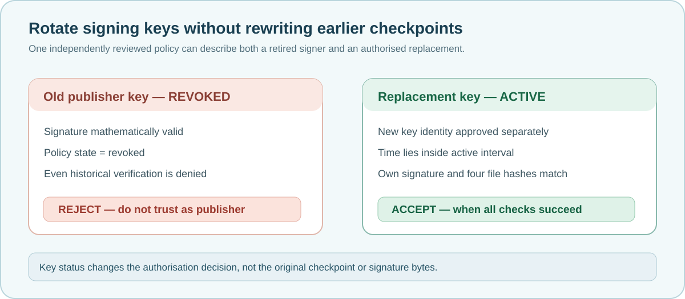

# Lesson 46 — Rotate and Revoke Training Signing Keys

A trustworthy training-evidence system needs a way to retire an old signer
without deleting historical checkpoints or silently pretending that its
signatures remain approved. In this lesson, we apply **key rotation** and
**key revocation** to the same native Ed25519 publication format.



## Learning objectives

You will be able to describe a controlled signing-key transition, distinguish
expiry from revocation, explain how an old checkpoint is treated after a
revocation and test the refusal to accept changed evidence.

## Why signing keys change

An organisation may replace a publisher key when its custodian changes, its
storage is no longer trusted, its agreed usage period ends or there is a
suspected compromise. A compromised key presents a special risk: signatures
made with it can no longer be accepted merely because their mathematics
verify correctly.

The Framework's offline trust policy allows several public keys to be listed,
with each key independently marked `active` or `revoked`. The policy file is
selected and protected by the verifying organisation, not by the publisher.

## Two different decisions

**Expiry** means the requested verification time falls outside an approved
interval. A key with `active` status can still be rejected because its
`until` boundary has been reached.

**Revocation** is a separate explicit decision. A `revoked` key is always
rejected, even if its signature and checkpoint data are unchanged and the
requested verification instant predates its retirement. This makes the
offline policy deliberately conservative.

| Publisher record | Time inside window | Policy outcome |
| --- | --- | --- |
| Old key, `active` | Yes | Proceed to Ed25519 and file-integrity checks |
| Old key, `active` | No | Reject |
| Old key, `revoked` | Yes or no | Reject |
| Replacement key, `active` | Yes | Proceed to Ed25519 and file-integrity checks |

Approval is never inferred from simply listing an unknown public key: the
operator must independently confirm each fingerprint and public-key file.

## A controlled transition

A reviewed policy might contain two `key=` lines. The following identifiers
are **illustrative placeholders only**; neither line authorises a real key.

```text
UMICOM-AI-TRUST-1
key=1111111111111111111111111111111111111111111111111111111111111111,keys/old.pem,0,1900000000,revoked
key=2222222222222222222222222222222222222222222222222222222222,keys/new.pem,1800000000,2100000000,active
```

The old key remains in the policy to communicate that it is intentionally
**not trusted**. The replacement key is independently reviewed, and can
verify only those publications whose Ed25519 signatures genuinely match it.
Changing the PEM pathname or its fingerprint never transforms an old
signature into a new signature.

### Do not rewrite historical checkpoint evidence

The existing Umicom publication services write a **new, no-clobber**
`.publication` marker and a **new, no-clobber** `.publication.ed25519`
signature. Key rotation does not silently replace either file. If a signed
checkpoint is no longer trusted, retain it for controlled forensic review or
remove it from approved distribution. Create a separately reviewed new
publication when a new publisher must approve a model.

## Try the independent verifier

With the optional Ed25519 build enabled, the read-only executable uses an
approved policy and a checkpoint path:

```powershell
Set-Location 'C:\umicom\Umicom-Applications'
$tool = '.\build\windows-ucrt64-native-llm-debug\umicom-native-llm-publication-trust.exe'
$checkpoint = 'C:\umicom\reviewed-models\reviewed-model.umi'
$approvedPolicy = 'C:\umicom\approved-keys\publishers.trust'
& $tool $checkpoint $approvedPolicy
```

By default, the program uses the local machine's UTC Unix clock. A fourth
argument can supply an explicit Unix second for repeatable audit work. That
argument does **not** authenticate the computer clock or the original signing
time. The verifier makes no network connections, does not run inference and
never launches code from the dataset.

## What the regressions prove

The native C23 test suite uses disposable Ed25519 keys and small local
publication fixtures. It checks that:

- The correct active key and valid interval allow verification.
- The exact `until` second is excluded.
- A revoked key is denied even for an otherwise valid older publication.
- Another trusted key in the same policy cannot validate the old key's
  signature, while a properly signed replacement publication can succeed.
- A changed `.source-lock` still invalidates a correctly signed publication.
- A failed verification leaves caller-owned result fields unchanged.

These checks must also pass in the complete Framework and Windows build. They
are only one layer of model provenance review.

## What still needs governance

Offline allowlists cannot broadcast revocations to computers that never
receive an updated policy. Administrators must distribute reviewed policy
changes through a trusted channel and control who can replace policy or PEM
files. This educational interface does not provide a certificate authority,
secure hardware, a trusted timestamp, a transparency log or automatic online
revocation checking.

A signed model must still be assessed for training-data authorisation,
fitness for purpose, generated-code safety and security of the host on which
it is used. Signing does not resolve antivirus quarantine findings.

## Exercises

1. A key expires at Unix second `2000000000`. Is a verification performed at
   that exact second accepted? Explain the boundary.
2. Why is it useful to keep an explicitly revoked key entry rather than
   simply assuming every key not mentioned is approved?
3. A new authorised key was added to a policy. Can it validate a previous
   signature generated with a different private key?
4. If an offline reviewer has not received a revocation update, what is the
   operational risk?
5. Compare the roles of a cryptographic signature, an operator-controlled
   trust policy and a future trusted timestamp.

## Check your understanding

**Question:** Does setting a key to `revoked` delete its previous training
checkpoints?  
**Answer:** No. It changes the verifier's authorisation decision; it does not
modify model weights, optimiser state, historical signatures or other files.
