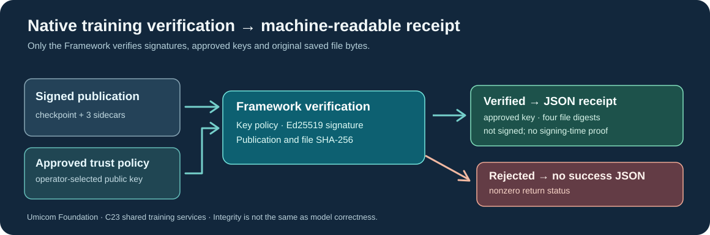

# Lesson 47 — Read a Machine-Readable Training Verification Receipt

**Umicom Foundation · Bits to Banking · Build Your Own LLM from Scratch**  
**Prerequisites:** Lessons 41–46 (publication integrity, Ed25519 signing and offline publisher trust).  
**Language:** ISO C23. The executable and verifier use native Framework services; no runtime scripting interpreter is required.

## Learning objectives

By the end of this lesson you should be able to explain the difference between a *signed publication* and a *verification receipt*, use an independently controlled trust policy to request a receipt, identify the four SHA-256 file identities within it, and recognise why a JSON report does not constitute new cryptographic evidence.

## 1. Why we need a machine-readable result

Earlier lessons established a chain of evidence: the model checkpoint contains model and AdamW optimiser state, three companion records document the training policy and source identity, and a `.publication` record identifies their exact bytes. A detached `.publication.ed25519` signature authenticates the publication record against a public key selected through an independently reviewed trust policy.

A person can read a terminal message saying that verification passed. An automated build, IDE or research notebook needs a stable data format instead of searching human-readable text for the word “verified”. **This is the purpose of a machine-readable verification receipt.**



A receipt is generated only *after* Umicom Framework has successfully checked the approved publisher, the Ed25519 signature and the four file digests. An invalid bundle produces an error, not a JSON object falsely claiming success.

## 2. Request the receipt from a native executable

After building the optional Ed25519 training components, open **PowerShell** and run the existing trust verifier with its additional `--receipt-json` option:

```powershell
Set-Location 'C:\umicom\Umicom-Applications'

$exe = '.\build\windows-ucrt64-native-llm-debug\umicom-native-llm-publication-trust.exe'
$checkpoint = 'C:\umicom\trusted-models\approved-model.umi'
$policy = 'C:\umicom\trusted-keys\publishers.trust'
$verificationSeconds = [DateTimeOffset]::UtcNow.ToUnixTimeSeconds()

& $exe $checkpoint $policy $verificationSeconds --receipt-json
if ($LASTEXITCODE -ne 0) { throw 'The signed training publication was not verified.' }
```

These example paths must point to files you have already independently reviewed. Use the current UTC Unix time for a *current* policy decision. A caller may deliberately supply another time for a historical comparison, but that **does not prove when the signature was created**.

The command prints one JSON object and a final newline on standard output only when verification succeeds. Errors are written to standard error and return a nonzero exit code. This distinction matters when using an automated release gate.

## 3. Understand the fields

A successful receipt uses the following structure. The digest strings shown below are **schematic placeholders**, not genuine hashes of a particular checkpoint:

```json
{
  "schema": "umicom.ai.training.trust-receipt",
  "result": "verified",
  "evaluated_at_unix_seconds": 1792713600,
  "publisher_key_sha256": "<SHA-256 of approved raw Ed25519 public key>",
  "files": {
    "checkpoint": {"bytes": 12345, "sha256": "<checkpoint SHA-256>"},
    "clip_policy": {"bytes": 120, "sha256": "<clip-policy SHA-256>"},
    "training_lock": {"bytes": 170, "sha256": "<training-lock SHA-256>"},
    "source_lock": {"bytes": 120, "sha256": "<source-lock SHA-256>"}
  },
  "checks": {
    "ed25519_signature": true,
    "approved_publisher_at_evaluation_time": true,
    "publication_file_integrity": true,
    "trusted_signing_timestamp": false,
    "host_integrity_attested": false,
    "dataset_rights_reviewed": false
  }
}
```

The actual Framework output contains the complete **64-character lowercase hexadecimal** digests. It serialises a fixed set of fields rather than embedding checkpoint paths, private keys or arbitrary policy text. The three `false` fields are deliberate: successful verification is not evidence of a trustworthy signing time, safe execution host or permission to use the dataset.

## 4. The C23 service underneath the command

The command calls `UmiAiTrainingTrustReceiptVerifyJson` from the shared Framework. The following code shows how a native application can obtain the same verified result without implementing its own signature parser:

```c
#include "umicom/ai/training/training_trust_receipt.h"
#include <stdio.h>

int PrintVerifiedReceipt(const char *checkpoint, const char *policy,
                         uint64_t evaluationTime)
{
    char receipt[UMI_AI_TRAINING_TRUST_RECEIPT_JSON_CAPACITY];
    size_t written = 0U;
    const UmiStatus status = UmiAiTrainingTrustReceiptVerifyJson(
        checkpoint, policy, evaluationTime,
        receipt, sizeof(receipt), &written);
    if (status != UMI_STATUS_OK) {
        /* Do not publish a success report when verification was rejected. */
        return 1;
    }
    return fwrite(receipt, 1U, written, stdout) == written ? 0 : 1;
}
```

This function does not store the receipt on disk or perform training. The caller owns the buffer, which is modified **only on success**. No new model mathematics, signing implementation or JSON parser was added to Umicom LLM applications: the Framework is the reusable authority.

## 5. What does failure-atomic mean?

Suppose an application has already stored an earlier report. It passes an output buffer to the verifier, but the new checkpoint fails an integrity check. **Failure-atomic output** means the verifier leaves that buffer and its recorded length completely unchanged.

This prevents a half-written success object from being mistaken for a new verification result. It does *not* stop an application from mistakenly reusing an old receipt: callers should clear or replace their own status explicitly when starting a new verification request.

## 6. Test the evidence chain

The Framework's focused tests use disposable signing keys and tiny synthetic companion files. `trust_receipt_roundtrip` checks that a valid publication produces deterministic JSON with the expected digests, while `trust_receipt_rejections` checks that revoked keys, wrong public keys, invalid time windows and changed file contents produce no success output.

Because these tests use synthetic training evidence, passing them demonstrates the **verification pipeline**, not language-model accuracy or the security of real training data.

## 7. Exercises

1. Identify which JSON field tells you that the signer was on the operator's allowlist at the evaluation time.
2. Explain why `trusted_signing_timestamp` is `false` even after a valid Ed25519 signature.
3. Change a disposable `.source-lock` file after a signed publication is created. What should the verifier do?
4. Write a short C23 function that rejects a receipt verification result when the Framework returns anything other than `UMI_STATUS_OK`.
5. Describe one reason an untrusted website's copy of a receipt should not be accepted as independent proof.

### Check your understanding

The publisher policy is evaluated at the caller-supplied UTC second; a signing-time claim would require independent timestamp evidence. Changing a signed publication's source-lock bytes must cause a verification failure. Finally, **the receipt itself is unsigned and editable**: preserve and independently reverify the original signed files and trust policy before making decisions.

**Next:** Lesson 48 shows how to turn these checks into a fail-closed native release-validation process.
