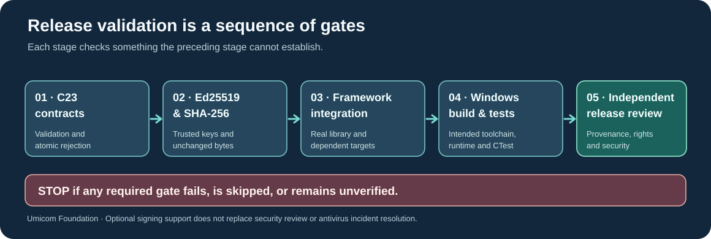

# Lesson 48 — Test Native LLM Verification Before a Release

**Umicom Foundation · Bits to Banking · Build Your Own LLM from Scratch**  
**Prerequisites:** Lessons 41–47, including strict checkpoint publication, Ed25519 signatures, trust-policy verification and JSON receipts.  
**Environment:** ISO C23; CMake, CTest and a C23 compiler. Windows examples use PowerShell and the MSYS2 UCRT64 development toolchain.

## Learning objectives

This lesson shows how to distinguish a successful component test from a complete product validation, build optional cryptographic functionality separately from the default Framework, and refuse release publication whenever important checks fail or remain unverified.

## 1. A verification chain is only as strong as its weakest check

A program that verifies an Ed25519 signature correctly may still load the wrong dataset, run against a different checkpoint or fail to start on Windows. Different tests answer different questions.



- **Contract tests:** Does the parser reject invalid inputs without modifying output?
- **Cryptographic tests:** Does the verifier accept a correctly signed record and reject wrong keys and tampering?
- **Integration tests:** Do all real Framework modules link and work together?
- **Platform tests:** Can the intended Windows executable build and launch on a clean development machine?
- **Release review:** Are source permissions, malware findings, key management and external dependencies independently approved?

All gates matter. A compiler's success code is not a safety certification, and **unit test results from an isolated harness cannot stand in for the complete Framework test suite**.

## 2. Configure the native training laboratory on Windows

Use the matching UCRT64 GCC compiler, Ninja, CMake and OpenSSL 3 development libraries. Mixing incompatible MSVC and MinGW/UCRT64 binary libraries can cause link failures.

```powershell
Set-Location 'C:\umicom\Umicom-Applications'
$env:Path = 'C:\msys64\ucrt64\bin;' + $env:Path

cmake --version
gcc --version
ninja --version
pkg-config --modversion openssl

cmake -S .\framework\learning\native-llm `
  -B .\build\windows-ucrt64-native-llm-debug -G Ninja `
  -DCMAKE_BUILD_TYPE=Debug -DBUILD_TESTING=ON `
  -DUMICOM_AI_TRAINING_ENABLE_SIGNATURES=ON
```

The `UMICOM_AI_TRAINING_ENABLE_SIGNATURES` option is **opt-in**. With it disabled, the base C23 training library remains usable without the additional OpenSSL signing dependency.

## 3. Compile and run the relevant CTest group

```powershell
cmake --build .\build\windows-ucrt64-native-llm-debug --parallel 2

ctest --test-dir .\build\windows-ucrt64-native-llm-debug `
  -R 'framework\.ai\.training\.(attestation_|trust_policy_|trust_receipt_)' `
  --output-on-failure --no-tests=error
```

Notice that `--no-tests=error` is important: a filter that accidentally matches **zero** tests must be treated as a failure rather than an apparent success.

For a complete run, remove the `-R` filter:

```powershell
ctest --test-dir .\build\windows-ucrt64-native-llm-debug `
  --output-on-failure --no-tests=error
```

If local antivirus software quarantines an executable, **do not disable security protections** to obtain a green test count. Treat the run as incomplete, preserve the detection details, and have the detection reviewed before approving the release.

## 4. Release and sanitiser builds answer different questions

A Debug build is useful for diagnostics. A Release build checks optimised compilation, while AddressSanitizer and UndefinedBehaviorSanitizer help detect certain memory and undefined-behaviour defects during execution. None of these checks prove that a model is safe to deploy.

On a suitable Linux development environment, the following separate build directory enables additional runtime diagnostics:

```text
cmake -S framework/learning/native-llm -B build/llm-clang-asan -G Ninja \
  -DCMAKE_C_COMPILER=clang -DCMAKE_BUILD_TYPE=Debug \
  -DCMAKE_C_FLAGS='-fsanitize=address,undefined -fno-omit-frame-pointer -g' \
  -DCMAKE_EXE_LINKER_FLAGS='-fsanitize=address,undefined' \
  -DBUILD_TESTING=ON -DUMICOM_AI_TRAINING_ENABLE_SIGNATURES=ON

cmake --build build/llm-clang-asan --parallel 2
ctest --test-dir build/llm-clang-asan --output-on-failure --no-tests=error
```

You may also enable strict warnings such as `-Wall`, `-Wextra`, `-Wpedantic`, `-Wconversion`, `-Wshadow` and `-Werror` where supported by the compiler. Address sanitiser support varies by target toolchain.

## 5. Why we test rejection as well as success

A trustworthy validator must handle not only an approved publication but also inputs that an attacker, a damaged disk or a mistaken build might provide. Good regression fixtures cover a revoked signing key, wrong public key, an expired policy window, a missing companion file, one modified byte and an insufficient output buffer.

The expected rule is simple: **a rejected verification must not emit a success receipt**. The CLI communicates failure through a nonzero process exit code. Its JSON mode emits nothing on standard output before verification completes.

## 6. Prepare a release evidence checklist

Before calling an actual product build *verified*, record the Git revision, compiler and OpenSSL versions, the selected CMake options, the number of tests executed, their failures and the exact binary tested. Ensure the signed publication's publisher key came from your separately controlled policy rather than from a file supplied by an untrusted checkpoint distributor.

A completed release review should also record unresolved items explicitly. For example, “seven isolated signing tests passed; complete Windows product build not run” is accurate. “All tests passed” would be misleading in the same situation.

## 7. Exercises

1. Explain the difference between `cmake --build` succeeding and `ctest` succeeding.
2. Why does an isolated Ed25519 test not prove the whole Umicom Studio IDE launches on Windows?
3. Why must your build toolchain and the OpenSSL library use compatible Windows ABIs?
4. Which command option prevents an empty CTest selection being treated as success?
5. Why should a rejected signing key or incomplete checkpoint publication block release even when a previous verification receipt exists?

### Check your understanding

The compiler checks source translation and linking. CTest executes selected tests. A complete platform release also requires integration, runtime, dependency and security review. `--no-tests=error` makes zero-test selections visible. An older receipt is not permission to skip fresh verification of the original signed evidence.

**Conclusion:** Reliable native LLM engineering requires reproducible experiments, exact evidence identities, independently approved publisher keys and truthful release-validation records—not merely a plausible model output or a green result from one test category.
