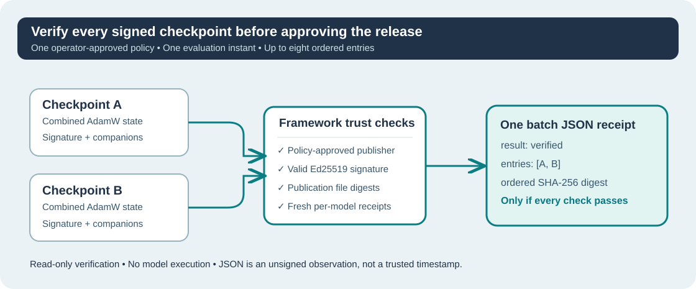

# Lesson 49 — Verify an Ordered Group of Signed Training Checkpoints

**Umicom Foundation · Bits to Banking · Build Your Own LLM from Scratch**  
**Prerequisites:** Lessons 41–48 on training publications, Ed25519 signatures, offline trust policies and single-publication JSON receipts.  
**Environment:** ISO C23, CMake, CTest and a C23 toolchain. The optional cryptographic build requires compatible OpenSSL 3 libraries.

## Learning objectives

By completing this lesson you should be able to explain why verifying several models requires more than accepting an old receipt, run a native all-or-nothing verification check, and interpret an ordered SHA-256 batch identifier.

## 1. Why verify more than one checkpoint?

An engineering team may publish a **baseline model**, a **candidate model** and a **reproducibility run**. Each has its own combined AdamW checkpoint and associated published evidence. Verifying one model does not establish that the other models are genuine or complete.



The Framework's `UmiAiTrainingTrustReceiptVerifyJson` verifies one signed publication. The new `UmiAiTrainingTrustBatchVerifyJson` composes that *existing authority* over one to eight explicitly selected checkpoints. It does **not** implement another Ed25519 algorithm, copy model code or independently invent a successful receipt.

Each checkpoint is checked against the same **independently reviewed offline publisher policy** at the same **caller-supplied Unix evaluation second**. Different approved publishers may sign different models, provided every signer is valid and permitted under that policy.

## 2. Build the optional native verifier

In Windows PowerShell, using a compatible UCRT64 installation:

```powershell
Set-Location 'C:\umicom\Umicom-Applications'
$env:Path = 'C:\msys64\ucrt64\bin;' + $env:Path

cmake -S .\framework\learning\native-llm `
  -B .\build\windows-ucrt64-native-llm-debug -G Ninja `
  -DCMAKE_BUILD_TYPE=Debug -DBUILD_TESTING=ON `
  -DUMICOM_AI_TRAINING_ENABLE_SIGNATURES=ON

cmake --build .\build\windows-ucrt64-native-llm-debug --parallel 2
```

Optional cryptography remains disabled in the standard build unless explicitly enabled. This lesson does not involve a remote signing service or ask you to restore quarantined executables.

## 3. Run a complete verification batch

The following is an example for **two previously reviewed, published and signed** model checkpoints; substitute your own approved paths. The files in this example are not supplied by the course.

```powershell
$exe = '.\build\windows-ucrt64-native-llm-debug\umicom-native-llm-trust-batch.exe'
$policy = 'C:\umicom\trusted-publishers\publishers.trust'
$utcSeconds = [DateTimeOffset]::UtcNow.ToUnixTimeSeconds()

& $exe $policy $utcSeconds `
  'C:\umicom\trusted-models\baseline.umi' `
  'C:\umicom\trusted-models\candidate.umi'

if ($LASTEXITCODE -ne 0) {
    throw 'The training batch failed publisher and file verification.'
}
```

An untrusted checkpoint cannot nominate a new trusted signer. The policy must be chosen by the operator independently, and its key files must be protected from replacement.

## 4. Understand the result

A successful command emits one compact JSON object containing a result of `verified`, the evaluation second, the number of accepted publications, one aggregate `batch_sha256`, and an `entries` array. Each entry contains the complete established single-publication trust receipt and its own `receipt_sha256`.

The following **simplified structure** uses placeholders rather than real digests:

```json
{
  "schema": "umicom.ai.training.trust-batch",
  "result": "verified",
  "evaluated_at_unix_seconds": 150,
  "publication_count": 2,
  "batch_sha256": "<64 lowercase hexadecimal characters>",
  "entries": [
    { "index": 0, "receipt_sha256": "<digest>", "receipt": { "result": "verified" } },
    { "index": 1, "receipt_sha256": "<digest>", "receipt": { "result": "verified" } }
  ]
}
```

The actual `receipt` objects include the verified publisher-key SHA-256 and the checkpoint, clipping-policy, training-lock and source-lock identities. Local paths and private key material are not included in the JSON. The actual output also contains explicit false indicators for unsupported trust claims.

## 5. Reuse the Framework API in a native application

The complete public API is declared in `umicom/ai/training/training_trust_batch.h`:

```c
#include "umicom/ai/training/training_trust_batch.h"

const char *models[] = {
    "C:/umicom/trusted-models/baseline.umi",
    "C:/umicom/trusted-models/candidate.umi"
};
char evidence[UMI_AI_TRAINING_TRUST_BATCH_JSON_CAPACITY];
size_t written = 0U;

UmiStatus status = UmiAiTrainingTrustBatchVerifyJson(
    models, 2U,
    "C:/umicom/trusted-publishers/publishers.trust",
    UINT64_C(150), evidence, sizeof(evidence), &written);

/* Use evidence[0..written) only when status == UMI_STATUS_OK. */
```

The public function never writes a partial JSON document to its output buffer. After a failure, the caller's previous `evidence` bytes and `written` value remain unchanged, so the caller must check the status instead of reusing a stale success response.

## 6. Exercises

1. Why can a trusted baseline model not establish that a candidate model is genuine?
2. Why is the publisher allowlist an independent input rather than a field supplied by the checkpoint?
3. How many checkpoints can one verification call process, and why is this number bounded?
4. If one of two signed publications has a changed `.source-lock`, should the result claim one success or reject the complete batch?

### Check your understanding

Every model must pass its own signature and evidence checks. The verifier accepts at most eight entries to bound work and output memory. One failing publication rejects the whole group; there is no partly successful release decision.

**Conclusion:** A release containing multiple models should be approved as a complete collection, not inferred from the signature on just one file.
