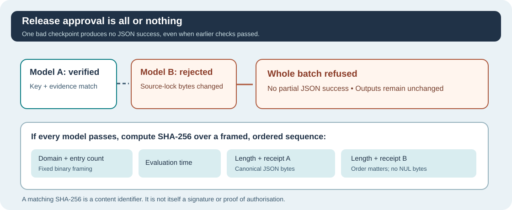

# Lesson 50 — Test Failure-Atomic Release Gates and Ordered SHA-256 Digests

**Umicom Foundation · Bits to Banking · Build Your Own LLM from Scratch**  
**Prerequisites:** Lesson 49, basic SHA-256 and Ed25519 verification, and the C23 test workflow.  
**Environment:** ISO C23, CMake, CTest and compatible OpenSSL 3 for optional signing tests.

## Learning objectives

You will learn how to test all-or-nothing verification, distinguish *content identity* from *cryptographic authentication*, and explain why the ordering of records must be included in an aggregate SHA-256 calculation.

## 1. One incorrect model invalidates the entire proposed release

Suppose a release contains models A and B. The operator verifies A successfully, then B fails because one byte in a companion file changed. The verifier must **not** produce a JSON document claiming `verified` for the whole release. It should report an error without modifying the caller's output buffer.



The Framework first verifies each checkpoint with the existing trust and Ed25519 checks. Only after all checks succeed does it format the batch JSON and copy it into the caller-owned output memory.

This is **failure-atomic output publication**, not an atomic snapshot of several filesystem files. A separate, hostile process could replace files between read operations; securing the workspace remains an operator responsibility.

## 2. Reconstruct the aggregate digest definition

The batch digest uses the existing Framework SHA-256 implementation. Its input is a sequence of unambiguous binary fields:

1. The ASCII bytes `UMICOM-AI-TRUST-BATCH-1`, without a terminating NUL.
2. An unsigned **64-bit little-endian** count of entries.
3. An unsigned **64-bit little-endian** Unix evaluation second.
4. For each receipt, in the supplied order: an unsigned **64-bit little-endian** byte count, followed by the canonical receipt's UTF-8 bytes *without* its NUL terminator.

For example, an ordered group `(A, B)` has a different hash input from `(B, A)`. Length prefixes also prevent accidentally treating two adjacent receipts as an ambiguous concatenation.

The individual `receipt_sha256` is SHA-256 over exactly one canonical single-publication JSON receipt. The overall `batch_sha256` hashes the structured, length-delimited **collection**. Neither digest is a digital signature.

## 3. Read the new C23 API contract

```c
#include "umicom/ai/training/training_trust_batch.h"

char result[UMI_AI_TRAINING_TRUST_BATCH_JSON_CAPACITY] = "PREVIOUS";
size_t written = 99U;
const char *checkpoints[] = {
    "C:/umicom/reviewed/model-a.umi",
    "C:/umicom/reviewed/model-b.umi"
};

UmiStatus status = UmiAiTrainingTrustBatchVerifyJson(
    checkpoints, 2U, "C:/umicom/approved/publishers.trust",
    UINT64_C(150), result, sizeof(result), &written);

if (status != UMI_STATUS_OK) {
    /* Both result[] and written still contain the caller's earlier values.
       They are NOT evidence that this verification attempt succeeded. */
}
```

Notice that the caller must branch on the returned `UmiStatus`. A buffer containing old data is not a substitute for a fresh successful check.

## 4. Run focused tests with CTest

```powershell
Set-Location 'C:\umicom\Umicom-Applications'

ctest --test-dir .\build\windows-ucrt64-native-llm-debug `
  -R '^framework\.ai\.training\.trust_batch_' `
  --output-on-failure --no-tests=error
```

The new regression tests cover signed two-model verification, repeatable canonical output, changed-order digests, a single-model request, insufficient output memory and invalid arguments. Rejection cases include repeated paths, expired trust keys and a modified companion file belonging to the *second* model.

`--no-tests=error` is important: it stops a mistyped filter from producing a misleading green result when **zero** tests were selected. Running only these focused tests does not mean the entire Umicom Framework, Windows executable packaging or release security review has passed.

## 5. Interpret hashes, signatures and trust correctly

| Mechanism | What it establishes | What it does not establish |
| --- | --- | --- |
| `receipt_sha256` | Identity of a single canonical local receipt | Authenticity or the signer's identity |
| `batch_sha256` | Identity and order of the verified receipt collection at an evaluation time | That the batch JSON itself was signed |
| Ed25519 publication signature | The publication record was signed by the holder of the corresponding private key | When it was signed or whether training was authorised |
| Offline trust policy | Whether the selected publisher key is approved at the chosen evaluation time | Host integrity, signing time or model accuracy |
| Complete integration testing | Whether selected software paths worked in the tested environment | Security in every deployment environment |

The verifier's unsigned JSON is a **local observation**. If you send it to somebody else, they should authenticate the original publications independently or use a separately trusted evidence-delivery mechanism. A timestamp supplied by the caller is not a trusted signing timestamp.

## 6. Exercises

1. Describe why publishing a one-model success receipt after the second of two models fails is misleading.
2. How does length-prefixing protect the hash-input format from ambiguous concatenation?
3. What changes when you swap models A and B in a valid batch?
4. Why can a JSON file with a matching SHA-256 still be untrustworthy?
5. Which additional testing evidence would you require before describing a Windows release as verified?

### Check your understanding

An all-or-nothing gate refuses incomplete collections. Ordered, length-delimited SHA-256 identifies the observation's exact canonical bytes, but anyone can recalculate it. Trust in the publisher comes from verified Ed25519 signatures and a separately controlled policy. Trust in a product release also depends on its actual platform build, runtime tests, dependencies and security review.

**Conclusion:** Reproducible hashes, cryptographic signatures, release-wide validation and independent operational review solve different problems. They are most useful when the evidence clearly distinguishes each one.
