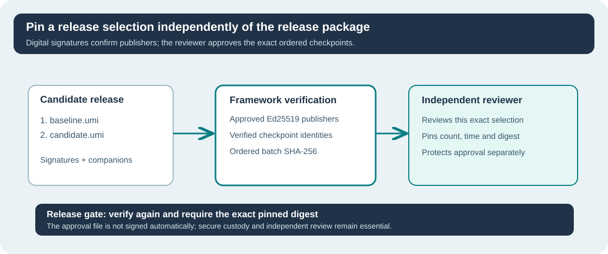

# Lesson 51 — Pin an Independently Approved Native LLM Release

**Umicom Foundation · Bits to Banking · Build Your Own LLM from Scratch**  
**Prerequisites:** Lessons 43–50, SHA-256 basics, Ed25519 publisher trust and ordered release verification.  
**Environment:** Native C23, CMake, CTest and optional OpenSSL 3 for signing verification.

## Learning objectives

By the end of the lesson, you should be able to distinguish a **valid
publisher signature** from a **reviewer's approval of particular models**,
explain why order matters in an approved release, and construct a strict,
independently maintained approval record for the Framework release gate.



## 1. Validly signed does not necessarily mean approved for this release

Imagine that Umicom has three signed models: `baseline.umi`,
`candidate.umi` and `experiment.umi`. All three were signed by an authorised
publisher, but the release committee selected only baseline and candidate.

A release verifier that merely accepts *any* signed model could accept the
third model by mistake. The independent release approval step answers a
different question: **Is this the exact ordered set that was reviewed?**

The existing `umicom-native-llm-trust-batch` command computes a canonical
`batch_sha256` after verifying each model's signer and checkpoint evidence.
Changing model order, evaluation time or a model's recorded bytes changes
that aggregate identity. SHA-256 is a reproducible identifier, not itself
permission to release the models.

## 2. The separate approval record

After a reviewer has checked the evidence, they record the expected digest
in a controlled file, separate from untrusted release artefacts:

```ini
UMICOM-AI-RELEASE-APPROVAL-1
publication_count=2
evaluated_at_unix_seconds=150
batch_sha256=0123456789abcdef0123456789abcdef0123456789abcdef0123456789abcdef
```

The hex value and time `150` above are illustrative teaching values only.
For a real release, use the **actual digest from a verified and reviewed
batch**. All three keys are mandatory. The parser rejects unknown or repeated
keys, negative or overflowing decimal values, invalid digests, NUL bytes
and oversized files. File paths and executable instructions are not part of
the grammar.

The `evaluated_at_unix_seconds` field deliberately pins the instant used
for key-validity checking, rather than silently using the machine clock.
This supports repeatable checks but **does not create a trustworthy signing
timestamp**. An external governance process must reject attempts to use a
historical instant to evade current restrictions.

## 3. Reuse Framework C23 rather than creating a second verifier

```c
#include "umicom/ai/training/training_release_approval.h"

UmiAiTrainingReleaseApproval reviewed;
UmiStatus status = UmiAiTrainingReleaseApprovalLoadFile(
    "C:/umicom/approved-releases/candidate.approval", &reviewed);

/* No checkpoint is trusted merely because the approval parsed. */
if (status != UMI_STATUS_OK) {
    /* Report failure; do not proceed to training or release. */
}
```

The header declares stable public functions. The Framework owns strict
parsing, policy verification, digital signature checks and JSON output.
Applications such as Umicom LLM or Studio IDE must **consume** the result
instead of duplicating this functionality.

## 4. Exercise

Suppose the reviewer approved two signed models in this order: A, then B.
A release packer submits B, then A. What should the approval gate do, even
if both individual signatures are valid? How would an unknown extra key in
the approval file be handled?

**Check:** The ordered digest changes, so approval must be denied. An unknown
configuration key is rejected by the strict parser rather than ignored.

**Next:** Lesson 52 demonstrates how the complete release gate refuses
missing models, changed identities and untrusted publisher state without
producing misleading success evidence.
