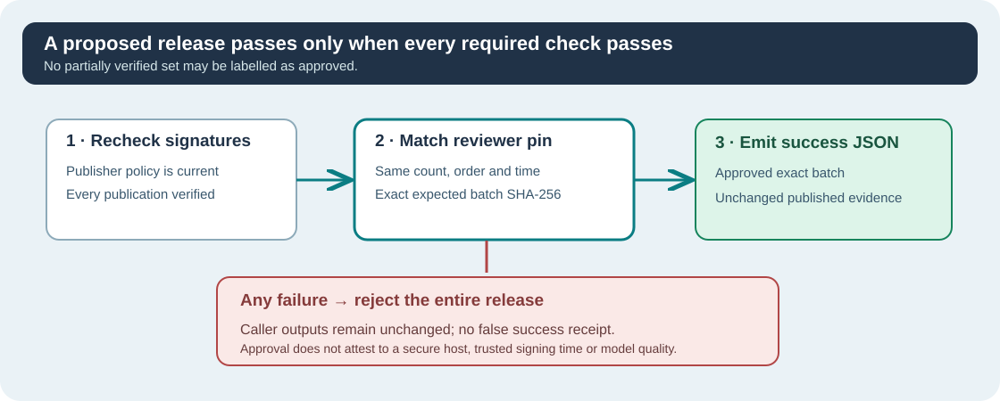

# Lesson 52 — Test Independent Release Approval and Rejection

**Umicom Foundation · Bits to Banking · Build Your Own LLM from Scratch**  
**Prerequisites:** Lesson 51, basic C23 unit testing, signed checkpoints and offline publisher trust.  
**Environment:** Native C23, CMake, CTest and optional OpenSSL 3.

## Learning objectives

Learn how to test a reviewer-pinned batch release, explain **failure-atomic
results**, and identify situations in which a cryptographic check alone is
not sufficient for release security.



## 1. Verify a release with one native C23 operation

The Framework entry point receives checkpoint paths, an independent
publisher trust-policy file and the separately approved expected identity.
Its implementation invokes the existing real Ed25519 trust-batch verifier
before checking the expected `batch_sha256`.

```c
#include "umicom/ai/training/training_release_approval.h"

/* Example: the caller has already loaded and reviewed approval and paths. */
char json[UMI_AI_TRAINING_RELEASE_APPROVAL_JSON_CAPACITY];
size_t jsonLength = 0U;
const char *checkpoints[2] = {
    "C:/umicom/trusted-models/baseline.umi",
    "C:/umicom/trusted-models/candidate.umi"
};

UmiStatus status = UmiAiTrainingReleaseApprovalVerifyJson(
    checkpoints, 2U,
    "C:/umicom/trusted-publishers/publishers.trust",
    &approval, json, sizeof(json), &jsonLength);

if (status != UMI_STATUS_OK) {
    /* Do not publish or act on the release. */
}
```

The JSON is published only after every required check succeeds. A successful
result records `release_approval.exact_ordered_batch_pinned=true` while
explicitly stating `release_approval.approval_record_signed=false`. The
approval document is a controlled local input, **not** an Ed25519 signature.

## 2. Why atomic output matters

Consider two proposed models, A and B. Verification of A succeeds, but the
signature or source-lock identity of B fails. The verifier must not return a
JSON object reporting "A approved" as though that were authorisation for
shipping the release.

The Framework first builds its complete output in private memory. On any
failure it leaves the caller's result buffer and written-length value
unchanged. This is **API-level failure atomicity**, not a multi-file
transaction, filesystem snapshot or network delivery guarantee.

## 3. Negative-test matrix

| Changed input | Required outcome |
| --- | --- |
| Same approved A and B, unchanged order and trust policy | Approve |
| Reverse the checkpoint order | Deny: aggregate identity changes |
| Supply only A when two were approved | Deny: count differs |
| Change one digit of the pinned digest | Deny |
| Change the selected verification instant | Deny unless independently reapproved |
| Revoke B's publisher in the independently managed policy | Deny |
| Modify one signed checkpoint companion after signing | Deny |
| Make the caller's JSON buffer too small | Report capacity error, preserve outputs |

The new regression suite uses disposable Ed25519 keys and temporary signed
publications. It never ships a developer's private signing key.

Run the focused tests on Windows after building the optional signing target:

```powershell
ctest --test-dir .\build\windows-ucrt64-native-llm-debug `
  -R '^framework\.ai\.training\.release_approval_' `
  --output-on-failure --no-tests=error
```

For a full confidence claim, also run all of the existing Framework tests
and repeat the build on a clean, protected Windows machine. Do not restore
or whitelist a quarantined executable merely to obtain a passing test count.

## 4. Exercise and explanation

A developer says: "All the files have valid digital signatures; therefore
we can publish any two in any order." Explain why this conclusion does not
follow. Name two further checks needed beyond signed-byte integrity.

**Check:** Publisher signatures confirm key-based provenance for each signed
publication, not the product team's selection of a particular ordered set.
An independent release digest pin verifies the selection. Additional checks
include benchmark quality, training-data permissions, dependency integrity,
protected signing credentials, an authentic approval channel and Windows
runtime security review.

**Conclusion:** Digital signatures, independent release approval, regression
testing and operational assurance answer different questions. Keeping their
roles separate produces stronger, more understandable release decisions.
