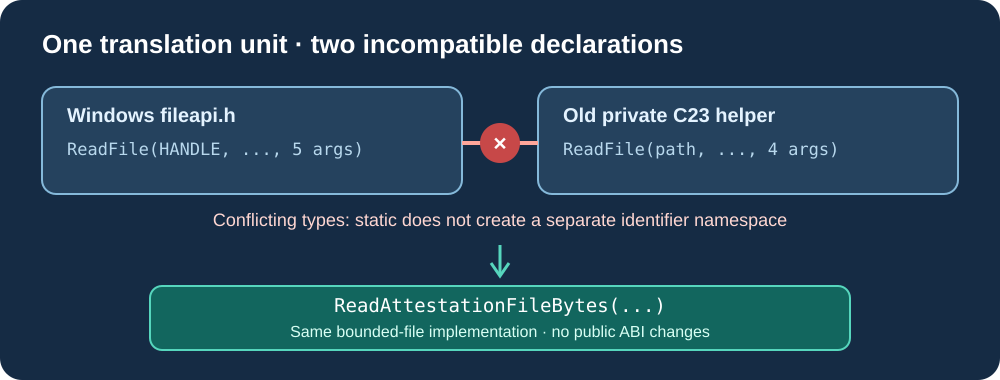

# Lesson 53 — Understand Windows API Name Collisions in Native C23

A project can compile correctly on Linux and still fail when the same C23
source includes the Windows platform headers. The cause may be a **name
collision**, not an incompatible OpenSSL version or an incorrect CMake setting.
This lesson explores a real class of portability defects in native libraries.



## 1. What changes after including `windows.h`?

A C translation unit is the source file together with every header and source
fragment it includes. Windows headers declare many global API functions.
One of these is `ReadFile`, used to read from Windows file handles. Its
prototype takes a handle, output buffer, byte count, count-output pointer
and an optional overlapped-operation pointer.

The Umicom attestation code already had a private helper also named
`ReadFile`. That helper was different: it accepted a file **path**, used
portable `fopen`/`fread`, enforced a maximum size, then returned an
`UmiStatus`. The two functions could not share a declaration.

### Broken example: both declarations become visible

```c
/* Simplified example: Windows headers already declare ReadFile. */
#include <windows.h>

/* Incorrect: static does not place this in a second identifier namespace. */
static int ReadFile(const char *path)
{
    return path != NULL;
}
```

This code is intentionally incorrect. Its `ReadFile` signature disagrees
with the Windows declaration. The compiler is required to diagnose those
incompatible declarations.

## 2. Why `static` does not fix it

For a file-scope C function, `static` gives **internal linkage**: the name
is not exported for linking by other translation units. It does **not** make
the function invisible to earlier declarations in the *same* translation
unit. The names are compared during compilation, before a linker runs.

Other measures such as rearranging `#include` lines, lowering the warning
level or suppressing diagnostics do not repair a type conflict. The internal
helper needs its own unambiguous identifier.

### Correctly scoped name

```c
/* A Framework-specific identifier is not a Win32 API symbol. */
static UmiStatus ReadAttestationFileBytes(
    const char *path,
    unsigned char *output,
    size_t capacity,
    size_t *written);
```

The production implementation keeps its existing bounded-file reading logic.
Only its private name and the corresponding call sites change. No public C
ABI, Ed25519 signature format, checkpoint format or cryptographic calculation
needs to change.

## 3. A compiler is a useful portability test

The Framework now includes a **compile-only probe**. It introduces the
`ReadFile` declaration before including the actual attestation source.
On Windows, `<windows.h>` supplies the declaration. On other platforms, a
declaration with the corresponding five-argument shape is used for the test.
The test is compiled to an object but is **never linked into an application**,
so it cannot introduce a second copy of the cryptographic implementation.


The separate signed-release CMake target depends on this compilation probe
when testing is enabled. This matters: running only a targeted build should
still exercise the known portability boundary.

## 4. Diagnose the error accurately

If compilation reports `conflicting types for 'ReadFile'`, examine the two
locations named in the error. One will usually point into the application's
source; the other may point to `fileapi.h` through `windows.h`.
The presence of OpenSSL in a CMake configuration log does **not** prove the
C source compiles. CMake configuration, source compilation, linking and test
execution are separate stages, and any one can fail independently.

## 5. Exercise

1. Explain in one sentence the difference between internal linkage and a
   distinct C identifier namespace.
2. Find the two `ReadFile` declarations in the original diagnostic and count
   their parameters. Why cannot they refer to the same function?
3. Predict whether moving the private helper below `#include <windows.h>`
   would fix the conflict.
4. In a training repository, locate the CMake target that compiles the
   platform-name probe, and describe why it is not linked.

**Check your understanding:** The Windows API declaration has five
parameters, while the original private helper has four and a different
return type. Both are visible during translation. A Framework-specific
internal name solves the collision without replacing the Windows function.

## Next lesson

Lesson 54 builds the signed native laboratory on Windows, runs its regression
tests, and distinguishes a successful configure from a successful release.
