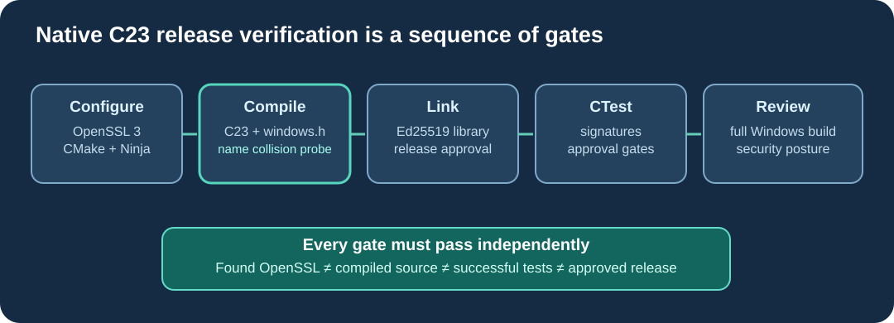

# Lesson 54 — Validate C23 Signing and Release Approval on Windows

A reproducible build is not only a command that generates project files. It
is a sequence of checks that proves the compiler, linker and tests all work
with the same reviewed source. This lesson uses **Umicom Framework's native
LLM learning laboratory** to demonstrate that sequence for C23, OpenSSL 3,
Ed25519 verification and an independent release-approval gate.



## 1. Prepare a Windows development shell

Use the MSYS2 **UCRT64** toolchain containing GCC, CMake, Ninja and OpenSSL.
The examples below assume the Umicom Applications checkout is located at
`C:\umicom\Umicom-Applications`. PowerShell is used here to invoke native
build tools; it is **not** an implementation language for Umicom functionality.

```powershell
Set-Location 'C:\umicom\Umicom-Applications'
$env:Path = 'C:\msys64\ucrt64\bin;' + $env:Path

cmake --version
ninja --version
cc --version
pkg-config --modversion openssl
```

If a command is missing, inspect the relevant UCRT64 installation first.
Avoid silently mixing DLLs or headers from unrelated Windows toolchains.

## 2. Configure the native C23 laboratory

```powershell
cmake -S .\framework\learning\native-llm `
  -B .\build\windows-ucrt64-native-llm-debug -G Ninja `
  -DCMAKE_BUILD_TYPE=Debug -DBUILD_TESTING=ON `
  -DUMICOM_AI_TRAINING_ENABLE_SIGNATURES=ON
```

When enabled, the signing module requires a compatible OpenSSL 3 Crypto
library. The familiar line `Found OpenSSL` reports **dependency discovery**.
It does not say whether `training_attestation.c` can compile with
`windows.h`. The next command checks that.

## 3. Build the exact release-approval target

```powershell
cmake --build .\build\windows-ucrt64-native-llm-debug `
  --target umicom-native-llm-release-approve --parallel 2
```

This compiles the native release-approval executable, the Framework's
Ed25519 support and, in a test-enabled build, the compile-only Windows
platform-name probe. `-Werror` is used for the probe to prevent a warning
from being mistaken for a successful portability check.

If this stage fails, **do not publish a release merely because CMake
configured successfully**. Correct the compiler error, then rerun the build.

## 4. Build all registered native tests

```powershell
cmake --build .\build\windows-ucrt64-native-llm-debug --parallel 2
```

Building only one executable cannot prove that all test executables compile.
The second build helps locate regressions in related modules.

## 5. Execute signing and release-gate tests

```powershell
ctest --test-dir .\build\windows-ucrt64-native-llm-debug `
  -R '^framework\.ai\.training\.(attestation_|trust_policy_|trust_receipt_|trust_batch_|release_approval_)' `
  --output-on-failure --no-tests=error
```

The relevant tests exercise key verification, publisher trust rules,
structured receipts, ordered multi-checkpoint validation and independent
release approval. CTest checks executable behaviour; the compile-only
platform-name probe is instead enforced by its build dependency.

A full product release requires wider integration testing, including the
complete Umicom Applications build and relevant Windows packaging checks.
This focused lesson deliberately does **not** claim those additional checks
have passed.

## 6. Preserve security boundaries

OpenSSL may be used to generate disposable Ed25519 **test** keys during
regression testing. Production signing keys must be independently managed,
protected and excluded from public repositories. An Ed25519 signature confirms
that specified bytes match a trusted key; it does not prove the model is
correct, that all training data were authorised or that a signing timestamp
is trustworthy.

If endpoint protection quarantines an executable, obtain the vendor's
review and independently validate the build environment. Do not weaken
antivirus controls or sign an unreviewed executable merely to make it run.

## 7. Exercise

1. Which of the configure, build and test commands can detect a C function
   prototype collision? Which cannot?
2. Why should the named executable target be built before running CTest?
3. What does a successful Ed25519 verification prove, and what does it not
   prove?
4. Run `ctest --test-dir` against your own completed build and record the
   number of passed and failed cases. Do not substitute another computer's
   results for your own.

**Check your understanding:** A clean build requires source compilation and
linking, not merely dependency discovery. Tests add behavioural evidence.
Cryptographic authenticity and application security remain different tasks.

## Continue learning

Return to the course map to review the complete native LLM engineering path,
from byte tokenisation through reproducible training and release verification.
