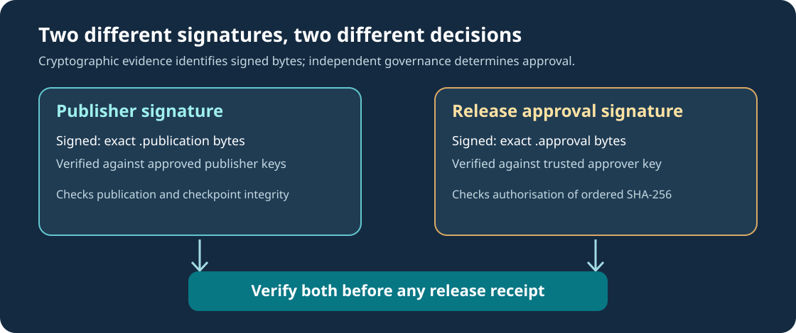

# Lesson 55 — Sign an Independent Native LLM Release Approval

## Learning objectives

By the end of this lesson you should be able to distinguish a **publisher's signature** from a **release approver's authorisation**, explain exactly which bytes an Ed25519 signature covers, build the opt-in C23 signing executable and identify the trust boundary of a separately distributed approval key.



## 1. Why a valid publisher signature is not enough

A native LLM checkpoint can be legitimate and intact without being suitable for release. The original publisher's Ed25519 signature binds the bytes of the model's publication record. It does not establish whether the model passed held-out tests, whether the dataset was authorised, or whether a reviewer accepted it for distribution.

In Lesson 51, an independently reviewed **release-approval record** pinned the count, verification instant and ordered SHA-256 identity of a set of already signed checkpoint publications. Its central information resembles:

```text
UMICOM-AI-RELEASE-APPROVAL-1
publication_count=2
evaluated_at_unix_seconds=150
batch_sha256=<64 lowercase SHA-256 characters>
```

The header and values are strict input to Umicom Framework, not commands to execute. The SHA-256 identity binds the *order* of the verified publications. A different order changes the batch identity. However, someone able to replace an unprotected approval file could replace its SHA-256 expectation too. File integrity alone is not an authorisation decision.

## 2. Separate the publisher and the approver

A safer release decision requires two distinct trust relationships. The publication verifier uses the operator's publisher trust policy to decide which model signers are acceptable. A separate, independently obtained approval public key verifies the approval record. In practice the keyholders and approval process should also be organisationally independent; cryptography by itself cannot prove a separation of people.

The new Framework-owned `UmiAiTrainingApprovalAttestationSignNewFile` operation reads and validates the entire existing approval file before signing its **exact bytes**. It then publishes a new sibling file using an exclusive, no-clobber creation policy. There is no replacement of a model, training plan or earlier signature.

The detached signature file has a fixed grammar:

```text
UMICOM-AI-RELEASE-APPROVAL-SIGNATURE-1
public_key_sha256=<64 lowercase SHA-256 characters>
signature=<128 lowercase hexadecimal characters>
```

The fingerprint is SHA-256 of the raw 32-byte Ed25519 public key, not of the PEM text containing that key. The signature record's fingerprint is not trusted by itself: the verifier must already possess a separately approved public key.

## 3. Domain separation protects context

Ed25519 accepts a message as bytes. The same raw bytes should never gain approval in two unrelated protocols by accident. Therefore, the Framework signs the following concatenation:

```text
UMICOM-AI-RELEASE-APPROVAL-ED25519-1\n
<exact original approval file bytes>
```

The final `\n` shown above is one LF byte; it immediately precedes the first byte of the approval record. The prefix distinguishes approval signatures from model-publication signatures. A line-ending change from LF to CRLF, even if a strict parser accepts both, changes the message and invalidates the signature. This is intentional: the reviewer signed the precise original file, not an approximate interpretation of it.

## 4. Build and sign with native C23

In PowerShell, configure the existing independent learning laboratory. On Windows, add the MSYS2 UCRT64 `bin` directory to the interactive environment before configuring if its tools are not already on `PATH`.

```powershell
Set-Location 'C:\umicom\Umicom-Applications'
$env:Path = 'C:\msys64\ucrt64\bin;' + $env:Path
cmake -S .\framework\learning\native-llm `
  -B .\build\windows-ucrt64-native-llm-debug -G Ninja `
  -DCMAKE_BUILD_TYPE=Debug -DBUILD_TESTING=ON `
  -DUMICOM_AI_TRAINING_ENABLE_SIGNATURES=ON
cmake --build .\build\windows-ucrt64-native-llm-debug `
  --target umicom-native-llm-signed-release --parallel 2
```

OpenSSL 3 is required only for this explicitly enabled signing component. Provision the private key through your own approved mechanism, outside Git, and protect it from unauthorised access. Then sign a **reviewed** approval file:

```powershell
& '.\build\windows-ucrt64-native-llm-debug\umicom-native-llm-signed-release.exe' `
  sign 'C:\umicom\reviewed\release.approval' `
  'C:\umicom\protected-keys\approver-private.pem'
```

The operation refuses an invalid approval and will not overwrite an existing `release.approval.ed25519`. In a release process, neither the private key nor the publisher trust policy should be obtained from the untrusted model distribution.

## 5. Read the stable C interface

```c
#include "umicom/ai/training/training_approval_attestation.h"

UmiStatus status = UmiAiTrainingApprovalAttestationSignNewFile(
    "reviewed-release.approval",
    "protected/approver-private.pem");
if (status != UMI_STATUS_OK) {
    /* Reject publication; inspect status and preserve the previous release. */
}
```

The new module owns cryptography and bounded file operations. The executable merely calls its C23 API. This distinction allows Studio IDE or another Umicom application to reuse the same verified behaviour without duplicating signing logic.

## 6. Exercises

1. Describe two ways in which a checkpoint could be authentic but still unsuitable for release.
2. Explain why the approval verifier cannot select its trusted public key from the `public_key_sha256` field it is trying to validate.
3. On a disposable working copy, change one comment or LF character after signing. Predict why verification fails even when the approval still parses.
4. Explain why Ed25519 verification is not a trusted timestamp or proof of approval-authority identity.

**Key point:** an independently distributed approval key authorises a *specific* reviewed release identity; it does not replace technical evaluation or human governance.
