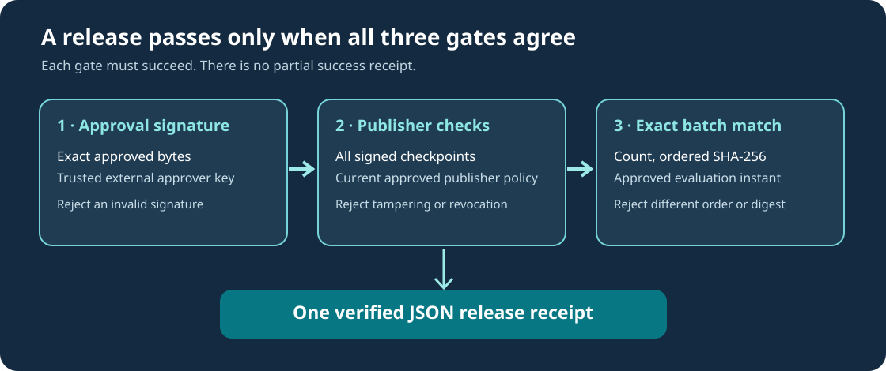

# Lesson 56 — Verify Signed Release Approval and Reject Tampering

## Learning objectives

You will learn how the Framework checks the approver's detached Ed25519 signature, re-verifies publishers and checkpoints, emits a machine-readable release receipt only on complete success, and tests common attempts to bypass an approval gate.



## 1. Treat independent approval as the first gate

A signed release cannot be accepted merely because an approval file and a signature file exist. The verifier must establish that the file has valid syntax, that the signature corresponds to its exact bytes and that the validating public key was provisioned independently. The detachment is deliberate: the signature's embedded key fingerprint is only an identifier, never permission to install a new trusted key.

The API `UmiAiTrainingApprovalAttestationVerifyFile` takes two independent paths—the approval record and the trusted approver public PEM—and returns a parsed approval plus the verified raw-public-key fingerprint. If parsing or verification fails, both caller-owned output objects remain unchanged.

## 2. Then re-run the existing publisher and checkpoint gate

The next step is not to reuse an old, unverified JSON file. The new `UmiAiTrainingSignedReleaseApprovalVerifyJson` function calls the existing native release-approval service again. That service verifies each checkpoint's publisher signature under the approved trust policy and recalculates the exact ordered batch SHA-256 at the approval's recorded evaluation instant.

This separation matters: a valid approval signature for one SHA-256 digest does not authorise another order of checkpoints. A publisher whose key has been revoked cannot be accepted merely because an old approval referred to that checkpoint. The operator still controls policy and its trust anchors.

## 3. Verify from PowerShell

After building the optional `umicom-native-llm-signed-release` target, supply all independent inputs explicitly:

```powershell
Set-Location 'C:\umicom\Umicom-Applications'
& '.\build\windows-ucrt64-native-llm-debug\umicom-native-llm-signed-release.exe' `
  verify 'C:\umicom\reviewed\release.approval' `
  'C:\umicom\trusted-keys\approver-public.pem' `
  'C:\umicom\trusted-keys\publishers.trust' `
  'C:\umicom\releases\baseline.umi' `
  'C:\umicom\releases\candidate.umi'
```

The original approval must declare `publication_count=2` and the digest must describe these two publications *in this order*. The signer of the approval may be entirely different from either checkpoint publisher. Invalid evidence produces an error and a nonzero exit code; there is no successful verification JSON.

A successful receipt includes the unchanged batch-verification information, an `approval_record_signed` flag set to `true`, and an `approval_signature` object with `algorithm: "Ed25519"` and `verification_key_sha256`. This records what the verifier checked. The JSON is an unsigned observation from the running verifier, not a new signed certificate.

## 4. What failure-atomic output means

Suppose another Framework component supplies a buffer for release JSON. It may have valuable old data. On a verification failure, the component must not receive a partly written success record.

```c
#include "umicom/ai/training/training_approval_attestation.h"

char json[UMI_AI_TRAINING_SIGNED_APPROVAL_JSON_CAPACITY];
size_t written = 0;
const char *checkpoints[] = { "baseline.umi", "candidate.umi" };

UmiStatus status = UmiAiTrainingSignedReleaseApprovalVerifyJson(
    checkpoints, 2, "publishers.trust", "release.approval",
    "approver-public.pem", json, sizeof(json), &written);

if (status != UMI_STATUS_OK) {
    /* No new release JSON has been published. */
}
```

The Framework stages its verification results and copies them into the caller's buffer only after every check succeeds. Consumers must also check a command-line process's exit status: even a correct CLI cannot atomically write all bytes to a pipe whose reader fails midway.

## 5. Failure scenarios to test

First verify a disposable release whose publisher and approver keys are separately generated. Then repeat with a deliberately incorrect approver key. Verification must fail regardless of whether the model signatures remain valid. Repeat after changing one character in the approval record, then after changing the detached signature, and finally after changing one byte of the source-lock companion for a checkpoint. Each change should independently reject the release.

Also test the approved order. Swapping the two checkpoint paths changes the ordered batch identity even if both individually pass signature verification. Providing one checkpoint when the approved count is two must fail before any success JSON is published. Finally, supply a caller output buffer that is too small. The API must reject the capacity without changing the caller's output bytes or written length.

## 6. Execute CTest and review the boundary

```powershell
ctest --test-dir .\build\windows-ucrt64-native-llm-debug `
  -R '^framework\.ai\.training\.(signed_approval_|release_approval_|attestation_)' `
  --output-on-failure --no-tests=error
```

These tests use ephemeral Ed25519 private keys in disposable local test workspaces. They do not prove the trustworthiness of a production approval authority. Secure key custody, permission to use training data, independent model evaluation, timestamping and reliable host operation remain separately required.

## 7. Exercises

1. Write a release verification checklist with separate publisher-key, approver-key and model-evaluation decisions.
2. Explain how a valid Ed25519 signature can still correspond to an old, unacceptable approval.
3. Describe the difference between a signed approval document and the verifier's unsigned JSON observation.
4. Explain why checking just the batch SHA-256 without rechecking publisher policy would be insufficient.

**Key point:** a reliable release gate requires agreement among approval-key trust, original signed publication integrity, current publisher policy, ordered batch identity and separately reviewed model readiness.
