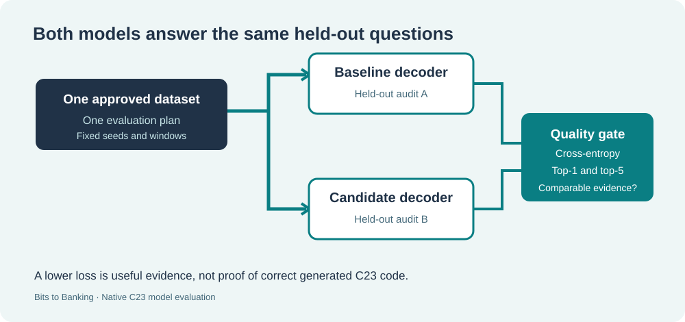

# Lesson 57 — Compare Two Native LLM Models on the Same Held-Out Data

## Learning objectives

Understand why a baseline model and a candidate model must answer **the same prediction questions** before their scores can be compared. Learn to interpret cross-entropy, perplexity and top-one/top-five accuracy; then use a Framework-owned C23 quality gate to inspect real model evidence.



## 1. Why one number is not enough

A training run may lower its loss while still producing incorrect predictions on material the model has never seen. That is why the native laboratory separates source files into training and evaluation partitions. **Held-out evaluation** uses source files withheld from parameter updates.

Cross-entropy measures how much probability the model assigns to the correct next token. Lower values are better. Perplexity is the exponential of average cross-entropy, so it also decreases as the model predicts the sample more accurately. Top-one accuracy measures how often the most likely token is correct; top-five accuracy checks whether the correct token is among the five most likely.

These numbers describe next-token prediction on the selected samples. They do not tell us whether the model writes correct, secure C23 programmes.

## 2. Compare like with like

Imagine the baseline sees 100 evaluation tokens and the candidate sees a different 100 tokens. A change in score could reflect a different set of questions rather than a genuinely improved model.

For an interpretable comparison, the two evaluations must use the same approved dataset snapshot and the same experiment plan. The plan contains the evaluation seed, context length, number of evaluation batches and sequences per batch. The Framework's `UmiAiTrainingModelAuditEvaluate` reports a dataset fingerprint, plan fingerprint and the number of targets evaluated.

The new `UmiAiTrainingModelQualityCompareReports` function rejects the comparison if those identities or counts do not match. These FNV fingerprints help detect accidental changes; they are **not cryptographic signatures**. File authenticity remains a separate responsibility.

## 3. Worked example

| Measure | Baseline | Candidate |
|---|---:|---:|
| Held-out cross-entropy | 3.00 | 2.50 |
| Top-one correct / 100 | 30 | 35 |
| Top-five correct / 100 | 70 | 75 |

The reduction in cross-entropy is **3.00 − 2.50 = 0.50**. Top-one accuracy rises from 30% to 35%, an improvement of five **percentage points**. Top-five accuracy also improves by five percentage points. Assuming distinct checkpoints and compatible audit identities, this candidate passes the Framework's default teaching policy.

If cross-entropy improves but top-one accuracy falls, the default policy does **not** pass. A separate reviewer can set explicit tolerances, but this should be documented rather than silently ignored.

## 4. Use the native Framework API

```c
#include "umicom/ai/training/model_quality_gate.h"

UmiAiTrainingModelQualityPolicy policy;
UmiAiTrainingModelQualityReport result;
UmiStatus status = UmiAiTrainingModelQualityDefaults(&policy);
if (status == UMI_STATUS_OK) {
    status = UmiAiTrainingModelQualityEvaluate(
        baselineModel, candidateModel, reviewedDataset,
        &evaluationPlan, &policy, &result);
}
if (status == UMI_STATUS_OK && result.accepted != 0) {
    /* Candidate met these sampled evaluation requirements. */
}
```

The two model handles and dataset remain caller-owned. The function calls the existing Framework evaluator for each model; it does not retrain a model or replace the checkpoint implementation. Rejected calls preserve the output report.

## 5. Limits of the exercise

A minimum sample of 32 evaluated target tokens is useful for testing the implementation but much too small to draw broad conclusions about a model. For a serious release, establish representative independent task suites, check data leakage, measure multiple seeds, inspect generated code and verify the source and publisher evidence separately.

The training quality gate is **not a substitute for cryptographic publication verification or independent release approval**.

## 6. Exercises

1. Explain how changing only the evaluation seed can make two scores incomparable.
2. Recalculate the cross-entropy improvement if the candidate loss is 2.90.
3. Explain the difference between a change of five *percentage points* and a 5% relative change.
4. Describe why a signed checkpoint can still fail a model quality assessment.

**Key point:** compare both models on the same held-out questions, and keep model quality separate from signed provenance and release authorisation.
