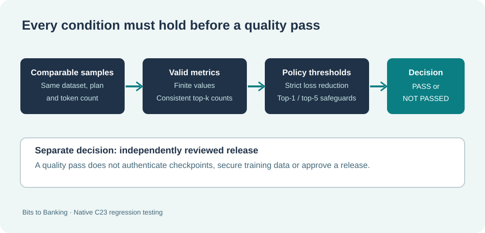

# Lesson 58 — Test Native C23 Model Quality Gates and Reject Incomparable Evidence

## Learning objectives

Use regression tests to check that a model quality decision is based on comparable metrics, explicit thresholds and real held-out evaluation. Learn the difference between a valid comparison that does not pass and an invalid comparison that must return an error without modifying the caller's output.



## 1. Give every comparison an explicit policy

The Framework's `UmiAiTrainingModelQualityPolicy` contains four settings: minimum cross-entropy reduction, maximum permitted top-one regression, maximum permitted top-five regression and minimum evaluated-token count.

The default policy requires a strictly positive loss reduction, does not permit either accuracy score to fall and requires at least 32 evaluated tokens. The default is **educational** rather than a statistical guarantee. More demanding projects should choose and justify their own independently reviewed thresholds.

For example, a top-one regression allowance of `0.02` is two **percentage points**, not a relative 2% reduction. The Framework validates that accuracy tolerances are finite and between zero and one.

## 2. A rejection is not always an API error

A valid candidate can fail because it did not improve enough. In that case `UmiAiTrainingModelQualityCompareReports` returns `UMI_STATUS_OK`, while `report.accepted` is zero. This distinguishes *the comparison was evaluated* from *the candidate met the policy*.

By contrast, NaN metrics, invalid accuracies, mismatched dataset fingerprints, different experiment plans or different evaluation-token counts are invalid input. They produce an error status. The function must leave the entire caller-owned report unchanged on this path.

## 3. Test an invalid comparison without corrupting the previous result

```c
#include "umicom/ai/training/model_quality_gate.h"

UmiAiTrainingModelQualityReport report = {0};
UmiAiTrainingModelQualityPolicy policy;
UmiStatus status = UmiAiTrainingModelQualityDefaults(&policy);
if (status == UMI_STATUS_OK) {
    status = UmiAiTrainingModelQualityCompareReports(
        &baselineAudit, &candidateAudit, &policy, &report);
}
if (status != UMI_STATUS_OK) {
    /* A rejected call has not committed a partial report. */
}
```

A test can save an exact copy of a caller buffer, give the function a deliberately incompatible candidate report and verify that every output byte remains the same. This is called **failure-atomic output**. It prevents an earlier decision from being overwritten by a half-completed new decision.

## 4. Run the registered regressions on Windows

```powershell
Set-Location 'C:\umicom\Umicom-Applications'
$env:Path = 'C:\msys64\ucrt64\bin;' + $env:Path
cmake -S .\framework\learning\native-llm `
  -B .\build\windows-ucrt64-native-llm-debug -G Ninja `
  -DCMAKE_BUILD_TYPE=Debug -DBUILD_TESTING=ON
cmake --build .\build\windows-ucrt64-native-llm-debug `
  --target umicom-native-llm-quality-compare --parallel 2
cmake --build .\build\windows-ucrt64-native-llm-debug --parallel 2
ctest --test-dir .\build\windows-ucrt64-native-llm-debug `
  -R '^framework\.ai\.training\.model_quality_' `
  --output-on-failure --no-tests=error
```

There are three focused regressions: deterministic quality scores, incompatible or malformed reports, and a real Framework evaluation of a decoder against itself. A model compared with the exact same checkpoint must **not** pass as a new candidate.

## 5. Inspect trusted AdamW checkpoints

The native learning executable compares two reviewed combined AdamW checkpoint files and does not train or publish either one:

```powershell
& '.\build\windows-ucrt64-native-llm-debug\umicom-native-llm-quality-compare.exe' `
  'C:\umicom\reviewed\evaluation-plan.conf' `
  'C:\umicom\reviewed\baseline.umi' `
  'C:\umicom\reviewed\candidate.umi'
```

The evaluation plan must cover the recorded step count of both checkpoints. The Framework loads the two models and their optimiser moments using the established combined-checkpoint codec, obtains held-out metrics, and compares them using one policy. It destroys each optimiser before its borrowed model.

A passing quality check is a narrow observation about next-token predictions on sampled held-out data. It is not permission to deploy a checkpoint whose source, publisher or approval status is unknown.

## 6. Exercises

1. Explain why `UMI_STATUS_OK` and `report.accepted == 0` can occur together.
2. Create a candidate report with top-five correct below top-one correct. What result should the API return?
3. Why should the report remain unchanged if the candidate uses a different dataset?
4. Extend a local testing checklist to include real C23 compilation tasks and independently verified model provenance.

**Key point:** trustworthy comparisons require both sound evaluation data and sound failure behaviour; quality and release authorisation are separate decisions.
