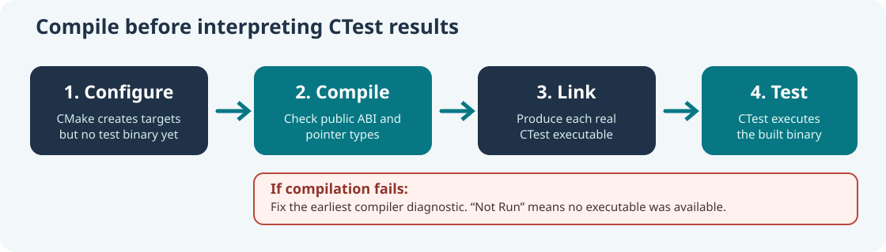

# Lesson 59 — Diagnose a C23 Type Error Before Running Model-Quality Tests

## Learning objectives

Learn to distinguish configuration, compilation, linking and test execution. Diagnose an incompatible pointer argument using a function declaration rather than guesswork. Apply the correct C23 type without changing the public decoder API, and use CMake and CTest in an order that preserves meaningful test results.



## 1. Read the first compiler error

A native LLM project may configure successfully even when some C source files contain type errors. Configuration produces build rules; compilation checks individual source files. A subsequent test command cannot execute a program that compilation failed to create.

Consider this compiler diagnostic:

```text
error: passing argument 2 of 'UmiAiTrainingDecoderInspect'
       from incompatible pointer type
expected 'UmiAiTrainingDecoderConfig *'
but argument is 'UmiAiTrainingExperimentConfig *'
```

Both structures belong to the same experiment, but they are different types. The containing experiment structure includes the decoder configuration plus training steps, evaluation settings, learning rate and seeds. The decoder inspection function expects only its own decoder configuration.

## 2. Check the declared function contract

The Framework's public decoder header contains this declaration:

```c
UmiStatus UmiAiTrainingDecoderInspect(
    const UmiAiTrainingDecoder *model,
    UmiAiTrainingDecoderConfig *outConfig,
    uint64_t *outSteps);
```

The correct caller declares a `UmiAiTrainingDecoderConfig` output object:

```c
UmiAiTrainingExperimentConfig plan;
UmiAiTrainingDecoderConfig actual;
uint64_t completedSteps = 0U;

/* After creating a decoder from plan.decoder: */
UmiStatus status = UmiAiTrainingDecoderInspect(
    model, &actual, &completedSteps);
if (status == UMI_STATUS_OK) {
    /* Compare actual.contextLength with plan.decoder.contextLength. */
}
```

Changing the decoder API to accept an experiment plan would unnecessarily widen the interface. The appropriate fix is in the test caller. No optimizer, checkpoint or model mathematics needs to be changed.

## 3. Understand the difference between build and test failures

Suppose a build stops while compiling `test_training_model_quality_integration.c`. CMake has already registered three model-quality tests, but Ninja may not have produced their executables. CTest then reports `Not Run` and `Could not find executable`.

That message does **not** show that the model's predictions were wrong. It means the test program was never started. Correct the compiler error, rebuild the test targets and run CTest only when the build succeeds.

## 4. Build and test on Windows

The following commands use the native C23 laboratory in Umicom Framework:

```powershell
Set-Location 'C:\umicom\Umicom-Applications'
$env:Path = 'C:\msys64\ucrt64\bin;' + $env:Path
cmake -S .\framework\learning\native-llm `
  -B .\build\windows-ucrt64-native-llm-debug -G Ninja `
  -DCMAKE_BUILD_TYPE=Debug -DBUILD_TESTING=ON `
  -DUMICOM_AI_TRAINING_ENABLE_SIGNATURES=ON
if ($LASTEXITCODE -ne 0) { throw 'Configure failed.' }

cmake --build .\build\windows-ucrt64-native-llm-debug --parallel 2
if ($LASTEXITCODE -ne 0) { throw 'Build failed: inspect the first compiler error.' }

ctest --test-dir .\build\windows-ucrt64-native-llm-debug `
  -R '^framework\.ai\.training\.model_quality_' `
  --output-on-failure --no-tests=error
```

The integration-test target additionally enables an incompatible-pointer-type diagnostic as an error. This detects type mistakes that other compilers might otherwise report only as warnings.

## 5. Exercises

1. Explain why `UmiAiTrainingExperimentConfig *` cannot be passed to an argument declared as `UmiAiTrainingDecoderConfig *`.
2. Identify the difference between a `FAILED` compiler step and a `Not Run` CTest result.
3. Update a test to compare the decoder's context length, channel counts and seed before and after read-only evaluation.
4. Describe why preserving the public decoder ABI is preferable to widening it for one test.

**Key point:** a successful CTest result requires a successfully compiled test executable. Fix the earliest compiler diagnostic before interpreting missing test binaries as model-quality failures.
