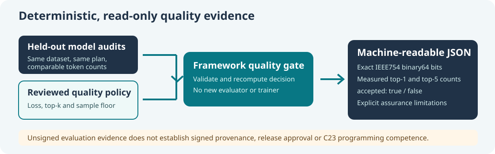

# Lesson 60 — Export Deterministic C23 Model-Quality Evidence

## Learning objectives

Export a held-out baseline-versus-candidate comparison in machine-readable JSON without creating another model evaluator. Understand why exact binary64 bit strings are useful for reproducibility, how to interpret a non-passing quality decision, and why neither an unsigned JSON receipt nor a small next-token sample is release authorisation.



## 1. Why machine-readable evidence matters

Human-readable terminal messages are useful while learning, but automated checks need an output format whose meaning does not change with wording or the computer's number-format settings. A quality comparison must distinguish an input error from a valid measured candidate that simply did not meet an acceptance threshold.

`UmiAiTrainingModelQualityEvidenceJson` exports a previously calculated `UmiAiTrainingModelQualityReport`. Before producing JSON, the Framework reuses `UmiAiTrainingModelQualityCompareReports` to check the audit inputs and independently recompute the policy decision. A stale or altered result is rejected without modifying the caller's output buffer.

## 2. Use one Framework-owned decision

```c
#include "umicom/ai/training/model_quality_evidence.h"

char json[UMI_AI_MODEL_QUALITY_EVIDENCE_JSON_CAPACITY];
size_t written = 0U;
UmiStatus status = UmiAiTrainingModelQualityEvidenceJson(
    &report, &policy, json, sizeof(json), &written);
if (status == UMI_STATUS_OK) {
    /* written excludes the final NUL character. */
    fwrite(json, 1U, written, stdout);
}
```

The function does not train, read checkpoints, inspect files or contact any service. It formats the audit snapshots already obtained from the canonical held-out evaluator and checked against a specific policy.

## 3. Preserve floating-point evidence exactly

In JSON, an IEEE 754 binary64 score is emitted as a 16-character hexadecimal bit pattern. For example, the value 0.5 has the pattern:

```text
3fe0000000000000
```

An ordinary decimal display such as `0.5000000` is easy to read but can lose information for other floating-point values. Bit strings retain the exact score and avoid decimal separators that vary by system locale. Consumers must decode these fields as IEEE 754 binary64, **not** treat them as decimal JSON numbers.

The output also identifies the evaluation dataset, plan, token count, baseline/candidate FNV-1a64 identifiers, accuracy counts, policy thresholds and final decision. The name `*_fnv1a64` is intentional: these identifiers are not cryptographic signatures.

## 4. Run the command-line application

```powershell
Set-Location 'C:\umicom\Umicom-Applications'
& '.\build\windows-ucrt64-native-llm-debug\umicom-native-llm-quality-compare.exe' `
  'C:\umicom\reviewed\evaluation-plan.conf' `
  'C:\umicom\reviewed\baseline.umi' `
  'C:\umicom\reviewed\candidate.umi' `
  --evidence-json
$LASTEXITCODE
```

The JSON output is available only after both trusted checkpoints have been loaded and evaluated successfully. A measured candidate that does not meet the quality policy still produces JSON with `"accepted":false` and returns exit code 1; a passing candidate returns exit code 0. Without `--evidence-json`, the original human-readable comparison remains available.

Successful quality evaluation does not independently verify the publisher's signature, a release approval or the model's competence at real C23 programming tasks. Those are separate reviews and tests.

## 5. Exercises

1. Explain why machine-readable output must not silently convert an invalid comparison into a passing result.
2. Decode the binary64 bit pattern `3fe0000000000000` using a C23 program and `memcpy` into a `double`.
3. Compare `"accepted":false` with a parsing or checkpoint-loading error. What does each say about the evaluation?
4. Name two additional checks required before distributing a model that passed a small held-out comparison.

**Key point:** exact, deterministic JSON helps integrate evaluation with tools, but evidence formatting does not make unsigned measurements cryptographically authenticated or establish model competence.
