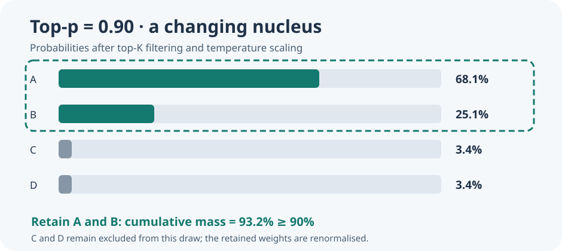

# Lesson 61 — Top-p nucleus sampling for native language models

**Bits to Banking · Umicom Foundation**  
**Author and project originator:** Sammy Hegab  
**Implementation:** Umicom Framework C23

## Learning objectives

Understand why a decoder needs a rule for choosing among predicted token
scores; distinguish fixed top-K filtering from probability-mass filtering;
calculate a nucleus by hand; and call the Framework's opt-in C23 API.

## 1. Scores are not choices

A language model provides a logit for each next token. The highest logit is
not always the best choice for every application: greedy generation always
chooses it, whereas seeded sampling can explore other likely tokens.

The established Umicom Framework sampler first keeps the best K candidates.
The new **nucleus** rule chooses a *smaller prefix* of those candidates when
their combined probability mass already reaches a specified fraction `topP`.

## 2. Worked example

Let the four allowed tokens A, B, C and D have logits `[3, 2, 0, 0]`, with
temperature 1 and topK 4. To prevent numerical overflow, subtract the largest
logit (3) before exponentiation:

```
weights = [exp(0), exp(-1), exp(-3), exp(-3)]
        ≈ [1.0000, 0.3679, 0.0498, 0.0498]
total   ≈ 1.4675
probabilities ≈ [0.6814, 0.2507, 0.0339, 0.0339]
```

For `topP=0.90`, A contributes only 68.14%, but A plus B contribute 93.21%.
The smallest qualifying prefix is therefore A and B. For `topP=0.50`, A
alone is enough. At `topP=1.00`, all four candidates are retained.

The random draw is then normalised over *only the retained candidates*.
For `topP=0.90`, A and B receive conditional probabilities close to 73.11%
and 26.89%, respectively.



## 3. Call the canonical sampler from C23

```c
#include "umicom/ai/training/generation.h"
#include <stdint.h>
#include <stdio.h>

int main(void)
{
    const float logits[8] = {0, 0, 0, 0, 3, 2, 0, 0};
    UmiAiTrainingNucleusOptions policy = {1.0F, 4U, 0.90F};
    UmiAiTrainingRandomState random;
    size_t selected = 0U, retained = 0U;

    if (UmiAiTrainingRandomSeed(&random, UINT64_C(20261023)) != UMI_STATUS_OK)
        return 1;
    if (UmiAiTrainingSampleLogitsNucleus(logits, 8U, 4U, 8U,
           &policy, &random, &selected, &retained) != UMI_STATUS_OK)
        return 1;
    printf("Selected token %zu from %zu candidates\n", selected, retained);
    return 0;
}
```

`[4,8)` is a half-open allowed-token interval. In this example it excludes the
first four reserved byte-token IDs. All eligible logits must be finite.

## 4. Compatibility and limits

The original `UmiAiTrainingSampleLogits` function remains unchanged. The new
nucleus API delegates to it for the final seeded draw. Setting `topP=1`
reproduces the original top-K results and random-state transitions. Invalid
`topP`, temperature, topK, ranges or logits reject the request without
changing caller output or random state.

The trained decoder, byte-token codec and checkpoints are untouched. Sampling
cannot repair an inaccurately trained model or demonstrate correctness of
its generated source code.

## Exercises

1. With probabilities `[0.55, 0.25, 0.15, 0.05]`, identify the nucleus for
   `topP=0.60` and for `topP=0.95`.
2. Explain why checking probability mass **before** removing the tail matters.
3. Why must two equal logits have deterministic token-ID ordering?
4. Explain what setting `topP=1` should preserve for an existing application.

**Next:** Lesson 62 checks real decoder generation and failure-atomic policies.
