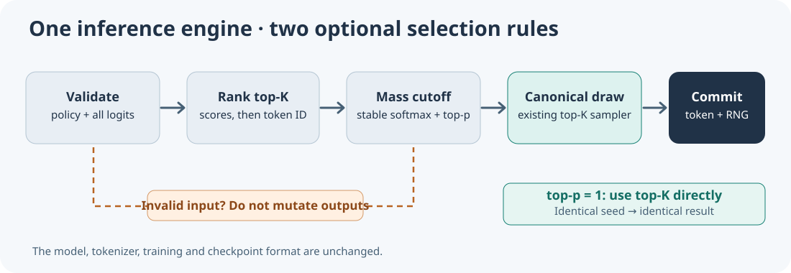

# Lesson 62 — Test top-p sampling and decoder compatibility in C23

**Bits to Banking · Umicom Foundation**  
**Author and project originator:** Sammy Hegab  
**Implementation:** Umicom Framework C23

## Learning objectives

Test a new inference feature without changing historical top-K behaviour.
Prove reproducibility, verify the reversible byte adapter and distinguish a
failed assertion from a test executable that Windows did not start.

## 1. A five-part verification path

Every nucleus-generation change needs separate evidence for:

1. **Policy validation:** `0 < topP <= 1`, finite positive temperature, valid
   topK and allowed range; no invalid or non-finite candidate logits.
2. **Mathematical cutoff:** the smallest descending-logit prefix reaches the
   requested fraction of the ORIGINAL top-K probability mass.
3. **Seeded determinism:** equal logits, seeds and policies produce equal
   tokens and the same random-state transition.
4. **Legacy parity:** `topP=1` produces exactly the original top-K result.
5. **Failure isolation:** rejected inputs do not change caller output buffers,
   byte counts, random state or model weights.



## 2. Verify the pure C23 selector

A carefully chosen example lets us test retained-candidate counts without
creating or training a decoder:

```c
const float scores[8] = {0, 0, 0, 0, 3, 2, 0, 0};
UmiAiTrainingNucleusOptions policy = {1.0F, 4U, 0.90F};
UmiAiTrainingRandomState state;
size_t selected = SIZE_MAX;
size_t retained = 0U;

UmiAiTrainingRandomSeed(&state, 42U);
UmiStatus status = UmiAiTrainingSampleLogitsNucleus(
    scores, 8U, 4U, 8U, &policy, &state, &selected, &retained);
/* On success, retained == 2 and selected is token 4 or token 5. */
```

When `topP=0.50`, only token 4 remains, so no random draw is needed.
When `topP=1`, the exact result and new RNG state must match a call to
`UmiAiTrainingSampleLogits` using the same `temperature`, `topK` and seed.

## 3. Test real decoder and byte generation

The Framework provides two additional opt-in operations:

```c
UmiStatus UmiAiTrainingDecoderGenerateNucleus(
    UmiAiTrainingDecoder *model,
    const size_t *promptTokenIds, size_t promptTokenCount,
    const UmiAiTrainingNucleusOptions *policy,
    size_t newTokenCount, uint64_t seed,
    size_t *outTokenIds, size_t capacity, size_t *outCount);

UmiStatus UmiAiTrainingDecoderGenerateBytesNucleus(
    UmiAiTrainingDecoder *model,
    const uint8_t *promptBytes, size_t promptLength,
    const UmiAiTrainingNucleusOptions *policy,
    size_t newByteCount, uint64_t seed,
    uint8_t *outBytes, size_t capacity, size_t *outCount);
```

Both consume the canonical decoder and the original rolling-context/byte
adapter pipeline. The first returns token IDs; the second returns exactly the
corresponding raw bytes for a model with vocabulary size 260. Generated bytes
are not necessarily printable text or valid UTF-8. No code is executed.

## 4. Run the registered Windows tests

After configuring and **successfully compiling** the Framework's native LLM
laboratory, run the existing generation regression cases:

```powershell
Set-Location 'C:\umicom\Umicom-Applications'
ctest --test-dir .\build\windows-ucrt64-native-llm-debug `
  -R '^framework\.ai\.training\.(generation|generation_bytes|generation_checkpoint)$' `
  --output-on-failure --no-tests=error
```

The registered cases cover seeded parity, invalid options, output-buffer
integrity, byte round trips and checkpoint preservation. A `Not Run` or
`BAD_COMMAND` message means the test process did not execute; it is not a
successful test and does not prove the underlying algorithm is defective.
Check that the executable exists, inspect the Windows security logs and
runtime dependencies, and try a direct invocation without disabling security
controls.

## 5. Interpreting results

A passing top-p sampler demonstrates consistent token selection under a
specified policy. It does **not** establish model competence or provenance.
A complete model assessment also needs independently reviewed test data,
held-out quality metrics, checkpoint/source identity and release approval.

## Exercises

1. Write a regression that uses `topP=0` and verifies the token output and
   RNG state stay unchanged.
2. Verify `topP=1` against the original top-K function with two seeds.
3. Test equal logits to show that lower token IDs take precedence.
4. Explain why compiling only the new executable is insufficient evidence that
   all previously registered regression tests can run.

**Key point:** A new optional inference policy is complete only when its
mathematical behaviour, historical compatibility and failure isolation are
verified independently.
