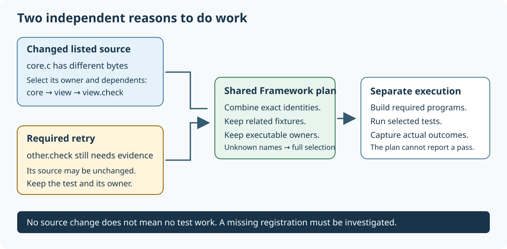

# Build only what changed

## Separate configuration, compilation and testing

Configuration reads a project's build description and records how files depend on one another. Compilation translates source files into object files. Linking joins the required objects and libraries into a program. Testing runs checks against that result. These stages answer different questions; repeating every stage is not always necessary.

An incremental build reuses outputs whose inputs have not changed. CMake describes the dependency graph and generates the native build instructions. In the Windows UCRT64 preset, Ninja executes those instructions. You do not need to name each edited source file to request an ordinary incremental build.

~~~text
editor changes one .c file
          |
          v
its object file becomes out of date
          |
          v
programs using that object are linked again

shared header changes
          |
          v
all source files that depend on it may need compilation
~~~

## Reuse the same build folder

1. Configure the intended preset once after installing its required tools. Keep that build folder; it holds the dependency graph and previous outputs.
2. Edit and save the source file. Saving changes the input that the builder observes.
3. Run the build command for the same preset. Do not add --clean-first when you want to retain useful previous work.
4. Read the result. An unchanged build may say that there is no work to do. A changed shared header can correctly trigger many compiler jobs.
5. Reconfigure when changing a build option or dependency. CMake may also regenerate automatically when a tracked build description changes. Use a fresh build folder when changing to an incompatible compiler or architecture.

~~~powershell
Set-Location "C:\umicom\Umicom-Applications"
$env:Path = "C:\msys64\ucrt64\bin;$env:Path"
cmake --build --preset windows-ucrt64-all-debug --parallel 2
~~~

Run this after the matching preset has been configured, as described in the setup guide. The command requests the normal build. It does not delete outputs, name one module, or prove that tests passed. Stop if the command reports an error.

## Why one edit can still cause a large build

A shared type declaration can affect many applications. A compiler flag can change generated machine code. A new public Framework contract identity can invalidate consumers even when a copied file retained an old timestamp. These are real dependencies, not necessarily a broken incremental builder.

Changing a comment can also update a file timestamp. A conventional compiler build may compile that file again. Do not assume that every builder compares program meaning, or that ignoring comments is always harmless: preprocessing, generated input and source-location diagnostics also matter. Umicom does not claim a universal semantic-only compiler.

## Derive a selection from source observations

Framework also provides a source-observation bridge for application hosts. Read [the observed-impact example](https://github.com/umicom-foundation/umicom-framework/blob/main/examples/observed_impact/main.c). It records the size and SHA-256 content identifier of listed inputs before and after a change, then uses UmiReleaseImpactFromObservations to select their owners, dependent targets and associated tests. SHA-256 is a digest of bytes; it does not describe program meaning or prove that a compiler consumed those bytes.

The teaching inventory has core, view and other libraries. view depends on core. Changing core.c selects core, view and view.check; the independent other.check stays outside that selection. With no earlier observation, the selector widens to the whole inventory. A current observation from a different inventory is rejected, so stale metadata cannot be presented as an exact selection.

A no-work plan means that the listed observations match. It does not mean that earlier failures were fixed. A host still has to schedule outstanding checks, refresh metadata for new or removed files and account for compiler, environment and resource changes. The example uses sample bytes in memory and does not build your project. Its README gives the separate installed-SDK exercise; keep that exercise distinct from executing the application tests it describes.

## Reuse test results only with evidence

Study [the automatic test driver](https://github.com/umicom-foundation/umicom-framework/blob/main/cmake/UmicomAutomaticTestsRun.cmake) and [the receipt API](https://github.com/umicom-foundation/umicom-framework/blob/main/include/umicom/testing/reuse.h). A receipt records evidence about a previous test result and the inputs associated with it. It is not permission to skip an arbitrary test just because its name passed yesterday.

An eligible unchanged passing result can be reused only when the driver has the required identity information. Failed tests remain candidates to run again. Missing or damaged evidence must not turn into a pass. If runtime library dependencies cannot be identified completely, the driver chooses a full run and records that reason. That conservative fallback can be slower, but it preserves coverage.

Runtime dependencies are libraries loaded when the program executes. On some Windows configurations, unresolved runtime imports prevent the driver from proving the complete dependency set. Do not remove those imports from the evidence merely to obtain a shorter test run.

<details>
<summary>Check your understanding</summary>
<p>Yesterday all tests passed. Today a shared Framework header changes. Is it safe to rerun only yesterday's failures?</p>
<p><strong>Answer:</strong> No. There were no failures, but the changed header may affect previously passing areas. Failed-test reruns help diagnose known failures; dependency-aware qualification must also account for changed inputs and newly affected tests.</p>
</details>

Read [the current automatic-build guide](https://github.com/umicom-foundation/umicom-framework/blob/main/docs/guides/automatic-builds.html) before using its qualification commands. Keep an ordinary incremental build, targeted diagnosis, and full release qualification as distinct operations.

[Previous lesson](06-use-an-installed-sdk.md) · [Course contents](index.md) · [Next lesson](08-read-build-and-test-evidence.md)

Sammy Hegab · Umicom Foundation · MIT. Original learning material.

## Why a passing row can still need another run

A test runner is a program that starts tests and collects their results. Its exit status tells the parent program whether the whole invocation completed successfully. A report row describes one test. These two observations answer different questions.

Suppose alpha passes and beta fails during one selected run. The report still records alpha's observed pass and beta's failure. Framework's automatic driver conservatively keeps both selected tests due because that runner invocation was unsuccessful. A third test, gamma, may have been excluded using an older matching pass. That separate historical receipt is retained if its inputs are still valid.

1. Open the run folder printed by automatic verification and read the transcript and results.xml together.
2. Distinguish tests that executed from tests reused from history. A saved passing row does not prove the runner completed successfully.
3. Fix the failure and run verification again without changing its files during execution. Some individually passing tests from the unsuccessful invocation will repeat.
4. Read the new report. Do not edit receipts.tsv to turn a failure, skipped test or unfinished run into a reusable pass.

The real Framework entry UmiTestReuseRecordProcess receives the parsed report input and a runnerSucceeded flag. False means the host did not establish successful runner completion. A reported pass then becomes NOT_RUN in the reuse table, while failures and other nonpasses stay recorded. The original XML remains separate evidence. Tests missing from a partial or damaged report never acquire a pass.

```c
/* The host sets this flag from the runner's actual exit result after
 * checking that the selected inputs stayed stable. */
UmiStatus status = UmiTestReuseRecordProcess(receipts, xml, xmlLength,
    runnerSucceeded);
```

Study include/umicom/testing/reuse.h, src/testing/reuse.c and tests/test_reuse/test_process_result.c in Umicom Framework. The retry-success case starts with an unsuccessful runner observation, checks that the test remains due, then records a successful retry. The mixed case checks that an observed pass and a failure remain distinct.

## Check your understanding

1. Why can one passing test not prove that the entire test runner succeeded?
2. Which evidence remains available when the reuse table keeps a test due?
3. Would a previously excluded, unchanged test need to lose its earlier pass just because another selected test failed? Explain the distinction.

A useful answer distinguishes the individual observation, the runner's exit status and the older input-bound receipt. The database and reports help investigate these facts; they do not replace execution.
## Combine source changes with tests that still need evidence



Imagine the example's core.c file changes. The graph says that view depends on core, so view.check must be included. Now imagine that other.check failed in an earlier run because a required resource was unavailable. Restoring that resource need not change other.c. Selecting only tests connected to changed source would miss this useful retry.

A required test is an exact registration name supplied to the planner. It is an additional reason to select work. Framework's UmiReleaseImpactFromObservationsWithTests combines these names with source observations. The example's union mode selects core, view and other, together with view.check and other.check. It does not run any of them.

1. Build the observed_impact SDK example using its README and a matching installed SDK.
2. Run the same mode and observe its empty source-derived selection. This is an example result, not evidence that your application passed.
3. Run retry. Listed bytes still match, but other.check and its owner are selected.
4. Run union. A core source edit and the separate other.check retry are both retained.
5. Run unknown-retry. The requested name is absent, so the planner selects the full configured graph. Investigate a renamed or missing registration instead of assuming that the old failure disappeared.

A fixture is shared test preparation or cleanup. For example, a reader check might require a test that first prepares a temporary catalogue. The configured graph records those relationships. The shared planner retains the connected group and the programs it requires; CTest still decides execution order and handles setup failure. Requiring one test does not automatically require every unrelated test using the same executable.

The public source examples are tests/release_impact/test_required_tests.c and tests/release_impact/test_observed_retries.c. The related case demonstrates fixture selection. The ownership case destroys the input inventory and observations after successful planning, then checks the plan's copied identity. This explains why a plan must own the data it exposes after the call.

The host application still needs to identify the correct previous run and environment. These functions do not find logs automatically, interpret an arbitrary report as current, launch a compiler or mark a test Done. The ordinary automatic verification driver uses its own checked receipt workflow. Keep selection, execution and acceptance as three separate responsibilities.