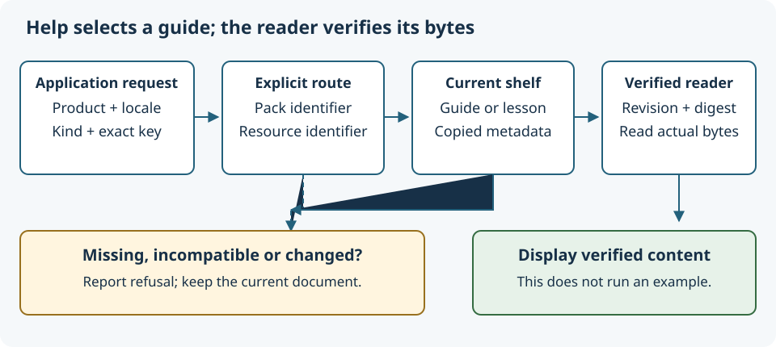

# Connect commands to helpful guides

<h2>What you will learn</h2>

Help is most useful when it explains the action a person is trying to take.
A general list of documents is useful for browsing, but someone who has just
seen a save error needs a guide about saving. This lesson follows Umicom
Framework's contextual-help service. You will learn how an application names an
action, how a small routing table selects a guide, and why selecting a guide is
separate from verifying the file that will be displayed.

You can follow the tables and draw the flow without installing a compiler.
If structures or pointers are unfamiliar, revisit Learning C and the earlier
offline-reader lesson. The complete example is
<code>examples/learning_pack_inspector/help.c</code> in the Framework repository.
It uses the same reusable services that a desktop, web or mobile interface can
call; a different interface still needs its own interaction and accessibility
checks.

<h2>1. Give actions stable names</h2>

A command is an action that an application can perform, such as opening a
document. An identifier is the stable name that code uses for that action.
A button might display “Documentation” while its command identifier is
<code>help.documentation</code>. Translating the button's caption should not
change what the command means.

A diagnostic is a reported condition, such as a file changing after a
catalogue was prepared. A topic is a subject someone can browse directly. These
are different kinds of help request. The same text can be used in two kinds
without making them the same request. For example, a command named
<code>document.save</code> and a topic named <code>document.save</code> can lead
to different explanations.

<table><thead><tr><th>Request field</th><th>Example</th><th>Meaning</th></tr></thead><tbody>
<tr><td>Product</td><td><code>studio</code></td><td>The application asking for help.</td></tr>
<tr><td>Locale</td><td><code>en</code></td><td>The requested language or regional convention.</td></tr>
<tr><td>Kind</td><td><code>UMI_LEARNING_HELP_COMMAND</code></td><td>This is help for a command.</td></tr>
<tr><td>Key</td><td><code>help.documentation</code></td><td>The exact identity within that kind.</td></tr>
</tbody></table>

The four fields together select a route. The product and key compare
exactly: <code>Studio</code> and <code>studio</code> are different. Locale case
is ignored for ASCII letters, so <code>en-GB</code> and <code>EN-gb</code> match.
However, <code>en</code> does not automatically match <code>en-GB</code>.
A product can offer an explicit language choice instead of silently presenting
a different edition.

<h2>2. Describe a route in C</h2>

A route associates the request with a pack identifier and a resource
identifier. A pack is the collection described by a learning manifest; a
resource is one guide or lesson inside it. The route does not contain a web
address, an executable command or a guessed filename.

<pre><code>UmiLearningHelpRoute route = {
    .request = {
        .product = "studio",
        .locale = "en",
        .kind = UMI_LEARNING_HELP_COMMAND,
        .key = "help.documentation"
    },
    .pack_id = "framework.learning-packs",
    .resource_id = "guide"
};</code></pre>

The dots name members of a C structure. The braces group values belonging to
that structure. The inner braces describe the request; the two final fields
describe its destination. The words in quotation marks are character strings.
The named constant beginning <code>UMI_</code> is one value of an enumeration:
a small named set of choices.

Here Studio deliberately uses a Framework guide. Shared material can serve
several applications without maintaining independent copies of its routing
logic. The product that owns the interface chooses this policy. A sentence
inside a downloaded guide cannot install another route or change the meaning
of a command.

<h2>3. Copy the policy into an owner</h2>
<pre><code>UmiLearningHelpMap *map = NULL;
UmiStatus status = UmiLearningHelpMapCreate(&amp;route, 1U, &amp;map);</code></pre>

<code>map</code> is a pointer to the object that owns the copied routes.
<code>NULL</code> means it initially points to no object. The ampersand in
<code>&amp;route</code> passes the address of the route. The ampersand in
<code>&amp;map</code> allows the function to store the newly created owner's
address. <code>1U</code> says there is one input route.

The creation function checks every route before publishing the map. Strings
must end within their fixed-size arrays. A key starts with a letter or digit
and then uses letters, digits, dots, hyphens or underscores. Spaces, slashes and
web addresses are refused. There can be no more than 128 routes. An empty map
is valid, but it cannot resolve any help request.

Two routes with the same request identity are refused, even if they point to
the same guide. Otherwise the order of a configuration file could silently
decide which destination wins. The map copies its input, so changing
<code>route</code> after successful creation does not change the stored policy.
Release the map with <code>UmiLearningHelpMapDestroy</code> when its owner has
finished using it.

<h2>4. Resolve against the loaded catalogue</h2>

A shelf owns the learning packs that the application has explicitly loaded.
Resolving means looking up the requested identity in the map, then checking
that its target exists in this current shelf. This operation only reads
metadata: the descriptions already held in memory. It does not open resource
files or contact a server.

<pre><code>UmiLearningHelpSelection selected;
if (status == UMI_STATUS_OK) {
    status = UmiLearningHelpResolve(map, shelf, &amp;route.request, &amp;selected);
}</code></pre>

This is a fragment, not a complete program: <code>shelf</code> must already
contain the sample pack. Read <code>help.c</code> for the complete load, adopt,
resolve and cleanup sequence. The condition prevents the next operation from
using a map that was not successfully created.

A successful selection contains copies of the route, pack description and
resource description. The resource must be a guide or lesson. An example file
or image is not treated as a help page merely because a route points to it.
The target pack's locale must match the request. Missing routes, unloaded packs
and missing resources report <code>NOT_FOUND</code>; a wrong target locale
reports <code>UNAVAILABLE</code>. On refusal the output is unchanged, so the
caller must inspect the returned status before using it.

<h2>5. Verify before showing the guide</h2>
<figure><figcaption>Routing and reading have separate responsibilities.</figcaption></figure>
<pre><code>UmiLearningReader *reader = NULL;
if (status == UMI_STATUS_OK) {
    status = UmiLearningReaderCreateFromShelf(
        shelf, selected.pack.id, selected.pack.revision,
        selected.resource.id, selected.resource.sha256,
        1024U * 1024U, &amp;reader);
}</code></pre>

The final numeric expression allows at most one mebibyte of resource bytes.
The reader rechecks the pack identifier, content revision, resource identifier
and digest before publishing a verified document. If the pack was replaced
between resolving and opening, an old selection must not quietly become a
different guide. If the source bytes changed, the digest comparison refuses
them.

A copied selection remains readable after its original map or shelf is
destroyed. That is a memory-ownership guarantee, not a claim that the selection
still describes the newest catalogue. Resolve again when you need current
metadata, and always verify bytes before display. A matching digest shows
consistency with the chosen manifest; it does not identify a trustworthy author.

In a graphical application, local file reading belongs on a worker so it does
not stop the window responding. <code>UmiLearningCatalogueGtk4OpenHelp</code>
uses this same routing service and the catalogue's existing asynchronous reader.
The map and request may be released after the call returns because an accepted
job owns its captured metadata. A return of <code>OK</code> means that the job
was accepted. Its later completion can still report a read failure.

<h2>6. Follow the real example</h2>
<ol>
<li>Find <code>examples/learning_pack_inspector/help.c</code> in Framework.
Locate the three rows in the <code>routes</code> array.</li>
<li>Read how the program converts its command-line kind into the enumeration.
An unknown kind returns an argument error before opening the pack.</li>
<li>Follow each assignment to <code>status</code>. Mark which calls read files
and which only inspect copied metadata.</li>
<li>Find the reader snapshot used for the two output lines. The program prints
a successful result only after the guide's bytes have been verified.</li>
<li>Follow cleanup at the end: reader, map, shelf and any unadopted pack each
have an explicit owner and release operation.</li>
</ol>

After building the installed-SDK example using its guide, run the help
executable from the example's build directory:

<pre><code>.&#92;umicom-learning-pack-help.exe "C:&#92;umicom&#92;practice&#92;learning-inspector&#92;pack" learning-pack.json command help.documentation</code></pre>

Use the actual absolute generated pack directory from your configuration.
With a multi-configuration generator, the executable may be inside its
configuration directory. Expected output identifies
<code>framework.learning-packs::guide</code> and reports the verified byte
count. That count depends on the guide file, including its line endings.

Try an unregistered key such as <code>absent.command</code>. The program must
return a nonzero status and must not print a successful help selection.
The example's CMake checks compare both the exit status and expected output;
a reassuring line alone cannot make a failed process pass.

<h2>7. Design an interface around the result</h2>

Keep ordinary catalogue search available when no context-specific route
exists. Explain the refusal in normal language and let the person choose the
next action. Do not run a command, download a pack or grant execution trust
merely because a help route is missing.

Search and help serve different purposes. A search result can be approximate;
a contextual route is exact. The native catalogue can open a mapped guide even
when the visible search has no matching rows. Opening another guide in the
same pack retains that reader's history. A request involving another pack starts
that pack's reading session. The existing display limits still apply: the
initial native reader shows HTML as plain text.

<h2>Check your understanding</h2>
<ol>
<li>Why is a translated button caption a poor routing key?</li>
<li>Why should two routes for the same request be rejected?</li>
<li>What can change between resolving metadata and reading a file?</li>
<li>Does copying a selection prove that it is current or trustworthy?</li>
<li>What does an asynchronous return of <code>OK</code> promise?</li>
</ol>

Compare your answers

A caption can change with language or wording while a command identity stays
stable. Duplicate routes make policy ambiguous. A pack can be replaced or its
file bytes can change between operations. A copied selection owns its memory,
but does not establish freshness or publisher trust. Asynchronous
<code>OK</code> promises admission of the request; the later operation still
needs a checked completion result.

For a design exercise, write two routes on paper: one for a command and one
for a diagnostic in Umicom Trader. Give each an exact locale and an existing
guide identity. Mark the checks required before either guide is displayed.
This proposes routing policy; it does not claim those Trader controls are
already connected.

[Previous lesson](14-copy-examples-without-overwriting.md) · [Course overview](index.md)

[Next: revision-bound checkpoints](16-keep-revision-bound-checkpoints.md)
