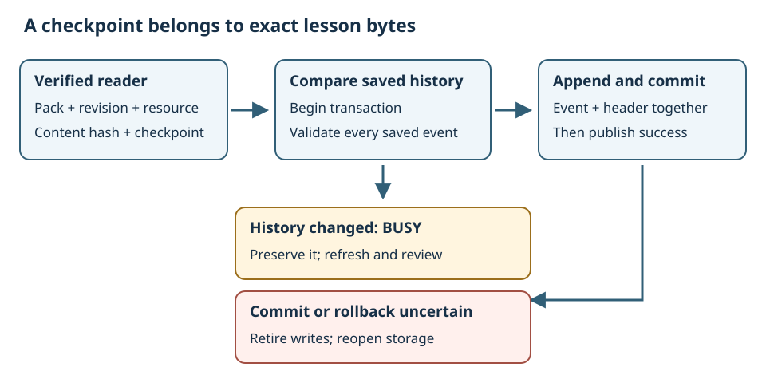

# Keep learning checkpoints with their source revision

<h2>What you will learn</h2>

A learning application needs to remember useful work. A learner might finish a
reading checkpoint, review an exercise and return another day. Saving a number
such as “three lessons complete” is not enough: the lessons may change, two
windows may save at the same time, or storage may fail. This lesson follows
Umicom Framework's learning progress service to see how a small journal keeps
those situations explicit.

No database experience is required. You can first follow the tables and draw
the steps on paper. The complete C example is
<code>examples/learning_pack_inspector/progress.c</code>. The reusable contract is
<code>include/umicom/teacher/learning_progress.h</code>. Both belong to Framework;
Studio and other applications can use that service rather than inventing
different record formats.

<h2>1. Separate a document from a learner's record</h2>

A <strong>document</strong> contains the lesson. A <strong>checkpoint</strong>
records an explicit action concerning it. Reading a page, reviewing an answer and
passing an assessed exercise are different actions. A program should not turn
one into another without an agreed rule.

Imagine a lesson explaining file ownership. You read its first revision and
record <code>read</code>. Later the author adds a new exercise. Your earlier
record is still true: you read the earlier lesson. It does not prove that you
read the new exercise. Keeping both facts is more accurate than erasing your
history or declaring the new lesson complete.

<table><thead><tr><th>Item</th><th>Example</th><th>Purpose</th></tr></thead><tbody>
<tr><td>Pack ID</td><td><code>framework.learning-packs</code></td><td>Identify the collection.</td></tr>
<tr><td>Resource ID</td><td><code>guide</code></td><td>Identify the document within that collection.</td></tr>
<tr><td>Revision</td><td><code>1</code></td><td>Identify the collection's declared edition.</td></tr>
<tr><td>Content hash</td><td>A SHA-256 value</td><td>Identify the exact document bytes checked by the reader.</td></tr>
<tr><td>Checkpoint</td><td><code>read</code></td><td>Name the action the learner deliberately recorded.</td></tr>
<tr><td>Evidence reference</td><td><code>review-001</code></td><td>Refer to supporting material by a local identifier.</td></tr>
</tbody></table>

A hash is a calculated fingerprint of bytes. It helps detect changes; it does
not tell us whether the author is honest or an answer is correct. The progress
service also does not inspect the material named by an evidence reference.
Applications must explain whether a checkpoint is self-recorded, reviewed or
assessed.

<h2>2. Understand a journal</h2>

A <strong>journal</strong> is an ordered list of events. An event states what
was recorded. New events are appended at the end. The progress API does not edit
or delete older events. Each event has a sequence number: one, two, three, and so
on. A sequence number gives order, not a date or time.

<pre><code>Event 1: revision 1, guide, read, review-001
Event 2: revision 1, guide, exercise-reviewed, review-002
Event 3: revision 2, guide, read, review-003</code></pre>

The first and third rows describe different lesson revisions. Looking for
current reading progress for revision two selects the third row. Looking for
exercise review in revision two finds no matching event. The second row remains
in history but does not silently satisfy that new query.

Umicom's journal permits 256 events for one learner in this initial service.
A bound is a declared limit. It lets the implementation allocate a known amount
of memory and refuse further entries clearly. The archive API can export history and import it into an empty journal for the
same learner. Rotation is still future work; the implementation does not delete
old events when it reaches the limit.

<h2>3. Choose where the records live</h2>

A <strong>Data Server</strong> is Framework's key/value storage interface. A key
names a value, rather like a labelled entry in a directory. The progress service
uses this existing interface instead of directly implementing another database.

The memory backend stores records inside the running process. It is useful for
examples and tests, but its records disappear when the server is destroyed.
The SQLite backend stores records in a selected database file and can reopen
them after the application exits. A <strong>backend</strong> is the implementation
behind the same interface.

Choose a private record location separately from the course directory and
public source repository. Do not save learner conversations or credentials in
checkpoint identifiers. This database is plaintext local storage; choosing a
learner ID does not log someone in or authenticate their identity.

<h2>4. Follow the ownership in the C example</h2>
<pre><code>UmiLearningProgress *progress = NULL;
UmiLearningProgressEvent event;
UmiStatus status = UmiLearningProgressOpen(server, "learner", &amp;progress);</code></pre>

<code>UmiLearningProgress</code> is the type of a journal owner. The asterisk
declares a pointer: a value through which the program refers to that owner.
<code>NULL</code> means no owner has been assigned yet. The address expression
<code>&amp;progress</code> lets the function return the new pointer to the caller.

<code>server</code> is borrowed. Borrowing means that the journal can use the
Data Server while its caller keeps it alive, but closing the journal does not
destroy the server. Close the journal first and the server afterwards. The
reader is also borrowed for the duration of a recording call.

<pre><code>if (status == UMI_STATUS_OK) {
    status = UmiLearningProgressRecord(
        progress, reader, "read", "review-001", &amp;event);
}
UmiLearningProgressClose(progress);</code></pre>

The <code>if</code> statement calls Record only when opening succeeded. The
reader must already hold verified guide or lesson bytes. Recording an image or
source example is refused. <code>event</code> receives the committed record only
when the operation succeeds; after a failure, the caller must not present it as
a new success.

Opening a document does not call Record automatically. A host application needs
an explicit control and a clear description of what the checkpoint means.
The native catalogue currently provides reading and example-copy controls;
these journal controls still need application integration.

<h2>5. Make related writes a transaction</h2>

The stored journal has a header stating how many events exist and a separate
record for each event. Appending needs to write both the new event and the new
header. If only one write succeeds, the journal would be inconsistent.

A <strong>transaction</strong> groups those writes. Begin reserves the storage
operation. Commit asks storage to accept the group. Rollback asks it to abandon
the uncommitted group. The application must check the result of each step,
including rollback: storage errors do not disappear merely because the program
tried to recover.

The Framework service reads and validates the journal inside the transaction
before appending. It checks the saved events against the projection previously
shown to the caller. A <strong>projection</strong> is the in-memory view of the
stored history. It is useful for display but may become old when another owner
writes.

<h2>6. Prevent a stale window overwriting newer work</h2>

Suppose two windows open the same learner's journal when it has one event.
Window A records a second event. Window B still remembers one event. B must not
write as though A's action never happened.

<ol>
<li>B starts its transaction and loads the current stored history.</li>
<li>The stored history differs from B's projection.</li>
<li>B receives <code>BUSY</code>, its output event remains unchanged and no event is appended.</li>
<li>The application refreshes B's journal and shows the newer history.</li>
<li>The learner can decide whether the intended action is still appropriate.</li>
</ol>

Checking only the count would miss an edit that changed an older event while
leaving the count the same. The implementation compares canonical records:
records in one defined format. It does not compare C structure padding, which
is unused space that a compiler may place between fields.

<h2>7. Handle an uncertain save</h2>

A failed commit is not proof that nothing was saved. Storage may have accepted
the event before the result became uncertain. Automatically repeating the action
can therefore produce a misleading result.

The journal exposes <code>recovery_required</code> after commit or rollback
uncertainty. Further writes and current-progress queries are refused through
that owner. Its last known events remain available for inspection, but they
must be labelled as the last known view. Close the journal, establish a new
storage connection and reopen the saved record before deciding what happened.

The regression file <code>tests/learning_pack/test_progress_faults.c</code>
deliberately creates both kinds of failed commit: one before storage accepts the
event, and one after acceptance. This is <strong>fault injection</strong>:
introducing a controlled failure to examine recovery. It does not make the
production service fail randomly.

<h2>8. Try the temporary example</h2>

After building the installed SDK example, use its build directory and run:

<pre><code>.\umicom-learning-pack-progress.exe memory "$PWD\pack" learning-pack.json guide</code></pre>

The expected result names checkpoint <code>read</code>, guide revision one,
event one and temporary storage. The program closes and reopens the journal
while retaining the same memory Data Server. It does not claim that memory
survives process shutdown.

Read Framework's <code>docs/learning/learning-checkpoints.html</code> for the
explicit SQLite record and read-only show commands. Those commands require a
SQLite-enabled SDK. Check a nonzero exit code instead of assuming that printed
text means success.

A private archive is a portable copy of the journal, not a course file.
<code>UmiLearningProgressExport</code> copies the current records to a buffer.
<code>UmiLearningProgressImportEmpty</code> checks the entire archive and refuses
another learner ID or an existing journal. LF and CRLF line endings are
accepted, but incomplete lines, duplicate events and unknown versions are
refused. The SDK <code>archive.c</code> example demonstrates saving to a new file
without overwriting one. Keep exported history outside public repositories;
importing it does not authenticate its learning claims.

<h2>9. Check your understanding</h2>
<ol>
<li>Why does an old checkpoint stay in history when a lesson changes?</li>
<li>What is the difference between a content hash and a teacher's assessment?</li>
<li>Why are the event and journal header written in one transaction?</li>
<li>What should a second window do after a stale-writer refusal?</li>
<li>Why must a commit error be investigated before retrying?</li>
</ol>

Compare your answers

The old checkpoint still
describes real work on an older document. A hash identifies bytes; an assessment
evaluates learning. The related writes must agree. The second window refreshes
and lets its owner review the new history. A commit error can occur after the
event became stored, so an immediate retry cannot safely assume nothing happened.

As a paper exercise, draw two windows and three journal events. Let the windows
take turns recording different checkpoints, then change the lesson revision.
Mark which queries should return a current record and which should return
<code>NOT_FOUND</code>. Compare your answers with the cases in
<code>tests/learning_pack/test_progress.c</code>.

[Previous lesson](15-connect-commands-to-guides.md) · [Course overview](index.md)
