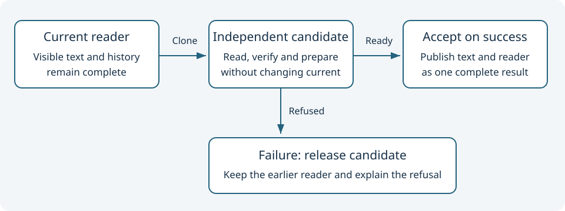

# Keep reading state consistent

<h2>What you will learn</h2>

A reader should not show one document while its Back button remembers a different document. This lesson explains how Umicom Framework keeps a visible reading session consistent when a new operation can fail. The same design is useful when an editor prepares a preview, a trading application calculates a view or a media application prepares a playlist. Each application still needs its own rules; a document reader does not provide trading or media behaviour by itself.

You can follow the first sections with paper and a pencil. For the C example, you should recognise a function call, a pointer and an <code>if</code> statement. Revisit <a href="../../courses/learning-c/index.html">Learning C</a> if those terms are new. We will explain ownership and candidate state here. The complete executable example is <code>examples/learning_pack_inspector/transaction.c</code> in Umicom Framework.

<h2>1. Decide which facts must agree</h2>

Suppose the catalogue currently displays a guide called “First lesson”. Its reader remembers the guide's identifier, its verified bytes, the position in history and the maximum amount of content it may read. The window also contains text prepared for display. These are related facts. If the reader advances to “Second lesson” but the window still shows the first lesson, the user cannot reliably interpret Back, Forward or Copy Example.

<strong>State</strong> means the information a program currently remembers. A <strong>consistent state</strong> is one in which the related facts obey the program's rules. For this reader, the selected resource and displayed text must belong to the same successful operation. Consistency is more precise than simply checking that no function crashed.

<table><thead><tr><th>Fact</th><th>Before an operation</th><th>After a successful operation</th></tr></thead><tbody>
<tr><td>Selected resource</td><td>First lesson</td><td>Second lesson</td></tr>
<tr><td>Displayed text</td><td>First lesson's text</td><td>Second lesson's text</td></tr>
<tr><td>History cursor</td><td>Points to the first lesson</td><td>Points to the second lesson</td></tr>
<tr><td>Previous lesson</td><td>Whatever was already in history</td><td>First lesson remains available through Back</td></tr>
</tbody></table>

If an operation fails, the earlier complete reading state remains available. A status message may change to explain the failure. Keeping the document does not mean hiding that message or reporting success.

<h2>2. Understand why a pointer assignment is not an independent copy</h2>

A pointer stores the location of an object. If two pointer variables contain the same location, they refer to the same object. Assigning one pointer to another does not duplicate the document, history or allocation behind it:

<pre><code>UmiLearningReader *candidate = current;</code></pre>

In that statement, changing <code>candidate</code>'s reader also changes the object reached through <code>current</code>. Destroying both pointers as if they owned separate readers would attempt to release the same object twice. The variable names do not create ownership; the API contract tells you who must eventually release each object.

A <strong>deep copy</strong> allocates independent storage for the data that the new owner needs. Framework provides <code>UmiLearningReaderClone</code> for this purpose. It copies the admitted pack metadata, verified in-memory bytes, history and content limit. The resulting reader can be destroyed or navigated independently of the original.

<pre><code>UmiLearningReader *candidate = NULL;
UmiStatus status = UmiLearningReaderClone(current, &amp;candidate);</code></pre>

<code>NULL</code> means that no reader is owned by this variable yet. The ampersand in <code>&amp;candidate</code> gives the function access to the pointer variable so it can return a new owner. Check <code>status</code> before using that owner. Supply separate output storage; do not overwrite the only pointer that owns the original.

<h2>3. Prepare a candidate before changing the visible state</h2>

A <strong>candidate</strong> is a possible next state which has not yet been accepted. Start from an independent reader, navigate it to the requested resource, then prepare anything needed for display. Only after those steps succeed should it replace the current reader.

<ol>
<li>Keep ownership of the complete current reader.</li>
<li>Create an independent candidate.</li>
<li>Ask the candidate to open the selected resource. The reader checks the file against the admitted pack's hash.</li>
<li>Prepare the candidate's display text. A graphical application may need another memory allocation here.</li>
<li>Accept the candidate only when the complete operation has succeeded.</li>
<li>If any step fails, release the candidate and keep the current reader.</li>
</ol>

This is a transaction in memory: a group of changes becomes visible together. It is not automatically a database transaction, a disk backup or a crash-recovery mechanism. The checkpoint journal from the previous lesson uses storage transactions for a different boundary.

A candidate also costs memory. A large reader can temporarily require space for both the original bytes and their copy. Framework therefore keeps explicit content limits. The native catalogue uses a smaller limit than the maximum supported by the core reader. An application must choose a practical bound rather than assuming every allocation will succeed.

<h2>4. Follow the actual Framework implementation</h2>

Open these source files in Studio. Start with the public contract, then follow one call into the implementation:

<ol>
<li><code>include/umicom/teacher/learning_reader.h</code> explains what Clone copies and what it does not verify.</li>
<li><code>src/teacher/learning_pack_copy.c</code> copies pack metadata and its root. It does not read the manifest again.</li>
<li><code>src/teacher/learning_reader.c</code> copies the reader's already verified bytes and history. Every failed allocation releases the incomplete candidate.</li>
<li><code>adapters/gtk4/learning_catalogue_jobs.c</code> keeps the transferred original reader while a worker prepares its candidate and text.</li>
<li><code>tests/learning_pack/test_catalogue_presentation_failure_gtk4.c</code> supplies controlled allocation failures to the actual worker implementation.</li>
</ol>

Cloning does not prove the file on disk is unchanged. It copies the bytes which were verified earlier. A later Open, Follow or Reload reads and verifies the requested file again. This distinction makes it possible to retain the last good display when a file changes unexpectedly.

The worker owns ordinary C objects while it prepares the result. It does not borrow the window's labels or text widget. The GTK owner thread receives the completed result and updates the live window. If the window has closed, that result is discarded and its owned objects are released. Ownership still matters when the user can no longer see the operation.

<h2>5. Inspect the small console example</h2>

The console example separates preparation from an explicit decision:

<pre><code>status = UmiLearningReaderClone(current, &amp;candidate);
if (status == UMI_STATUS_OK)
    status = UmiLearningReaderOpen(candidate, candidate_id);

if (status == UMI_STATUS_OK &amp;&amp; accept_candidate) {
    UmiLearningReaderDestroy(current);
    current = candidate;
    candidate = NULL;
}
UmiLearningReaderDestroy(candidate);</code></pre>

This excerpt illustrates the ownership transfer; read the complete example for argument checks, diagnostics and cleanup. After acceptance, <code>current</code> owns the new reader. Setting <code>candidate</code> to <code>NULL</code> prevents the later cleanup from releasing that same reader again. After rejection, the old <code>current</code> remains owned and the independent candidate is released.

The example accepts either <code>accept</code> or <code>reject</code> as its decision. A graphical application would first prepare its real display instead of treating a command-line word as a rendering result. This console program demonstrates the ownership boundary without claiming to test a native window.

<h2>6. Run the example with a matching installed SDK</h2>

First follow the example's <code>guide.html</code> to configure its project against a matching installed Framework SDK and build its targets. These commands assume your current directory is the example build folder, containing the generated <code>pack</code> folder and executables. Do not run them from the source directory by accident.

<pre><code>.\umicom-learning-reader-transaction.exe "$PWD\pack" learning-pack.json guide inspector reject
.\umicom-learning-reader-transaction.exe "$PWD\pack" learning-pack.json guide inspector accept</code></pre>

The rejected decision should report <code>Resource: guide</code> and one history entry. The accepted decision should report <code>Resource: inspector</code> and two history entries. Each command starts a new process and a fresh reader; the second command is not continuing the first process's memory.

Now request a resource that is not declared:

<pre><code>.\umicom-learning-reader-transaction.exe "$PWD\pack" learning-pack.json guide missing-resource accept</code></pre>

This should report a refused candidate, return a nonzero process status and still identify the original guide. A nonzero status is the program's explicit failure signal. Do not decide that a command passed merely because it printed a familiar resource name. The installed example's regression wrapper checks both the status and exact result text.

<h2>7. Read evidence for the important failure cases</h2>

A useful regression check deliberately creates the situation it claims to cover. To check allocation failure, the test substitutes two narrow allocation calls in the actual catalogue worker. It does not add a secret production option or claim that every operating-system memory failure has been tested.

The checks compare the document identifier, history position, revision and displayed text before and after the refused operation. They then perform a real retry without the injected failure. The retry checks that cleanup did not leave the old reader unusable. Separate clone cases cover binary bytes, changed files, source destruction, history independence and preserved read limits.

A registered test is not an executed result. Compile the matching source, run the relevant tests and keep their output before describing the workflow as verified. A headless environment may skip native GTK cases; a skip does not demonstrate successful window behaviour.

<h2>8. Practise explaining the design</h2>
<ol>
<li>Draw two boxes labelled current and candidate. Add separate arrows for their owned pack and content bytes.</li>
<li>Walk through a successful Open and cross out the old current only after acceptance.</li>
<li>Repeat with a failed content verification. Which object is released?</li>
<li>Repeat with a successful read followed by a failed preview allocation.</li>
<li>Explain why a plain pointer assignment cannot provide the same protection.</li>
</ol>

Compare your reasoning

The candidate owns its own data. On failure it is released while the original stays available. On success ownership of the candidate moves into current and the former current is released. A pointer assignment alone makes both names refer to the same object, so mutation or destruction through either name affects that one object.

For a final source exercise, find where the native worker clears a failed candidate's snapshot before returning the previous reader. Explain why publishing that new snapshot alongside the old text would still be inconsistent, even if no memory leaked.

[Previous lesson](16-keep-revision-bound-checkpoints.md) · [Course overview](index.md)
