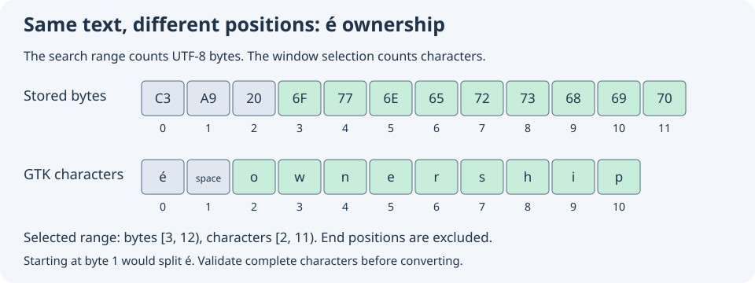

# Open search results without losing your place

Read the accompanying [Umicom source example](https://github.com/umicom-foundation/umicom-framework/blob/main/adapters/gtk4/learning_catalogue_body_navigation.c). Match its revision to your checkout before comparing behavior.

A useful search tool does more than list filenames. It takes you to the words you searched for, keeps the document readable, and refuses to apply an old location to a different file. This lesson follows that journey through Umicom Framework’s shared learning catalogue, which Studio can embed.

You can complete the reading and paper exercises without installing software. When you try the window, use a build that includes the learning catalogue and a reviewed learning pack. A pack is a folder of resources with a manifest: a file describing what each resource is and which bytes are expected. Start with [Search verified learning resources](26-search-verified-learning-resources.md) if these terms are new.

## 1. Understand the three things a result carries

A search result contains an identity, a location and a preview. The identity tells the reader which pack and resource the result belongs to. The location says where the matching text begins and ends. The preview is a short piece of text for the list. These are related, but they are not interchangeable.

In `UmiLearningTextHit`, the copied pack description includes its ID and revision. A revision is a number used by that pack to identify an edition. The resource description includes an ID and a SHA-256 digest. The digest is calculated from file bytes. Checking it helps detect a file that differs from the admitted manifest; it does not prove the publisher’s identity.

The fields `byte_start` and `byte_end` describe a half-open range. This means that the first position is included and the end position is excluded. For a match occupying bytes 3 through 11, the range is written as 3..12 and its length is 12 − 3 = 9 bytes. This convention lets adjacent ranges share a boundary without sharing a byte.

## 2. Count bytes and characters separately

A byte is a small unit of stored data. A character is a unit of text represented by an encoding. UTF-8 represents many familiar letters with one byte, but some characters need several bytes. Therefore, adding a byte offset to a GTK text position can select the wrong letters.



In the illustrated text, `é` occupies two UTF-8 bytes. The following space occupies one. The word `ownership` begins at byte 3 but at character position 2. GTK’s text buffer uses character positions. The search engine reports byte positions. The adapter must convert between the two after checking the text.

A valid beginning or end must lie between complete UTF-8 characters. Byte 1 lies inside the two-byte encoding of `é`, so it cannot be a character boundary. A range that starts there is refused. This is a correctness rule: the program must not highlight half of an encoded character.

UTF-8 characters are not always the same as the visual symbols a reader perceives. A letter and a combining accent may use more than one encoded character. This service follows UTF-8 character boundaries and literal matching; it does not promise language-specific word segmentation or Unicode normalization.

## 3. Follow the request through the real source

1. Open `adapters/gtk4/learning_catalogue_body.c`. Find `UmiLearningCatalogueGtk4ReadBodySearchResult`. It refuses a busy or retired panel, checks whether the result still belongs to the shelf generation, and copies the chosen hit.
2. Open `adapters/gtk4/learning_catalogue_selection.c`. Find `LearningCatalogueOpenTextHit` and `OpenSelectionRequest`. The request copies the hit before worker dispatch. The worker does not keep a pointer into a dropdown row or the caller’s stack.
3. Open `adapters/gtk4/learning_catalogue_jobs.c`. Find the active `CatalogueWorker` implementation. A worker is background work that allows the window’s event loop to keep responding. The worker opens the expected resource through the verified reader.
4. Follow `PrepareDisplay`, then `LearningCataloguePrepareBodySelection`. They prepare the reading representation and validate the location before accepting the candidate reader.
5. Follow completion back to `LearningCataloguePublishBodySelection`. This runs on the GTK thread, checks the displayed text and applies the converted range. Scrolling happens only while the panel is still active.

Some older implementations are retained in disabled blocks for engineering review. A C preprocessor block beginning with `#if 0` does not execute. Follow the active function outside that block. This distinction matters when studying a repository that keeps previous implementations for comparison.

## 4. Verify before changing the visible document

Suppose a result was created yesterday and its source file changes today. Yesterday’s offset can now refer to another word. The reader therefore checks the captured revision and digest when opening the result. If verification fails, it keeps the previously visible document and selection.

The worker uses a candidate reader: an independently owned proposed next state. Preparing a display or checking its match may fail after the file has been opened. The candidate is accepted only when all required steps succeed. On refusal it is destroyed and the earlier reader is returned. This is a transaction boundary: a complete change becomes visible together, or the previous complete state remains.

```c
if (job->status == UMI_STATUS_OK && job->selects_text_hit)
    job->status = LearningCataloguePrepareBodySelection(job);

/* The surrounding worker accepts the candidate only on success. */
if (job->status == UMI_STATUS_OK)
    UmiLearningReaderDestroy(previous);
```

This excerpt is part of the real worker, not a complete program. `job` owns one accepted request. `status` records whether the current step succeeded. `previous` owns the earlier reader. The omitted failure branch releases the candidate, returns the previous reader and clears the proposed snapshot. Read the surrounding function before changing this ownership sequence.

## 5. Distinguish source text from HTML reading text

A source example is searched as verified UTF-8 text. An HTML guide contains markup such as paragraph tags that should not appear as visible words. The shared browser reading service constructs an inert reading projection: text and structural information for presentation without executing scripts.

A guide search range refers to that reading projection, not the HTML file’s raw bytes. The reader must recreate the same representation. A shortened fallback preview is not a substitute because its positions may differ. The location validator refuses that mismatch rather than selecting an unrelated passage.

The current search returns the first occurrence in each matching resource. Once you open it, use Find in this resource to move to later occurrences. Back, Forward and Reload still navigate resources; they do not automatically replay a previous search highlight. Selecting Read result again applies that result’s location after verification.

## 6. Practise the native workflow

1. Open the application’s shared learning catalogue and load the reviewed pack you want to use. Read its title, product ID and language tag.
2. Expand Search inside guides and examples. Enter a phrase that occurs in an actual guide paragraph or source comment.
3. Leave Product ID and Language tag empty for a broad search. Choose All readable resources. Select Search text.
4. Select a result and choose Read result. Expect the matching passage to be selected. Check the resource identity as well as the visible words.
5. Try the Product ID filter using the exact manifest value. Product IDs are case-sensitive. Try a language tag such as en-GB; ASCII letter case is ignored, but en is not a fallback for en-GB.
6. Choose Examples to restrict results to source examples. Changing these controls does not change existing results until you request another search.
7. Use Refresh search when you want to reread files. If a reviewed source file changed without a matching manifest, expect a refusal and retained earlier results. Review the file and manifest together; do not bypass the digest check.

A search snapshot is a copy of the text at one point. Reusing it avoids reading every resource for every query. It does not continuously watch the disk. Reading a selected result is a separate verification boundary, so an older snapshot does not authorize opening changed bytes.

## 7. Understand callbacks without needing another language

A callback is a function registered to run when an event occurs. GTK can call it synchronously while a label or text selection changes. Synchronous means that the callback runs before the original function finishes. This can happen even when all window code uses one thread.

Imagine changing the selected text and immediately receiving a callback that tries to start another reader request. The first request is still publishing its state. The catalogue’s busy flag refuses the second mutation until publication finishes. Error notices need the same protection: reporting an invalid query can also emit a label-change notification.

Retirement means that a panel is closing and must accept no new work. An accepted file operation may finish privately after retirement. Its owned data is released without updating the closed panel. These rules are about object lifetime and consistent state, not just the appearance of a disabled button.

## 8. Read the regression cases

1. Read `tests/learning_pack/test_body_location.c`. Compare the unicode-prefix, start-split and end-split cases. Write down which range is valid and why.
2. Read `tests/learning_pack/test_body_navigation_gtk4.c`. The changed-source and invalid-location cases start with a readable guide, attempt a refused next selection, and check that the earlier selection remains.
3. Read the visible-mutated case. It deliberately changes the displayed buffer during publication. The verified reader may remain open, but applying a location to altered display text must refuse.
4. Read `tests/learning_pack/test_body_filters_gtk4.c`. The snapshot case changes caller storage after dispatch to check that the worker owns a copy. The control-notice case checks the busy boundary during error reporting.

Reading a test explains the intended contract; it is not evidence that the test has passed on your machine. Execute the appropriate tests for your configured build, retain the logs and distinguish skipped window checks from successful runs. A console check cannot establish that scrolling, keyboard focus or a screen reader works correctly.

## 9. Check your understanding

1. Why does the illustrated word start at byte 3 but character 2? Answer: the leading é uses two bytes but one GTK character position.
2. Can a correct digest prove that a pack came from a trusted author? Answer: no. It checks consistency with the admitted digest, not authorship.
3. Why validate the match before accepting the candidate reader? Answer: later validation failure must not leave new history paired with the old display.
4. Does a failed Refresh search mean earlier snapshot text has disappeared? Answer: no. The earlier owned results remain, but selected files are still reverified before opening.
5. Design an additional case with a multibyte character at the end of a match. Explain the expected byte range and GTK positions before editing the test.

Continue exploring [shared text search](24-find-text-with-shared-services.md), [reader transactions](17-keep-reading-state-consistent.md) and [the course index](index.md). These same ownership and verification ideas also apply to Studio’s editor navigation and other Umicom applications.


Next: [Understand waiting and timeouts](28-understand-waiting-and-timeouts.md).

## Apply the idea

<details>
<summary>Count bytes and characters</summary>
<p>The displayed text is éa. UTF-8 stores é in two bytes and a in one. What half-open byte range and character range select only a?</p>
<p><strong>Explanation:</strong> The byte range is [2, 3), while the character range is [1, 2). Half-open means that the first position is included and the end position is excluded. Validate byte boundaries before converting; a byte inside é is not a valid character boundary.</p>
</details>
