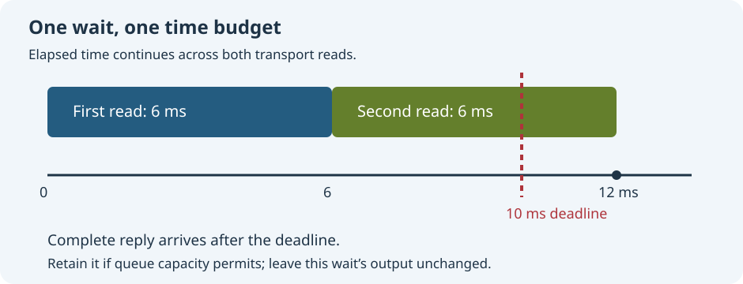

# Understand waiting and timeouts

Read the accompanying [Umicom source example](https://github.com/umicom-foundation/umicom-framework/blob/main/examples/debug_reply_queue/main.c). Match its revision to your checkout before comparing behavior.

A development tool often asks another program to do something. Umicom Studio may ask a debugger for the list of running threads. A thread is one sequence of instructions being executed by a program. The debugger may reply quickly, reply later, report an error, or stop responding. A useful application must handle all four possibilities without confusing one request with another.

This lesson follows the debugger adapter in Umicom Framework. An adapter connects two parts of a program while keeping the details of that connection in one place. You will trace messages on paper, read a small C example, and learn why a timeout is different from a failed operation. No debugger, trading account or network service is needed for the reading exercise.

## 1. Give every request an identity

Suppose Studio asks for threads and then asks for scopes. A scope describes a collection of variables visible at a particular place in the paused program. These are different questions. Their answers may arrive in a different order from the questions. The adapter assigns each outgoing request a sequence number. The response carries that number in a field named request_seq. Matching a response to its request is called correlation.

| Direction | Message | Identity |
| --- | --- | --- |
| Studio to debugger | List threads | Request 1 |
| Studio to debugger | List scopes | Request 2 |
| Debugger to Studio | Scopes response | Answers request 2 |
| Debugger to Studio | Threads response | Answers request 1 |

The first answer received is not necessarily the answer to the first question. A wait for request 1 must retain the response for request 2 instead of displaying its contents as threads. In Framework this retained response belongs to a bounded response queue. Bounded means the queue has a fixed capacity: it cannot grow forever.

## 2. Separate responses from events

An event reports that something happened without answering a particular request. A debugger can announce that it has initialised or provide a line of output while Studio is waiting for a response. Events and responses share a transport, which is the part that carries bytes between programs. They still have different meanings. Framework keeps an event queue as well as a response queue.

Read examples/debug_reply_queue/main.c in the Framework checkout. The interleaved mode supplies four complete messages: an initialised event, the response for request 2, an output event, and the response for request 1. Interleaved means these different kinds of messages are mixed in one stream. The example checks that waiting for request 1 leaves both events and the other response available for their own consumers. A consumer is the part of the program that reads and handles an item.

1. Write four cards with those messages and place them in the supplied order.
2. Draw three boxes labelled Incoming bytes, Saved responses and Saved events.
3. Read each card while looking for response 1. Put unrelated responses and events into their respective boxes.
4. When response 1 arrives, stop this wait. Check that response 2 and the two events still have owners.
5. Take response 2 by its request number, then take the events in their original order.

This exercise explains why throwing away every message that does not match the current request would break an IDE. An output panel and a variables panel can both depend on messages that arrive while another panel is waiting.

## 3. Use one time budget for one wait

A timeout is a limit on how long an operation is willing to wait. It is usually measured in milliseconds; one thousand milliseconds make one second. A deadline is the point at which that budget runs out. Framework measures elapsed time with a monotonic clock. Unlike the clock displayed on a desktop, a monotonic clock is intended for measuring durations and does not jump when a user changes the calendar time.

Imagine a wait with a budget of 10 milliseconds. One transport read takes 6 milliseconds and returns part of a message. A second read takes another 6 milliseconds and completes it. The total is 12 milliseconds. Checking time only before each read can incorrectly accept this reply: the second read started while time remained, but finished after the deadline. The wait must check again after receiving a complete message.



Giving every read a fresh 10 milliseconds would change the rule. A slow peer could keep the wait alive by sending small pieces indefinitely. The remaining budget must shrink as the same operation continues. This does not make a callback interruptible: a synchronous callback that blocks must return before the caller can examine the clock again. Deadlines bound acceptance and future work; they do not magically stop arbitrary code.

## 4. Keep ownership when a reply arrives late

Receiving a message consumes bytes from the transport. Once those bytes have been decoded, returning a timeout cannot put them back into the connection. Framework therefore places a late decoded response or event into its appropriate queue when capacity permits. The current wait returns a timeout and leaves the caller’s output unchanged. A later, explicit wait can inspect the retained response using the same request number.

This is not a guarantee that every late message can be stored. If the bounded queue is full, the operation reports a capacity error. The caller must treat the connection as needing recovery; it must not report that the message was retained. Queue limits protect memory use, but they also create a real failure case that tests and application feedback must cover.

A timeout does not prove that the remote operation failed or was cancelled. The other program may already have performed it. Automatically sending the same request again could repeat an action. For a harmless query, an application may offer a new refresh. For a command that changes program state, it must first establish what happened and apply the protocol’s recovery rules.

## 5. Protect the caller’s output

A function can return a status and also write a result through a pointer. A pointer identifies where an object lives in memory. If the function fails halfway through decoding, partially replacing the caller’s earlier result makes recovery confusing. The wait functions decode into a temporary envelope, the structure containing one message, and copy a matching response into the caller’s output only when the contract permits it.

```c
UmiDebugRuntimeEnvelope *candidate = calloc(1U, sizeof(*candidate));
if (candidate == NULL) {
    /* Report allocation failure before asking the adapter to write a result. */
    return UMI_STATUS_OUT_OF_MEMORY;
}
UmiStatus status = umi_debug_runtime_adapter_wait_response(
    adapter, request_sequence, 1000U, candidate);

/* A matching failure response is different from a transport failure.
 * UNAVAILABLE alone does not tell us which of those happened. */
int matching = candidate->kind == UMI_DEBUG_RUNTIME_MESSAGE_RESPONSE &&
               candidate->request_sequence == request_sequence;
if (status == UMI_STATUS_OK && matching) {
    /* Read the successful response here. */
} else if (status == UMI_STATUS_UNAVAILABLE && matching &&
           !candidate->success) {
    /* Explain the debugger's refusal here. */
} else {
    /* Preserve earlier application state and report the wait/transport status. */
}
free(candidate);
```

This is a reading fragment, not a complete program: adapter and request_sequence must come from an existing connection and a successfully sent request. calloc allocates storage and fills its bytes with zero. sizeof determines how many bytes the structure requires. The NULL check handles allocation failure. free releases the storage once it is no longer needed. The complete SDK example performs creation, request sending, queue inspection and cleanup.

Why start with a fresh empty candidate? UMI_STATUS_UNAVAILABLE can mean a matching refusal from the debugger, but it can also come from a transport that did not deliver a reply. Checking a stale result from an earlier operation could mistake old data for a new refusal. Inspect both the status and the message identity before interpreting the contents.

## 6. Read zero-time behavior in the API contract

Zero is sometimes used to request an immediate poll. A poll checks what is already available without sleeping for future work. Do not assume that every wait function gives zero the same meaning. Framework retains the established behavior of its two debugger wait interfaces.

| Interface | Meaning of a zero timeout |
| --- | --- |
| umi_debug_runtime_adapter_wait_response | Check saved responses and poll immediately available frames within a bounded loop. |
| UmiDebugRuntimeAdapterWaitObserved | Check saved responses only; do not start a transport read. |

The observed wait can call an observer when an event arrives. An observer is a callback: a function supplied by another part of the application. For example, receiving an initialisation event may lead to a configuration request. That nested request can receive and save the original response. On returning from the observer, the outer wait checks its own remaining budget before removing a saved response. Nested work does not create a fresh budget for the original wait.

The adapter and its queues have one owner during these operations. Nested use through the documented observer path does not mean that unrelated threads may read the same connection at the same time. A background worker and a window callback must not race to consume the same protocol bytes.

## 7. Explore the complete SDK example

1. Open examples/debug_reply_queue/main.c and its CMakeLists.txt in the same Framework revision. Read main before Supply. Supply creates a framed JSON message; the Content-Length header gives its byte length.
2. Find the two calls to umi_debug_runtime_adapter_send_request. Record the commands and the resulting request numbers.
3. Follow the interleaved branch and list which frames are supplied before the first wait.
4. Follow the snapshot checks. A snapshot reports counts such as queued responses, queued events and pending requests without removing their items.
5. Read the remote-error mode. It deliberately supplies a matching response with success set to false and checks the identity before interpreting the refusal.
6. Read the final empty poll. The example copies the current envelope before the call and compares every byte afterwards to check preservation on timeout.

To compile the example, use an installed Framework SDK containing the developer component and the matching example files. The CMake project requires an absolute UMICOM_EXPECTED_SDK_PREFIX and checks that the selected package belongs to that installation. Follow the SDK instructions in the [Windows development guide](../../umicom/windows-development.md). Keep one compiler environment for both the SDK and its consumer.

The executable accepts ordered, interleaved or remote-error. With no argument it uses interleaved. Expected messages describe which response was received, whether both events remained in order, and whether an empty poll preserved output. A nonzero exit status reports a failed expectation. These are local replay checks; they do not establish that a real debugger can launch, pause, step through or inspect your application.

## 8. Read tests before changing the rule

The regression source tests/debug_runtime/test_wait_deadline.c supplies a controlled clock and transport. A controlled clock lets a case advance time deliberately instead of depending on the speed of a particular computer. Read boundary, near, partial, queued-cross and late-event. Then read the observed nested case, where an observer obtains another reply while the first wait’s budget continues to run.

The response-full and event-full cases explain the limit of retention. The read-unavailable and remote-error cases explain why a status value alone cannot identify a remote refusal. A source review can check that these scenarios are represented. Only executing the configured tests against an identified build provides pass or failure evidence. A skipped case is missing coverage, not a pass.

## 9. Check your understanding

1. A response for request 2 arrives while waiting for request 1. What identifies its owner? Answer: request_seq, not the order of arrival.
2. Two reads take 6 milliseconds each under one 10 millisecond budget. Is the completed reply on time? Answer: no; total elapsed time is 12 milliseconds.
3. Does a timeout prove that the remote action did not happen? Answer: no. The action may have completed while its reply was delayed.
4. Why can a full queue produce a capacity error instead of a timeout? Answer: the decoded message could not be retained under the memory limit.
5. Why is a zeroed candidate useful when interpreting UNAVAILABLE? Answer: a transport failure may leave output unchanged; fresh storage avoids interpreting a stale response.
6. Design a paper trace in which an event observer receives another response and finishes after the original deadline. State which response remains queued and which output remains unchanged.

Continue with [protocol message boundaries](22-follow-protocol-message-boundaries.md), [tool connection validation](25-validate-a-tool-connection.md) and [closing background work](10-close-background-work.md). These rules support responsive Studio tools and other Umicom applications that communicate with services.

Next: [Remember projects without deleting their files](29-remember-projects-without-deleting-files.md).

## Apply the idea

<details>
<summary>Keep one deadline</summary>
<p>A request has a ten-millisecond budget. An event takes six milliseconds to receive and its callback takes five more. Should the request get a fresh ten milliseconds after the callback?</p>
<p><strong>Explanation:</strong> No. Eleven milliseconds have elapsed under the original deadline. Receiving an unrelated event or running its observer must not restart the request budget. Preserve accepted queued messages while reporting the timeout honestly.</p>
</details>
