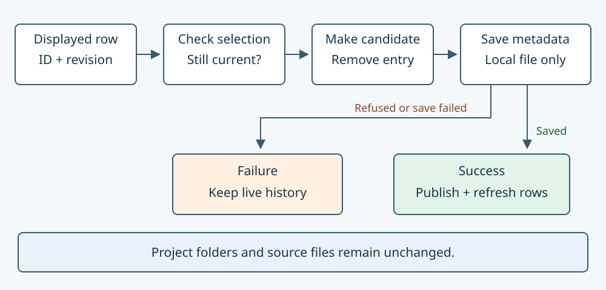

# Remember projects without deleting their files

Read the accompanying [Umicom source example](https://github.com/umicom-foundation/umicom-framework/blob/main/examples/recent_history/main.c). Match its revision to your checkout before comparing behavior.

When Umicom Studio starts, its Welcome page can show projects opened earlier. The list is a convenience: it remembers a project name and location so that you do not have to browse for the folder every time. The list is not the project. Understanding that separation helps us design a Remove from recent projects button that does exactly what its label promises.

This lesson follows a real Framework service and its Studio caller. You will learn what metadata means, why a displayed selection can become stale, and why saving should happen before the interface announces success. You can begin by drawing the state changes on paper. The optional C example requires the installed Framework SDK; it does not require a broker account, a server or an AI model.

## 1. Separate a resource from its description

A resource is the thing an application uses: for example, a folder containing a project, a source file, or a lesson. Metadata is information describing that thing. A recent-project record may contain a label, a path, an identifier and a last-opened counter. Deleting the record should not delete the resource that it describes.

| Stored item | Example | Owner |
| --- | --- | --- |
| Project file | A notes.c file in a project folder | The project and its editing workflow |
| Recent record | Label, folder path, item ID and revision | The recent-history registry |
| Displayed row | A button and its copied item identity | The Welcome interface |
| History file | Serialized recent records on local storage | The application state service |

A registry is a collection managed through an API. An API is a set of functions and data types that another part of the program is allowed to use. Umicom Framework keeps the registry layout private. Studio asks for a snapshot, which is a copy of one record. This lets the interface display a record without taking ownership of the registry’s internal storage.

## 2. Follow one action from the screen to storage

1. Studio asks Framework for a list of recent workspaces. A workspace is the project context that Studio opens and manages.
2. For each row, the interface copies the item ID and revision. The ID tells us which record was displayed. The revision tells us which state of that record was displayed.
3. The user chooses Remove from recent projects for one row.
4. Studio checks that the record still belongs to the workspace kind, then calls UmiRecentItemsRemoveLocal.
5. Framework checks the selection, copies the bounded registry, removes the entry from the copy and saves that candidate.
6. Only after a successful save does Framework replace the live registry contents. Studio then refreshes the list and reports success.



A candidate is a proposed new state. It is not yet the accepted live state. This distinction matters when storage fails. If the application removed the row immediately and saving failed afterwards, the screen could say the entry had gone while the file still contained it. On the next start, the entry would appear to return. The candidate approach keeps memory and the reported result consistent for this operation.

## 3. Understand a stale selection

Imagine that a row displays item project-a at revision 7. Before you press its button, another operation opens that project and updates its recent record to revision 8. The old row still describes revision 7. We call it stale because it no longer represents the current record. The removal operation rejects that old selection instead of guessing what you intended.

| Event | Selected item revision | Outcome |
| --- | --- | --- |
| Row displayed | 7 | The row copies ID project-a and revision 7. |
| The same project is opened again | 8 | The live item now has a newer state. |
| Old Remove button activated | 7 requested, 8 current | INVALID_STATE; retain the item and refresh. |
| New row deliberately selected | 8 requested, 8 current | Removal can proceed to storage. |

The revision is not a date, a Git commit or a cryptographic hash. It is a counter in this live model. A change to a different lesson entry does not change project-a’s item revision. That means unrelated activity does not unnecessarily reject the project selection. Revisions do not solve conflicts between two separate processes writing the same file; that needs a separate ownership policy.

## 4. Read the public C call

```c
UmiStatus status = UmiRecentItemsRemoveLocal(
    registry,
    displayed.id,
    displayed.revision,
    absolute_metadata_path);
```

UmiStatus is the result type used by Framework operations. The variable named registry points to a registry that an owner previously created or loaded. displayed is a copied UmiRecentItemSnapshot from the row. Its id field identifies the entry; its revision field identifies the state the user saw. absolute_metadata_path identifies the local file containing history, not the project folder.

The parentheses contain the function’s arguments: values supplied by the caller. Commas separate them. The semicolon finishes the C statement. The returned status is assigned to a variable so that the caller can decide what to do next. Ignoring that result would make it impossible to distinguish a successful removal from a refused stale selection or a storage problem.

```c
if (status == UMI_STATUS_OK) {
    /* Read the updated registry and refresh the visible rows. */
} else if (status == UMI_STATUS_INVALID_STATE) {
    /* The item changed. Refresh and ask for a new deliberate selection. */
} else {
    /* Explain the failure while retaining the current row. */
}
```

The double equals sign compares two values; it does not assign a value. Braces group the statements belonging to a branch. These fragments explain the decision and are not a complete executable program. The complete example in examples/recent_history/main.c also creates or loads state, checks each operation and releases owned memory.

## 5. Trace the real implementation

1. Open include/umicom/platform/recent_items.h in the Framework checkout. Read the contract for UmiRecentItemsRemoveLocal before reading its implementation.
2. Open src/platform/recent_items_remove.inc. It is included by recent_items.c so the operation can use the private bounded registry layout.
3. Find the item revision comparison. Explain why it happens before allocation or file writing.
4. Find malloc(sizeof(*candidate)). malloc requests memory; sizeof gives the required number of bytes for the registry type. A failed allocation returns without changing the live registry.
5. Follow the candidate removal and UmiRecentItemsSaveLocal calls. Each later step runs only if the previous status was OK.
6. Find the assignment to the live registry and the final free(candidate). The candidate is published only after saving; temporary memory is released whether saving succeeds or fails.

The include fragment is ordinary C source included into its owning source file. It is not a separate library or a program to launch. The registry has a fixed capacity, so copying it has a bounded memory cost. Bounded does not mean allocation can never fail; the implementation still checks for that failure.

## 6. Use a stable local path

A relative path such as .umicom/studio-recent-items is interpreted using the process’s current working directory. A working directory is the folder used as the starting point when resolving relative paths. If the process changes that folder, the same text can name a different file. That can split history across unexpected locations.

Studio now resolves its existing history location once when creating its services. The resulting absolute path names a location from the filesystem root or Windows drive. Later saves reuse that captured path. This does not move old history automatically, create a central account or upload private paths. It keeps the chosen local location stable for this service lifetime.

Local history can reveal project names and folder locations. Keep real application state outside public commits. A source repository contains the program and its reviewed examples; it should not accidentally contain the history produced while you use the program.

## 7. Explore the installed SDK example

The standalone examples/recent_history project uses the public platform component from one explicit installed Framework SDK. Its CMake file checks that the selected package belongs to the supplied SDK prefix. That prevents an old cached package path from quietly selecting another installation. Follow the Framework guide docs/learning/local-recent-history.html for configure, build and run commands appropriate to this example.

1. Choose a dedicated sample directory and metadata filename. Do not use Studio’s real history file: the example writes two named teaching entries.
2. Read Run in main.c. It loads the selected metadata or starts an empty registry when the file is absent. Malformed existing data is refused.
3. Follow the remove mode. It records a sample project and a lesson, removes the project entry, reloads the saved file and checks that the lesson remains.
4. Follow the stale mode. It captures a revision, touches the selected item, then tries the earlier revision. The operation refuses and the example compares saved bytes before and after.
5. Follow storage-refusal. It deliberately supplies a directory where a metadata file is required. The example checks that both the live registry and the original file remain unchanged.
6. Read the cleanup path. The program releases both input buffers and any registries it owns. It retains sample files so that you can inspect them.

The sample uses teaching URI values. A URI is a text identifier for a resource; it is not necessarily a local file path. The recent-history operation stores those values as metadata and never opens them. No recorded project, lesson or network address is executed or deleted by the example.

## 8. Keep interface lifetimes separate

A graphical button can outlive the window that originally created it if another part of a program retains a reference. Calling through a raw pointer to a destroyed window would be unsafe. Studio’s Welcome action stores a weak reference to its host and copies its item identity. A weak reference lets the callback check whether the host still exists without keeping that host alive indefinitely.

Refreshing the list can also destroy the button whose callback is running. The callback therefore copies the command data and obtains its own operation binding before replacing rows. After replacing widgets, it resolves the host again before notifying it. These are ownership rules: they describe which object may use which memory, and for how long.

The source cases in tests/test_recent_workspace_gtk4.c include a retained button after host destruction, stale selection, missing folders and storage refusal. Headless service cases exercise persistence without requiring a display. A graphical skip is not equivalent to a pass of those interactions. Source reading, compiling and executing tests provide different kinds of evidence.

## 9. Understand what this does not guarantee

Saving through native replacement helps avoid exposing a partially serialized file during normal operation. It does not guarantee recovery after every power loss. It also does not compare another process’s saved file version before writing. Use one writer for this metadata file and a trusted parent directory. Local file operations can wait for the operating system or antivirus scanning, so they are not automatically fast just because the data is small.

The current Studio action performs this local operation synchronously. A future asynchronous version must retain the candidate and its owner until completion, reject stale results, and report cancellation honestly. Moving a function to a worker is not enough unless the lifetime and publication rules move with it.

## 10. Check your understanding

1. Does removing a recent-project row delete its source folder? Answer: no; the record and resource have different owners.
2. Why save the candidate before changing the live registry? Answer: a failed save should not be presented as a successful history change.
3. Why is an ID alone insufficient for a displayed action? Answer: the same item may have changed since the row was displayed.
4. Does changing an unrelated lesson always invalidate a project selection? Answer: no; the operation compares the selected item’s own revision.
5. Why capture an absolute path once? Answer: a later working-directory change should not redirect history persistence.
6. Draw a failed-save trace. Mark the live registry, candidate, saved file and displayed row. Which states remain accepted? Answer: the existing live registry, saved file and row; the candidate is discarded.
7. Explain why a successful console example does not prove the Welcome button works. Answer: graphical dispatch, widget ownership and presentation require their own checks.

Continue with [remembering locations without inheriting trust](19-remember-locations-without-inheriting-trust.md), [keeping reading state consistent](17-keep-reading-state-consistent.md) and [waiting and timeouts](28-understand-waiting-and-timeouts.md). The same separation of identity, state and ownership applies across Umicom applications.

[Next: Keep test data separate from your work](30-keep-test-data-separate.md)

## Apply the idea

<details>
<summary>Protect a newer selection</summary>
<p>A Welcome row displays revision 4. Another action updates the same recent item to revision 5 before you press Pin. Should the old button silently pin revision 5?</p>
<p><strong>Explanation:</strong> No. Its expected item revision is stale. Refuse the change and refresh the view, allowing a new deliberate action. Changing a different recent item does not by itself make this item's revision stale.</p>
</details>
