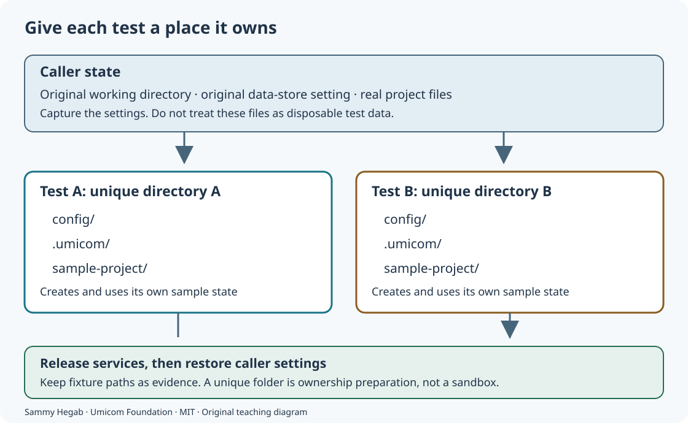

# Keep test data separate from your work

Read the accompanying [Umicom source example](https://github.com/umicom-foundation/umicom-studio-ide-module/blob/main/tests/studio_test_state.h). Match its revision to your checkout before comparing behavior.

A test is a small program that checks an expected result. It might open a sample project, save a preference or create a temporary document. Those actions are real file operations, even when the purpose is testing. A reliable test therefore needs a place it owns. It should not borrow your current project folder and assume that everything there can be replaced.

This lesson follows Studio’s service tests and their shared fixture helper. You will learn how a running program chooses file locations, how environment settings affect startup, and how to keep a repeated test from depending on a previous run. You can trace every step on paper before using a terminal. No knowledge of operating-system internals is required.

## 1. Start with a path

A file has a name and a location. A path describes how to reach that location. An absolute path starts from a known filesystem root, such as C:\ on Windows. A relative path starts from the running program’s current working directory. The working directory is a process setting; it is not necessarily the directory containing the executable.

| Written path | Working directory | Location described |
| --- | --- | --- |
| .umicom/studio-recent-items | C:\practice\one | C:\practice\one\.umicom\studio-recent-items |
| .umicom/studio-recent-items | C:\practice\two | C:\practice\two\.umicom\studio-recent-items |
| C:\practice\history.txt | Either directory | C:\practice\history.txt |

The dot in .umicom is part of the directory name. It does not make the directory disposable. A test launched from your project could encounter real state under that name. The program must establish which files it created before deciding what it may remove.

## 2. Define a fixture

A fixture is the prepared state a test needs. For a document test, it can be a directory containing two sample files. For a history test, it can be a metadata file with known entries. Preparation gives the test a predictable starting point; the assertions then check behavior against that starting point.

A fixed name under a common temporary directory is not enough to establish ownership. Two processes can use that name at the same time. A later run can also encounter files retained by an earlier run. Studio’s StudioTestStateBegin helper asks GLib, the utility library used by the native application, to create a unique directory for that invocation.



Unique means that the creation operation selects a directory that does not already exist. It is stronger than inventing a name from a clock reading. It does not turn the test into a security sandbox: code must still stay inside the paths it owns, and filesystem permissions still matter.

## 3. Understand inherited settings

An environment variable is a named text setting passed to a process. A child process normally receives a copy of its parent’s environment. Applications use these settings to locate tools or choose configuration. Studio recognizes UMICOM_STUDIO_DATA_PATH; a nonempty value can select a SQLite data store when that support is available.

A service test should not inherit your normal data-store location and then write its sample records there. Studio’s fixture helper copies the previous value, removes it while the isolated test runs, and restores it when finished. It distinguishes an absent variable from a variable whose value is an empty string. These are different environment states, even if a particular application treats them alike.

| Before the test | During isolated service setup | After restoration |
| --- | --- | --- |
| Variable absent | Variable absent | Variable absent |
| Variable contains a path | Variable absent | Original path restored |
| Variable contains an empty string | Variable absent | Empty string restored |

Removing the variable does not erase the database file. It only changes the test process’s startup input. The same distinction appears in recent-project history: changing metadata or configuration is different from deleting a resource.

## 4. Follow the helper’s lifetime

1. Open tests/studio_test_state.h in the Studio repository. Find the StudioTestState structure. Its strings hold the original working directory, the original data-store setting and the newly created directory.
2. Follow StudioTestStateBegin. It captures the caller’s state, creates the unique directory, enters it and prepares config and .umicom beneath it.
3. Follow the test’s own setup. It creates only the sample records and files needed for that case.
4. Follow the service release before StudioTestStateEnd. A service must not continue writing state after the test has returned to the caller’s directory.
5. Follow StudioTestStateEnd. It restores the working directory and environment, frees the helper’s strings, and reports the retained fixture location.

```c
StudioTestState state = {0};
if (!StudioTestStateBegin(&state)) return 1;

/* Create services, exercise the behavior and release services here. */

if (!StudioTestStateEnd(&state)) return 1;
return 0;
```

This is a lifetime excerpt, not a standalone application. The structure begins with zeroed fields. A return value of 1 tells the caller that the process failed. A return value of 0 means that this path completed successfully. The real regression program also releases its resources when a check fails; read its cleanup section before adding another exit.

The helper retains its outer directory for diagnosis. Retention lets you inspect state from a failed run. It can also consume disk space over time, so review those printed locations after testing. Retention is not permission to remove a directory merely because its name resembles a fixture.

## 5. Put sample projects beneath the owned directory

Some tests need both application state and a project. Keeping them separate inside one owned outer directory makes their roles clear. Studio’s file, document, process, search, watcher and workspace tests create their sample project beneath the invocation’s directory. They do not use the global temporary root as the direct parent of a fixed project name.

```c
assert(umi_path_copy(temporary, sizeof(temporary),
    test_state.directory) == UMI_STATUS_OK);
assert(umi_path_join(temporary, "umicom-studio-files-test",
    root, sizeof(root)) == UMI_STATUS_OK);
```

This excerpt comes from an existing assertion-based Studio test. temporary and root are character arrays: bounded storage for path text. sizeof gives the array’s capacity in bytes. umi_path_copy copies a path into the first array; umi_path_join combines that owned base with a child name. Each function reports whether it could produce the complete path. A failed copy must not be ignored before the next file operation.

## 6. Know what an assertion does

In C, assert checks a condition in builds where assertions are enabled. A failed condition normally ends the process with a diagnostic. When NDEBUG is defined before the assertion header is read, assert expressions can be omitted. This matters if the expression creates a directory or initializes a service: omitting the check also omits that operation.

The older Studio tests contain setup inside assert expressions. They keep assertions active explicitly so optimized test builds still perform that setup. New regression code can instead use explicit checks that run in every configuration. An application should not rely on assert to validate input, save user data or enforce an important permission.

```c
UmiStatus status = umi_path_copy(buffer, sizeof(buffer), source);
if (status != UMI_STATUS_OK) {
    fprintf(stderr, "Cannot prepare the fixture path: %d\n", (int)status);
    return 1;
}
```

The snippet separates the operation from its check. It assumes buffer, source and the relevant declarations are already present. Reading a return status is not optional simply because a path is short in today’s example.

## 7. Review the five ownership checks

| Case | Question it checks |
| --- | --- |
| unset | Does the caller still have no data-store variable after the fixture ends? |
| existing | Is the caller’s original nonempty setting restored? |
| empty | Is an explicitly empty value restored as empty rather than absent? |
| nested | Does an inner fixture return to the outer fixture without taking its files? |
| repeat | Does a second invocation receive a different owned directory while the earlier evidence remains? |

The real test also puts a marker in an owned caller fixture. A marker is a small file with known content. The child fixture must not see that marker as its own .umicom state. Ending the child must leave the caller marker available. This checks preservation without placing any real personal file at risk.

## 8. Build and run the ownership checks

These commands assume that Umicom Applications has already been configured with its Windows UCRT64 all-applications preset and BUILD_TESTING enabled. Run each command separately and stop on an error. The named target is the small fixture regression executable; this command does not request every application target.

```powershell
Set-Location "C:\umicom\Umicom-Applications"
$env:Path = "C:\msys64\ucrt64\bin;$env:Path"
New-Item -ItemType Directory -Force "C:\umicom\_local\logs\studio-test-ownership"
cmake --build --preset windows-ucrt64-all-debug --target umicom-studio-state-isolation-test --parallel 2 2>&1 | Tee-Object "C:\umicom\_local\logs\studio-test-ownership\build.log"
ctest --preset windows-ucrt64-all-debug -R "^studio[.]state_isolation[.]" --output-on-failure --no-tests=error --output-log "C:\umicom\_local\logs\studio-test-ownership\tests.log"
```

A compatible configured checkout should discover five cases. If the target or cases are missing, reconfigure the updated source tree using the repository’s development guide. Do not interpret zero tests as success. If a case fails, keep the log and printed fixture path. Check the first failed operation before changing the expected result.

These checks cover the fixture helper. They do not prove that every Studio feature works or that every program is free of filesystem side effects. The individual service and native interaction regressions remain necessary. A test that could not run because its executable was missing is also different from an executed test that passed.

## 9. Think about parallel execution

Parallel tests are separate processes running at overlapping times. Unique directories remove one source of collisions. They do not remove every shared resource: a port number, external device or selected database can still be shared. Studio retains existing CTest resource locks while the wider test set is qualified. A resource lock tells the test runner which tests must not use the same named resource at the same time.

Inside one process, the working directory and environment are shared by its threads. StudioTestState is intended for a test process whose setup owns those settings, before background work starts. It is not a way to give two concurrent threads independent working directories. Product services should prefer explicit, stable paths rather than repeatedly changing global process settings.

## 10. Trace the real source

1. Read tests/studio_test_state.h for capture, unique creation and restoration.
2. Read tests/test_state_isolation.c for the five lifecycle cases and marker checks.
3. Read tests/test_files.c and tests/test_workspace.c for sample projects underneath the owned base.
4. Read cmake/UmicomStudioTestIsolation.cmake for the explicit existing target names, utility-library dependencies and regression registration.
5. Read Framework’s include/umicom/platform/path.h for the bounded path-copy and joining contracts.

The Studio checkout is C:\umicom\Umicom-Applications\applications\studio. Framework is C:\umicom\Umicom-Applications\framework. Compare the source you are reading with the source that produced your executable; a result from an older executable does not qualify a newly edited helper.

## 11. Check your understanding

1. Two tests use the same fixed directory under the system temp root. Why can they interfere? Each may read, replace or remove the other’s files; the location was not uniquely created for either invocation.
2. Why restore an environment value rather than simply leave it unset? The caller’s prior setting is its state, and the test should not silently change it.
3. Why release services before restoring the working directory? A still-running service could otherwise perform relative writes in the caller’s directory.
4. Why does a successful build not establish ownership preservation? Compilation checks source translation; the ownership cases must execute to inspect behavior.
5. Sketch two invocations, their two config directories and one original project. Draw only the file operations each invocation is allowed to perform.

Continue with [remembering projects without deleting their files](29-remember-projects-without-deleting-files.md), [reading build and test evidence](08-read-build-and-test-evidence.md) and [understanding waiting and timeouts](28-understand-waiting-and-timeouts.md). These are parts of the same habit: identify the owner, make the state change explicit, and keep evidence of what actually ran.

[Previous: Remember projects without deleting their files](29-remember-projects-without-deleting-files.md) · [Course index](index.md)

Sammy Hegab · Umicom Foundation · MIT. Original learning material.

## Apply the idea

<details>
<summary>Prove the test owns its files</summary>
<p>A service test creates config/settings.json using a relative path. What evidence would show that it wrote only inside its own fixture?</p>
<p><strong>Explanation:</strong> Capture the caller's directory, create a unique fixture, enter it before service initialization, and inspect the file underneath that fixture. After destroying services, restore the caller's directory and environment, then verify the caller's original marker remains unchanged. A successful compiler exit alone does not establish these facts.</p>
</details>

[Next: Understand skipped tests and host coverage](31-understand-skipped-tests-and-host-coverage.md)
