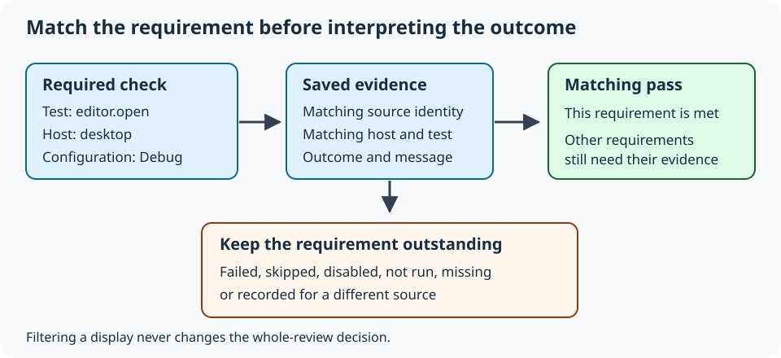
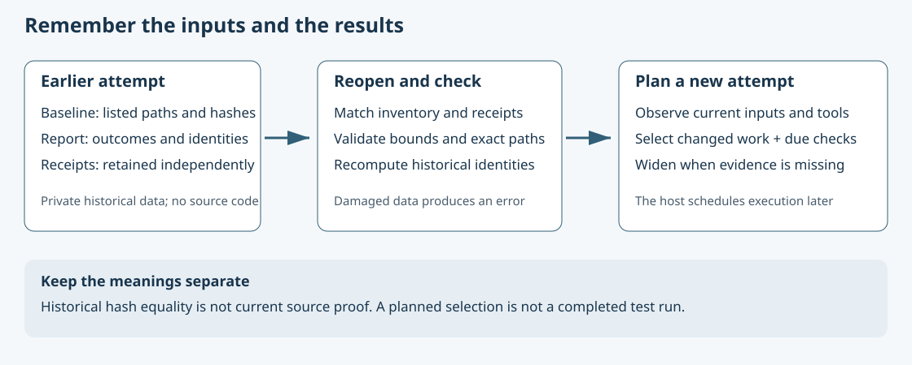

# Understand skipped tests and host coverage

Read the accompanying [Umicom source example](https://github.com/umicom-foundation/umicom-framework/blob/main/examples/host_coverage/main.c). Match the source revision to your installed SDK before comparing its behavior. This lesson uses saved sample reports; it does not ask you to connect to a broker, open private data or run the application tests named in those reports.

A test is a program that checks a particular expectation. A result tells us what happened when that check was attempted. If a window test needs a display but the machine has no display session, the test may be skipped. That is useful information: we learned why the check did not complete. We have not learned whether the window works.

This chapter explains how Umicom records that distinction, how to read a result message and how to connect an outstanding check to a suitable computer. You can first work through the tables with a pencil. The optional terminal exercise uses the small host-coverage example from the Framework SDK.

## 1. Distinguish an outcome from an explanation

An outcome is a category such as passed, failed or skipped. A message is a short piece of text saved beside that category. The message may identify a test-runner rule, but it does not always identify the underlying cause. For example, SKIP_RETURN_CODE=77 says that the program returned the number configured to mean skip. You must read the test output to find out which prerequisite was unavailable.

| Saved outcome | What it establishes | What to investigate next |
| --- | --- | --- |
| Passed | The named check reported success during that run. | Confirm the source revision, configuration and host match the requirement. |
| Failed | The check reported a failure. | Read the first assertion or diagnostic and the associated test output. |
| Timed out | The check did not finish inside its allowed time. | Investigate a blocked operation, unavailable dependency or slow environment before changing the limit. |
| Skipped | A configured condition prevented the normal check. | Find the stated prerequisite and arrange a suitable host. |
| Disabled | The check was explicitly disabled. | Find the configuration that disabled it and decide where it must run. |
| Not run | The check did not execute normally, for example because its executable was missing. | Check the build result and the exact executable path before retrying. |

A percentage alone hides these differences. Suppose 98 tests pass and 2 are skipped. There are 98 observations of success and 2 gaps. It would be misleading to say that all 100 behaviors passed. Likewise, a missing executable is often a consequence of an earlier link failure; rerunning the test command cannot create the executable.

## 2. Describe the computer and the requirement

In this lesson, a host means the computer and environment used for a check. Its name is a label such as desktop. A configuration describes a build choice such as Debug. A capability is something that the check needs, such as a display session. These words do not automatically detect hardware. They help you state and review the requirement.

Umicom combines the test name, host and configuration into an explicit coverage requirement. This is more precise than accepting a test with the same name from any available report. A successful console run on one machine does not prove a graphical workflow on another machine. A release build also needs the qualification required by its release policy; a Debug label cannot be silently substituted.



## 3. Read the small CSV plan

CSV means comma-separated values. A row contains fields separated by commas. The first row below gives their names. The example has one report row and one requirement row. Empty fields are intentional; consecutive commas leave a field empty.

```text
kind,host,configuration,source_identity,test,capability,report
host,desktop,Debug,source-A,,,results.xml
require,desktop,Debug,,example.open,GTK display,
```

1. The host row says that results.xml belongs to the desktop / Debug report set and carries the source label source-A.
2. The require row asks for example.open on that same host and configuration. GTK display describes the capability that needs checking.
3. The report path is relative to the folder containing this plan. The reader does not interpret it relative to whichever folder your terminal happens to use.
4. The source label is supplied by the person or process collecting the evidence. It must be connected to a recorded revision and build. Merely typing source-A does not prove that the report came from that source.

The host-coverage guide documents the accepted fields and path restrictions. Use a separate evidence directory outside a public repository for real logs and plans. A report can contain local paths and application output; a sanitized synthetic fixture is appropriate for a public example.

## 4. Follow the Framework ownership in C

Open examples/host_coverage/main.c. ConsumerMain is the function containing the example workflow. The process entry point captures native command arguments first. On Windows, this preserves file paths containing characters outside the default narrow-character code page. The file-reading service then receives UTF-8 text, a standard way to encode Unicode characters as bytes.

Find UmiCtestCoverageReviewReadFile. It reads a complete plan and reports into an owned review. A pointer is a value used to refer to that object. Owning it means the caller must release it when finished. In the real example, every error is checked before later operations use the review. The following excerpt concentrates on that ownership boundary; the complete file also prints the results and handles output errors.

```c
UmiCtestCoverageReview *review = NULL;
UmiStatus status = UmiCtestCoverageReviewReadFile(
    manifest_path, source_identity, &review);
if (status != UMI_STATUS_OK) {
    /* Explain the refused input before returning to the caller. */
    return 2;
}
UmiStatus decision = UmiCtestCoverageRequirePassed(review);
UmiCtestCoverageReviewDestroy(review);
return decision == UMI_STATUS_OK ? 0 : 1;
```

manifest_path and source_identity stand for the two checked command arguments. NULL means that the pointer does not yet refer to a review. The ampersand in &review lets the function provide that pointer. UmiStatus is the Framework status type. The equality check compares it with the named success value. Destroy releases the owned object; later code must not read through its old pointer.

The example returns 0 when every listed requirement has a matching pass, 1 when coverage is outstanding or empty, and 2 when reading or printing fails. These numbers are exit statuses: the operating system makes them available to the program that launched the example. They are not a count of failed tests.

## 5. Inspect a saved result message

A matching observed row includes its saved duration and result message. A missing message says not recorded. That means the report did not supply a message; it does not mean the test had no problems. A source mismatch cannot borrow the result message from the wrong revision to imply that the requirement was met.

```text
[skipped] desktop / Debug : example.open
  Requires: GTK display
  Observed source: source-A
  Saved duration: 0 ms
  Saved result message: SKIP_RETURN_CODE=77
```

Messages are imported text. A message can contain a newline or tab. The shared formatter prints such control bytes as visible escape sequences; a newline becomes \x0A. This prevents the message from appearing to be an additional result row. The original report is left unchanged. A backslash is also escaped, so literal text cannot be confused with the formatter’s own escape notation.

The CLI and Studio coverage panel use the same Framework formatting logic. Applications therefore present the same classification and escaped message instead of each inventing a different interpretation. This is an example of reusable behavior belonging in Framework while the application chooses where to display it.

## 6. Build only the SDK consumer

First complete the earlier installed-SDK lesson. An SDK contains the public headers and built libraries needed by another program. The following commands build this small example against an existing installation. They do not rebuild Framework or certify its installation. Stop if any command fails; fix the first error before continuing. Replace the installation path only if your SDK was installed elsewhere.

```powershell
Set-Location "C:\umicom\Umicom-Applications\framework"
$env:Path = "C:\msys64\ucrt64\bin;$env:Path"
cmake -S ".\examples\host_coverage" -B ".\build\host-coverage-consumer" -G Ninja -DCMAKE_C_COMPILER=C:/msys64/ucrt64/bin/gcc.exe -DUMICOM_SDK_PREFIX=C:/umicom/installed/applications -DBUILD_TESTING=ON
cmake --build ".\build\host-coverage-consumer" --parallel 2
ctest --test-dir ".\build\host-coverage-consumer" --output-on-failure --no-tests=error
```

The source directory after -S contains the example. The directory after -B stores its build files. Ninja is the build tool. The compiler path selects the C compiler in the supported Windows toolchain. BUILD_TESTING enables the example’s checks. A successful configure is preparation, a successful build creates the executable, and a successful CTest run checks the synthetic scenarios. These are three separate pieces of evidence.

The scenarios include a pass, skip, disabled check, missing executable, stale source label, malformed report, filtered displays and a directory containing non-ASCII characters. The checks create their own sample reports and retain their logs beneath the consumer build directory. Passing a scenario that contains a synthetic failure means the reader classified that failure correctly; it does not turn the synthetic failure into a real application pass.

## 7. Filter the view without changing the decision

Once you have an actual coverage plan, pass its absolute path and the recorded source identity to the consumer. The optional --passed flag shows only passing rows. --outstanding shows the remaining rows. A final text argument matches literal test-name or capability text. The source identity in this illustration must be replaced with the identity recorded for your collected reports.

```powershell
& ".\build\host-coverage-consumer\host-coverage-consumer.exe" "C:\umicom\_local\logs\testing\coverage.csv" "source-fingerprint-from-the-run" --outstanding
$LASTEXITCODE
```

PowerShell stores the exit status of the last native program in $LASTEXITCODE. Read it immediately after the command. Filtering changes the visible rows, not the coverage decision. If a plan requires two checks and only one passed, displaying only that pass still returns 1. An empty display also cannot establish a pass.

## 8. Investigate and collect a new observation

1. Keep the original report and its build/configure logs. Record which source and environment produced them.
2. For a missing executable, inspect the first compiler or linker error and complete the relevant build before rerunning its check.
3. For a skip, read the saved testcase output and identify the actual prerequisite. Record an appropriate host or explicitly keep the requirement unsupported.
4. After a fix, run the affected check on the intended source and host. Keep the new report separately so an earlier failure is not erased.
5. Revisit the whole requirement list. A successful rerun satisfies only the requirements supported by that evidence.

If the SDK cannot be found, confirm that the selected prefix contains matching installed headers, libraries and package metadata. Do not point the consumer directly at source headers to conceal an incomplete installation. If a plan is refused, inspect its field names, duplicate requirements and report paths. If output says not recorded, return to the original report and process log instead of inventing a diagnosis.

## 9. Plan retries from earlier results

A test may need another run even when you have not edited its source file. A previous run might have failed, stopped early or lacked a required device. This is why the build graph and the result history answer different questions. The graph tells us which work may be affected by an edit. History tells us which checks still lack usable evidence.

Framework provides UmiReleaseQualificationPlanNext for an earlier attempt held in memory. It combines that record with two source observations and the current toolchain identity. A source observation records hashes of declared input bytes. The baseline observation describes the earlier inputs; the current observation describes the inputs available now. A toolchain is the compiler, relevant options, commands and environment used to build and test. A changed or unknown toolchain can invalidate an earlier result even when the source bytes match.

| Situation | What the planner does | Why |
| --- | --- | --- |
| A compatible earlier check failed | Keeps the exact test name due | Unchanged code does not repair a recorded failure. |
| The earlier scoped run did not contain the check | Keeps it due | No row means no recorded result for that check. |
| The earlier runner failed but listed some passes | Widens the work | An incomplete or unsuccessful runner cannot establish a fresh reusable success. |
| The source changed | Adds tests reached through the ownership graph | An old pass describes old inputs. |
| An outstanding name disappeared from registration | Widens to the configured graph | Removing a test must not silently erase an unresolved problem. |

To trace a real implementation, open include/umicom/distribution/runtime/qualification_retry.h, then src/distribution/runtime/qualification_retry.c in the Framework repository. Read HistoryReasons before KnownPass: compatibility is checked before the service considers an individual pass. Find the call to UmiReleaseImpactFromObservationsWithTests. That shared graph combines changed inputs with required retries. The function returns an owned plan, so its test names remain available after the temporary history input is released.

## 10. Reopen evidence after an application restart

A pointer is a location in a running program, not a durable record. After the program exits, that pointer cannot recover its earlier attempt. A saved report keeps the data instead. UmiReleaseQualificationPlanFromReport accepts bounded report bytes and a separately retained SHA-256 receipt. SHA-256 turns bytes into a fixed-size digest. Comparing that digest with a trusted earlier receipt can detect changed bytes. It does not prove who wrote the report or whether its tests really ran.

1. Read the report through a bounded host file service. Keep its earlier receipt separately; do not calculate a new receipt from an unfamiliar file and call that independent verification.
2. Provide the current inventory and source observation. Supply the earlier baseline only when you actually retained it. Without a baseline, request broader work rather than inventing old source evidence.
3. Call UmiReleaseQualificationPlanFromReport and check its status before inspecting the output. Corrupt reports are errors, not empty passing selections.
4. Retain the old report. Execute any selected work as a new attempt with new output and a new identity.

The installed observed_impact example demonstrates this ownership boundary using deliberately synthetic records. In saved-failed mode it formats a record, destroys the earlier attempt object, parses the saved bytes and selects other.check again. The example keeps the source observations in memory; it does not implement a durable observation database or an unattended build service.

```powershell
& ".\build\observed-impact-consumer\umicom-observed-impact.exe" saved-failed
$LASTEXITCODE
```

Use this command only after configuring and building the observed_impact installed SDK example as described in its README. Expected output includes one target, one test, one required test and a message saying that the original attempt was destroyed before reopening. These are synthetic selections. Successful execution checks the example, not the application test named other.check. If the package lacks the new public header or symbol, install a matching Framework SDK rather than mixing old libraries with new source headers.

An empty next selection means that this planning contract found no due work. It is not a new passing execution. A release policy may still require a full test run, additional hosts, manual interaction or review. Keeping these meanings separate makes automatic selection useful without hiding missing coverage.

## 11. Keep the source baseline as historical data



The report alone cannot explain which individual files changed. It contains the identity of its earlier source observation, but not that observation’s complete path list. Framework therefore provides a second small data format in source_observation_archive.h. UmiReleaseSourceObservationEncode produces owned bytes, their length and a digest. UmiReleaseSourceObservationDecode reconstructs the historical observation after checking its receipt and the exact configured inventory. This makes a baseline available after its original allocation has been destroyed.

Open src/distribution/runtime/source_observation_archive.c. Encode writes paths as hexadecimal byte pairs so separators in a path cannot be mistaken for report columns. Decode does not trust those paths as instructions. It first obtains the expected path list from the separately supplied inventory, then checks each encoded row against that list in the same order. It checks each file size, the total source-byte limit and the stored fingerprint. It never opens a source path named by the archive.

The encoded data is not a copy of the source files. It contains their earlier sizes and digests. It cannot restore an old source file or turn a series of file reads into an atomic snapshot. A digest is also not a password or digital signature. Keep source archives and receipts in private storage because their paths may contain workstation details.

1. Read the Encode declaration and identify its three output values: owned bytes, byte length and digest. The byte length excludes the final null character used by C strings.
2. Find ExampleRestoreBaseline in examples/observed_impact/main.c. Follow the encode, destroy, decode and free calls. Reopened observations own their paths; they do not borrow the encoded buffer.
3. Run the restored-pass, restored-failed and restored-edited example scenarios after building the installed example. Compare the selected target and test counts.
4. Open tests/release_qualification/test_source_archive.c and trace ownership, receipt, path and total-overflow cases. These are injected data scenarios. They teach which inputs the reader must refuse; they do not establish that an application build passed.

```powershell
& ".\build\observed-impact-consumer\umicom-observed-impact.exe" restored-pass
& ".\build\observed-impact-consumer\umicom-observed-impact.exe" restored-failed
& ".\build\observed-impact-consumer\umicom-observed-impact.exe" restored-edited
```

| Scenario | Expected selection | Meaning |
| --- | --- | --- |
| restored-pass | 0 targets, 0 tests | Compatible synthetic earlier passes and matching listed bytes leave no planned work. |
| restored-failed | 1 target, 1 test | The failed other.check remains due after both historical objects are reopened. |
| restored-edited | 2 targets, 1 test | A new core edit reaches view.check through its dependencies despite the earlier synthetic pass. |

Run each command separately and read its exit status. If decoding refuses the inventory, check whether configuration, registration or declared inputs changed. Do not alter archived fields to make the comparison succeed. Retain the old evidence and plan from a new baseline or explicitly unknown history. A host still needs to select a private storage directory, write and retain the bytes and receipts, refresh metadata and schedule the selected work. The example uses memory buffers to demonstrate those data boundaries; it does not install a background build monitor.

## Check your understanding

A plan requires editor.open and editor.save on desktop / Debug. The report shows editor.open passed and editor.save skipped with SKIP_RETURN_CODE=77. You select --passed and see one passing row. Decide the exit status, what remains unknown and the next useful action. Explain why building the coverage reader successfully does not answer whether editor.save works.

## Continue learning

Return to the source and trace the create, format, decision and destroy calls. Compare them with the native Studio panel: the window owns presentation state, while Framework owns the evidence model. The same separation is useful in a banking reconciliation screen, a media import review or a kernel qualification dashboard. Each application needs its own requirements and real observations; the shared reader does not supply them automatically.

<details><summary>Show an explanation</summary><p>The exit status remains 1 because editor.save is outstanding. Return code 77 identifies the skip rule, not the missing prerequisite. Read the original testcase output, arrange the required capability and collect a new run for the same source and configuration. Building or testing the reader checks the reader; it does not execute editor.save.</p></details>

[Previous: Keep test data separate from your work](30-keep-test-data-separate.md) · [Course contents](index.md)
