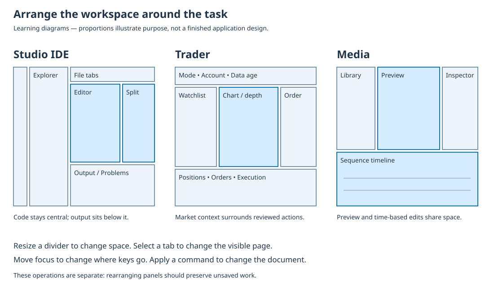

# Use Studio, Trader and Media workspaces

Read the [corresponding Framework source](https://github.com/umicom-foundation/umicom-framework/blob/main/adapters/gtk4/workstation/workspace_layout_host_gtk4.c) at the revision used by your build. Source-reading exercises do not establish that an installed workflow has been qualified.

A workspace is the arrangement of tools inside an application window. A panel is one of those tools, such as a list of files or a video player. A tab is a labelled selector that brings one page to the front. These words describe the screen, not the files you own. Closing a panel and deleting a file are different operations. This lesson follows three Umicom applications so you can recognise their different jobs while learning their shared controls.

## 1. Identify the main task

Start by asking what you want to accomplish. In Studio, you write and run a program. In Trader, you inspect markets and prepare an order. In Media, you assemble clips into a sequence. The largest area should support that main task. Sharing Framework code does not mean placing the same dashboard in every application.

| Application | Main area | Supporting tools |
| --- | --- | --- |
| Studio IDE | Source editor or form designer | Project files, search, build output, problems and properties |
| Trader | Market chart and trading context | Watchlist, quotes, order draft, positions and connection status |
| Media | Clip preview and sequence timeline | Media library, trim inspector and export settings |

## 2. Follow a small Studio task

1. Open a disposable practice project. A project groups source files and build instructions. Keep an original copy if you intend to experiment.
2. Open two text files in the editor. Type a short comment in the first, move to the second tab, then return. The unsaved text should remain. A tab change must not reload and replace your draft.
3. Save the first file. Read the project configuration before choosing Configure or Build. Configure prepares build instructions; Build compiles and links the program. Running it is a separate action.
4. Inspect Output and Problems. Output contains messages from tools; Problems helps locate reported errors. Clicking a diagnostic should open the corresponding source location, not modify it.
5. Resize a supporting panel and return to the editor. Check that the same file, caret location and unsaved text remain. If they do not, stop and record the operation that caused the change.

A successful build means that the selected build command completed. It does not prove that every application feature works. If Run is unavailable, check the selected executable, project trust and the build result. Do not infer that a disabled control has already run its command.

## 3. Follow a Trader inspection task

1. Start in guest or an explicitly identified practice session. Read the connection, account mode and market-data status before interpreting a price.
2. Select an instrument in a watchlist. An instrument is the specific asset or contract being observed; a short symbol alone can be ambiguous. Check its exchange, currency and contract identity.
3. Observe linked quote and chart panels. Linking means they follow the same selection. It does not grant permission to submit an order.
4. Open an order draft only through its explicit command. Check quantity, price, order type and account independently of the displayed chart. This exercise stops before transmission.
5. Resize or rearrange a market panel, then verify that the draft and account mode remain unchanged.

The current integration exposes bounded capabilities. A visible chart or order field does not establish that live execution is available or verified. Authentication, market-data subscriptions and broker-side permissions are separate prerequisites. Follow the installed product guide and explicit supported mode; this lesson neither connects to an account nor places a trade.

## 4. Follow a Media editing task

1. Open the Video Edit workspace. Locate Media on the left, Preview in the centre, Inspector on the right and Timeline below.
2. Choose a local practice video, provide a clip name and add it. The library identifies source files; the timeline shows the order of clips in the current sequence.
3. Select a clip. Read its source start and end in the Inspector. Milliseconds are thousandths of a second: 1500 milliseconds is 1.5 seconds. Changing a number is a draft until the relevant apply command accepts it.
4. Use Preview selected clip, then Stop preview. The current sequence preview is silent. Silence here is a documented limit, not proof that your source file lacks sound.
5. Use Layout to hide a supporting region and show it again. Check that the clip order and unapplied trim values remain. Save a new recipe before leaving work you want to keep.

The current sequence editor supports sequential cuts, up to six clips and a ten-minute total duration. It is not a general multitrack editor. A recipe describes the sequence; it does not contain the source video files. Rendering requires a trusted compatible FFmpeg executable and a new output path. Soundtrack and caption export are separate reviewed operations.

## 5. Read the shared implementation

In Framework, open adapters/gtk4/workstation/workspace_layout_host_gtk4.c and find create_panel. A provider supplies the panel body, and Framework adds the surrounding frame. The body holds the actual controls. When content retention is enabled before panels are created, layout changes can move those bodies instead of recreating them. Studio and the Trader workstation use this host through their own product composition.

Media has a different composition in adapters/gtk4/video_sequence_editor.inc. GtkPaned creates a divider between two regions. Three dividers form its library, preview, inspector and timeline arrangement. Its editor model still owns clip edits and undo history. The screen arrangement is presentation state; the recipe is document state. Keeping them separate prevents a layout reset from becoming a destructive edit.

## Check your understanding

You hide the Media Inspector while a new trim end time is still unapplied. Should the clip immediately become shorter? What should happen when you show the Inspector again?

Show an explanation

No. Hiding a panel changes presentation only. The sequence should stay unchanged and the unapplied value should remain available when the Inspector is shown. Applying the trim is a separate command that validates and changes the recipe.

[Course contents](index.md) · [Read the illustrated lesson](../../courses/umicom-development/lessons/32-use-application-workspaces.html)
