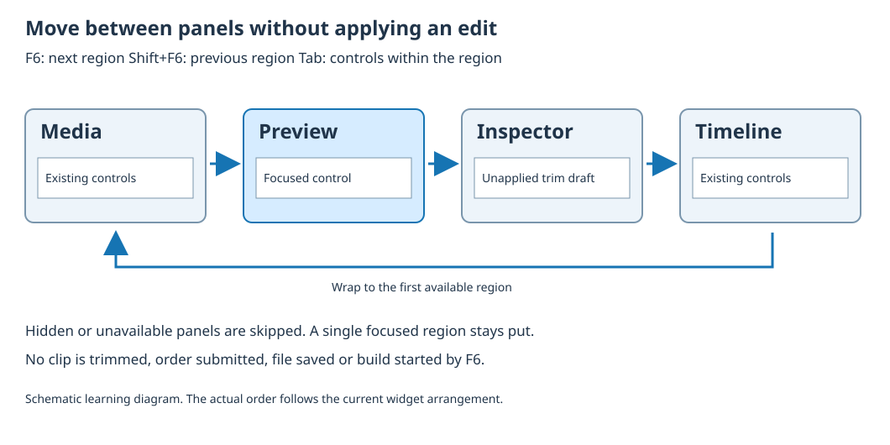

# Navigate panels with the keyboard

Read the [corresponding Framework source](https://github.com/umicom-foundation/umicom-framework/blob/main/include/umicom/ui/gtk4/workstation/focus_cycle.h) at the revision used by your build. Source-reading exercises do not establish that an installed workflow has been qualified.

Keyboard focus identifies the control that receives typing. It might be a text field, a button or a list. A focused button is not the same as a pressed button: moving focus should not perform its action. In a large workspace, pressing Tab through every control can be slow. Umicom Framework provides a separate panel-navigation service so the user can move between major regions before choosing a control inside one.

## 1. Try the navigation deliberately

1. Use a build containing focus_cycle.h and its native adapter. Older installed builds may not contain this service. Open the Media Video Edit workspace with a practice sequence.
2. Place focus in the media search field. Press F6 once to move to the Preview region. Press F6 again to reach the Inspector, then again to reach the Timeline. The order follows the current widget tree.
3. Press Shift+F6 to move backwards. Shift is a modifier key: hold it while pressing F6. If your laptop uses F6 for a hardware function, use its documented function-key mode.
4. Press Tab to move among controls inside the region. Use the application control normally when you are ready; F6 itself does not apply an edit or start rendering.
5. Hide the Inspector using Layout and repeat. Navigation skips hidden regions and does not reopen them. Restore the Inspector through Layout when you want it back.

Studio and Trader mark the bodies of panels built by their shared workspace host. Their order depends on the selected layout. Only the visible page of a tab group participates. Floating windows are separate native windows; this service does not jump between windows. Use normal operating-system window switching for that. A focused child can handle a key before the workspace does, and combinations such as Ctrl+F6 are left available to other commands.

## 2. Describe a region in C

A widget is a graphical object, such as a box or entry field. GTK4 is the toolkit that creates these objects. In C, GtkWidget * names a pointer to one: the star means the variable refers to an object elsewhere in memory. The following excerpt assumes that workspace, library, preview, inspector and timeline have already been created and parented by the application. It shows service setup, not a complete standalone program.

```c
#include "umicom/ui/gtk4/workstation/focus_cycle.h"

UmiGtk4FocusCycleMarkRegion(library, TRUE);
UmiGtk4FocusCycleMarkRegion(preview, TRUE);
UmiGtk4FocusCycleMarkRegion(inspector, TRUE);
UmiGtk4FocusCycleMarkRegion(timeline, TRUE);
UmiGtk4FocusCycleInstall(workspace);
```

Each call ends with a semicolon. The first argument identifies an existing widget. TRUE enables its region marker; FALSE removes the marker. Mark the whole panel body or notebook, not every button. A marked region contributes one navigation stop, even if a child inside it is also marked. Install attaches a keyboard controller to the stable workspace container. Repeating Install on that container does not add another controller.

A controller receives input events. This controller uses the bubble phase: the focused child gets an opportunity to handle the event before it travels outward to the workspace. That prevents a shared layout helper from automatically overriding a specialised editor shortcut. The widget owns its controller and releases it as part of its lifetime. All these calls belong on the GTK thread, the thread responsible for updating the window.

GTK split panes already have an F6 action. An action is a named operation a widget can perform in response to a key. Framework connects that action for layout panes outside marked regions, so it reaches the same shared navigation service. Call Install again after replacing layout containers; existing controllers are not duplicated. Panes inside a marked panel body keep their specialised behaviour, and divider resize keys are unchanged.

## 3. Follow one focus request



```c
gboolean moved = UmiGtk4FocusCycleAdvance(workspace, FALSE);
if (!moved) {
    /* No eligible destination accepted focus. Leave the layout alone. */
}
```

gboolean is GTK’s true-or-false type. The variable moved records the result. FALSE requests forward movement; TRUE requests reverse movement. The exclamation mark in !moved means “not moved”. The braces enclose the statements belonging to the condition. A false result can mean that no other region is available, or that a focus callback changed the target while navigation was in progress. It is not permission to reveal hidden panels or submit a pending command.

## 4. Understand callbacks and ownership

A callback is a function that another component calls when something happens. Moving focus can notify application code. That code may close a panel, remove the workspace or send focus elsewhere. The navigation service therefore keeps temporary references to its workspace, native root and candidate regions. A reference keeps an object available for inspection until it is released; it does not make a removed panel visible again.

After asking GTK to move focus, the service checks the real result. The target must still be mapped, sensitive and inside the same workspace and native root. Mapped means it participates in a displayed window. Sensitive means input is enabled. If a callback redirects focus or retires the target, traversal stops. A per-window busy guard also prevents a focus callback from recursively starting another cycle in that window.

## 5. Check what did not change

1. Type an unapplied value into the Media Inspector, such as a proposed new right-hand clip ID.
2. Cycle through the visible regions and return. Compare the text with what you typed.
3. Inspect the sequence order and saved/dirty state. Merely navigating must not edit the recipe.
4. If an action ran during navigation, record the starting control, exact keys and observed action. Do not label the result successful merely because focus moved.

Read tests/ui_workstation/test_focus_cycle_gtk4.c to see the equivalent native checks. A counter detects unexpected button activation, while entry text exposes lost drafts. The controller cases emit its GTK signal directly; they do not replace testing real hardware keys and assistive technology on the installed application.

## Check your understanding

Only the Preview region is visible and already contains focus. F6 returns FALSE. Should the program recreate all panels to find a destination?

<details><summary>Show an explanation</summary>

No. A single already-focused region has nowhere else to go. Keeping the existing controls preserves the user’s state. Restore a hidden panel through its explicit layout command if you need another destination.

</details>

[Course contents](index.md) · [Read the illustrated lesson](../../courses/umicom-development/lessons/33-follow-keyboard-focus.html)
