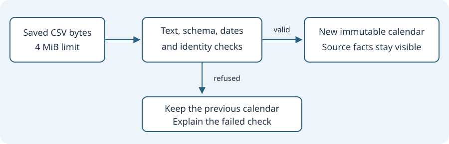

# Read calendar data without inventing values

Read the [actual Framework calendar contract](https://github.com/umicom-foundation/umicom-framework/blob/main/include/umicom/trading/event_calendar.h) alongside this lesson. Use the source revision that belongs to your build.

## 1. Start with a record

A record is a group of facts about one thing. A calendar event might have a title, a date, a source and a result. An economic event is a scheduled publication about an economy, such as an employment report. An earnings event is a company's report about a period of its business. You do not need to trade to study how an application stores these facts.

A snapshot is a saved copy of information at one moment. It is different from a live feed, which supplies updates over time. Umicom Trader's calendar imports a snapshot. Reading it does not prove that it is current or complete. In the fictional practice data, Example company reports an actual value of 2.5 USD per diluted share for Q3 2026. The unit tells us what the number measures. “Per diluted share” is a company reporting measure; it is not a share price. Our lesson is about retaining the supplied meaning, not valuing a company.

## 2. Missing is different from zero

Imagine an employment release with an estimate of 1.2 percent, a previous value of 1.0 percent, and no actual value yet. An estimate is an expected value. A previous value belongs to an earlier reporting period. The actual value is the figure supplied for this release. An empty actual cell says that no figure was supplied. Replacing it with zero would create a new claim that the source never made.

The Framework structure stores these cells as text. A C array such as char actual[64] reserves room for up to 63 bytes plus a terminating zero byte. That final byte marks the end of the string; it is not the financial value zero. UTF-8 characters may use more than one byte, so capacity is measured in bytes rather than visible letters. The native panel displays an empty field as “Not supplied”. A future calculation must first check compatible units, periods and numeric formats.

## 3. Keep a date separate from an instant

A date such as 2026-11-02 identifies a day in a stated calendar context. A clock time such as 09:30 is incomplete without its timezone. UTC is a common reference timezone. America/New_York is a timezone label in the example; the importer retains this label but does not look up daylight-saving rules.

An earnings source may give only “after-hours”. This describes a market session, not an exact time. In that case the time cell must remain empty. The model accepts four timing labels: exact, pre-market, after-hours and unspecified. Only exact permits a clock value, and requires one. Mixed source timezones are not sorted as a global timeline. This is why the interface tells you to read source dates instead of implying all events happened in one timezone.

## 4. Follow a file into a model

CSV means comma-separated values. Commas divide cells and a newline ends a record. The first record names the columns. Quoting lets one cell contain a comma; an embedded quote is written twice. A schema is the agreed set of field names and rules. Umicom uses an exact 21-column schema for this calendar.

Open src/trading_ui/event_calendar_csv.c in the same Framework checkout as the header. UmiCsvReaderCreate copies the bytes and checks the text encoding. UmiCsvReaderNext returns borrowed cells: their storage belongs to the reader and may change on the next call. The calendar copies each cell into its own row before requesting another record. It then checks dates, enum labels, field lengths and identity. An enum is a set of named choices; an unknown choice is refused rather than guessed.

An event's identity combines its source and ID. Two sources may use the same ID for different events. Repeating the same pair in one snapshot is refused. The import has byte and record limits so an unexpectedly large file cannot grow memory without a bound. The model is published only after the complete input passes its checks.



## 5. Replace a snapshot only after success

Read the small pattern below. A pointer stores the location of an object. NULL means that it does not point to an object. The address-of operator & lets the parser write a pointer into next. A status reports whether an operation succeeded. The caller already owns current; bytes and length describe the new file. This is an excerpt to read inside an application, not a complete program.

On success, destroying current releases the old allocation, and assigning next transfers the new model to the owner. On failure, current is untouched. Atomic replacement here means the user sees either the old complete snapshot or the new complete snapshot, never half an import. It does not mean a CPU atomic instruction or a database transaction.

```c
UmiEventCalendar *next = NULL;
size_t record = 0;
UmiStatus status = UmiEventCalendarReadCsv(bytes, length, &next, &record);
if (status == UMI_STATUS_OK) {
    UmiEventCalendarDestroy(current);
    current = next;
}
```

## 6. Keep the window responsive

The GTK thread owns the widgets: text fields, buttons and event rows. A worker reads the selected file so slow storage does not block those controls. The worker returns bytes; the GTK completion callback validates and publishes them. A weak reference lets that callback check whether its panel still exists without keeping the whole window alive. Cancellation asks unfinished reading to stop when the workspace closes or the user chooses Cancel import. The panel also retires the request identity immediately: a late callback cannot overwrite a later import.

Filtering reads the immutable model. Immutable means the rows do not change after successful creation. The native panel displays at most 100 matching rows per page. The model reports both the page size and total matches, which are different counts. A market quote update does not rebuild this panel or erase its filters. No calendar action calls an order submission operation.

## 7. Practise with fictional data

1. Open framework/docs/learning/economic-earnings-calendar.html and save its calendar-example.csv next to your practice files. All values are invented and labelled example.
2. In a build that includes the calendar, open Trader in guest mode and add Economic Calendar from the workspace tool catalogue. Import your copy. Expect two rows, with source details available when selected.
3. Search for company and apply. Expect one earnings row. Clear the search, expand Event filters, and select Economic releases. Expect the employment row.
4. Enter 2026-02-30 as the start date and apply. February has no thirtieth day. Expect an error and the previously applied rows to remain visible. Correct the date before continuing.
5. In a disposable copy of the CSV, repeat the same data row. Import it. Expect rejection of the duplicate identity and retention of the previous snapshot.
6. Resize the panel and the divider between events and details. Check that the selected controls remain usable and source text is readable. Record the application revision and observed result. Do not treat these expected outcomes as a claim that your build has passed.

## 8. Read the regression cases

Tests turn expectations into repeatable checks. tests/event_calendar/test_event_calendar.c checks date boundaries, unknown labels, duplicate identities, missing values and page counts. test_event_calendar_gtk4.c creates real GTK controls and emits their signals to check filter actions and retained-widget lifetimes. These native tests need a graphical display. A skipped test means the check was not completed.

Neither a source review nor a passing parser test proves that a live provider works. This feature imports local files; automatic feeds, timezone conversion and calendar alerts are separate capabilities. Compare your observation with the exact source revision you tested, then retain both successes and failures.

## Check your understanding

An earnings row has no actual value and a timing label of after-hours. May the application display an actual value of zero at 16:00 UTC?

<details><summary>Show an explanation</summary>

No. Both changes invent information. The actual value stays “Not supplied”, and after-hours remains a source session label. Exact time and timezone conversion require additional evidence.

</details>

[Previous lesson](34-check-layout-and-draft-retention.md) · [Course contents](index.md)
